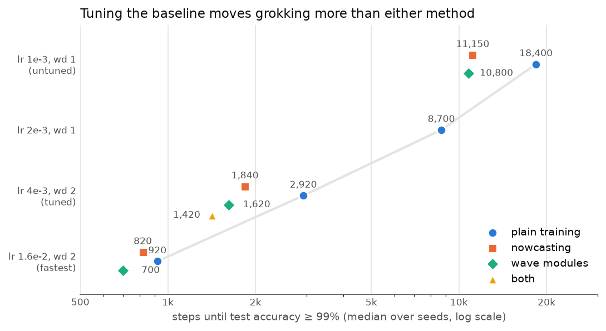
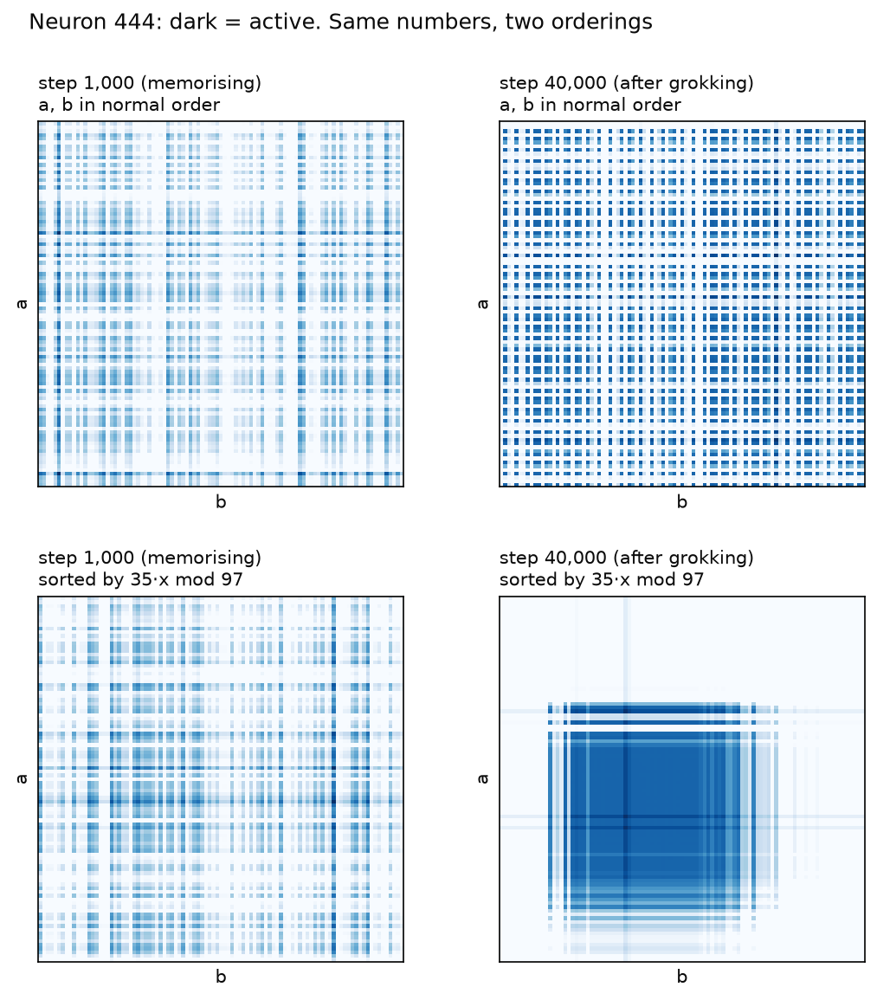
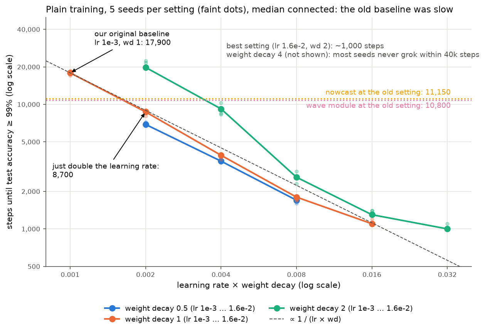
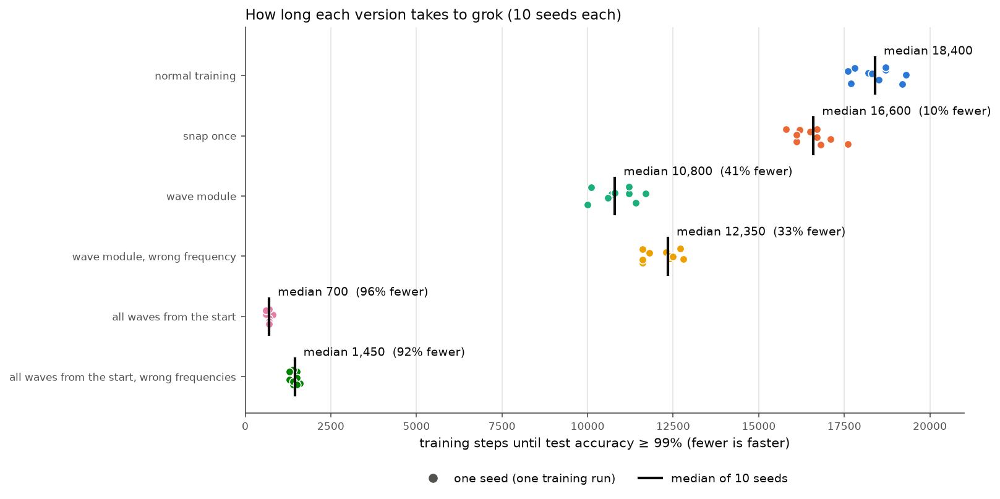
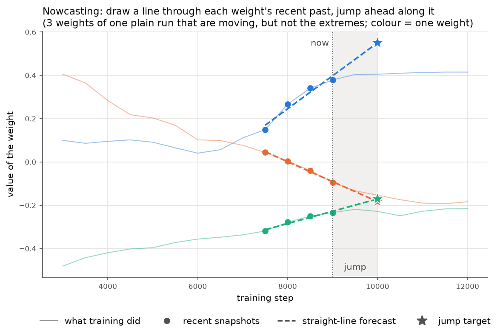
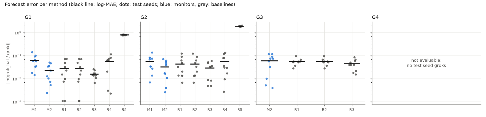

# What survives a tuned baseline in grokking research

*quickgrok: a small research project on making grokking happen sooner. Concluded November 2026.*



## **In short**

- I tried two ways to make a small network grok sooner on modular addition: replacing hidden neurons with trainable wave modules once they start to look like waves, and extrapolating the weights forward ("nowcasting"). Against the baseline I started with, they cut the steps to generalisation by 41% and 39%.
- A control showed that most of the wave-module gain is a built-in prior, not a jump to where the network was heading: waves of the wrong frequency helped almost as much.
- Simply tuning the baseline's learning rate and weight decay cut the same plateau up to 18×. Doubling the learning rate alone beat both methods. This is already known in the literature.
- On a tuned baseline both methods still save steps (37% and 45%), but only nowcasting also saves wall-clock time.
- A pre-registered test of whether signals from training data can forecast *when* a run groks failed: the plain weight norm forecast better. The same signals did tell grokking runs from non-grokking ones, with no false alarms.

The rest of this page covers the setup, each method and why it did or didn't hold up, what is left, and what could be tried next. The research reports in [`reports/`](reports/README.md) have the full tables, seeds and statistics. A longer, picture-first walkthrough is in [`intuition/`](intuition/README.md).

## Setup

**Task.** Predict (a + b) mod 97 from a and b. There are 97² = 9,409 pairs; a random 30% is the training set and the rest is the test set.

**Model.** One-hot a and b feed one hidden layer of 512 ReLU neurons and a linear readout over the 97 answers. Full-batch AdamW, lr 1e-3, weight decay 1, inherited from a pilot with a small transformer.

**Grokking.** The network gets every training pair right by step ~200 and stays near 0% on the test set for thousands of steps. It passes 99% test accuracy at step 18,400 (median of 10 seeds, IQR 17,900–18,700).

**Metric.** Steps until test accuracy ≥ 99%, median over 10 seeds, compared with a Mann–Whitney test. Every speed-up quoted below has p ≈ 2e-4 unless stated otherwise.

**What the network learns.** Grokked networks on this task are known to work with waves (Nanda et al. 2023). Write each number as a point on a circle and addition becomes rotation: products of cos and sin of a and b give cos and sin of a + b. In this MLP each neuron ends up as a square wave in k·x mod 97 for some frequency k:



This structure can be measured **from the training data alone, long before test accuracy moves.** Fitting each neuron with Fourier features on a split of the training pairs, at least 10% of neurons pass a "this is a wave" test between a quarter and a half of the way to the grok step, while test accuracy is still near 0%. That early structure is what both methods tried to exploit.

## Results at a glance

| Method | Untuned baseline (lr 1e-3, wd 1) | Tuned baseline (lr 4e-3, wd 2) | Wall-clock, tuned | Verdict |
| --- | --- | --- | --- | --- |
| Plain training | 18,400 steps | 2,920 steps | ×1.00 | — |
| Plain training, lr ×2 | 8,700 (−53%) | — | — | the cheapest speed-up |
| Wave modules | 10,800 (−41%) | 1,620 (−45%) | ×1.53 | works in steps, mostly a prior; slower in time |
| Wave modules, wrong frequency | 12,350 (−33%) | 2,030 (−30%) | ×1.90 | the control |
| Nowcasting | 11,150 (−39%) | 1,840 (−37%) | **×0.80** | the only method that saves time |
| Both | — | 1,420 (−51%) | ×1.50 | combine sub-additively |
| Task-blind replacement shapes | stall at 94–96% test | — | — | failed |
| Grokfast (λ 2) | 18,350 (0%) | — | — | no effect here |
| Training-data monitors as forecasters | — | — | — | failed the pre-registered test |

At the fastest setting tried (lr 1.6e-2, wd 2, 920 steps) the step savings shrink to 11% for nowcasting (wall-clock ×1.04) and 24% for wave modules (wall-clock ×3.5).

## The baseline was the biggest effect

The first round of experiments used lr 1e-3 and weight decay 1, taken over from the pilot without tuning. A grid over learning rate and weight decay for plain training (5 seeds each) changed the picture:



- Grokking time falls from 17,900 steps to about 1,000 (up to 18×). It is still grokking: every setting memorises within 100–200 steps and generalises 10–40× later.
- It falls roughly like 1 / (lr · wd), but the product is only a rough guide. The learning rate dominates: at equal lr · wd, lr 8e-3 / wd 0.5 groks in 3,500 steps and lr 2e-3 / wd 2 in 9,200. At lr 1e-3, raising wd from 1 to 2 made grokking slightly slower. Weight decay 4 stopped most seeds from grokking within 40,000 steps.
- **Why it works:** AdamW shrinks every weight by a fraction lr · wd per step, and grokking here coincides with the weight norm falling to a particular value (about 124). Faster shrinking gets there sooner.
- **This is known.** The dependence of grokking time on lr and wd is in the literature (e.g. Pracher et al. 2026, arXiv 2609.26679), and the "weights must shrink into the right range" picture is Omnigrok's (Liu et al. 2023). A literature search before the first comparison would have caught it.

Both methods were then re-tuned on 5 separate seeds and re-tested on 10 new seeds at lr 4e-3, wd 2. The numbers in the table come from that re-test.

## Wave modules (fit and substitute)

**What.** Every 500 steps, fit each neuron's input weights with a constant plus cos and sin at its dominant frequency k and 3 harmonics, using training pairs only (80% to fit, 20% to check). When the fit is good (check R² ≥ 0.8, at least half the variance in k's harmonic family), replace the neuron's 97 input weights per input with those 9 trainable coefficients, using `torch.nn.utils.parametrize`. Training continues; amplitudes and phases stay free, but the neuron stays a wave of frequency k.

**Result.** 41% fewer steps at the untuned setting, 45% at the tuned one. The slowest wave-module run beat the fastest plain run.

**Why it worked, and why that is less interesting than it looks.** The obvious story is "the probe sees where each neuron is going, and we jump there". Two arms test that story:



- **Wrong frequency:** giving each triggered neuron a random k instead of the fitted one still saves 33% (30% when tuned). The fitted k adds a smaller extra on top.
- **Waves from step 0:** making every neuron a wave module before training starts groks in ~700 steps, 26× sooner than plain training (1,450 steps with random frequencies).

So most of the gain is a strong prior: the module tells the network that neurons should be waves, and this task happens to reward that. Building the shape in from step 0 beats waiting to observe it.

**Constrain, don't snap.** Writing the fitted wave into the weights once and then training freely (no parametrisation) saved only 10%: the neurons drift back.

**Cost.** On this tiny model a plain step takes 0.74 ms. The probe fits (28–49 ms each), optimizer rebuilds and the parametrisation (each step 57% slower once ~270 neurons are converted) make the method 1.5× slower in wall-clock at the tuned setting and 3.5× slower at the fastest.

## Nowcasting (extrapolate the weights and jump)

**What.** Snapshot all weights every 100 steps. Every 1,000 steps, fit a straight line through each weight's last 8 snapshots and move the weight to where the line will be 1,000 steps from now. If the training loss after the jump is more than 1.5× the loss before, undo it. About 70% of jumps were kept. It needs no knowledge of the task.



**Result.** 39% fewer steps at the untuned setting, 37% at the tuned one, and the only method that also saves wall-clock time (×0.80). At the fastest setting the gain drops to 11% and the time saving disappears.

**Why it works.** The plateau is mostly weight decay slowly shrinking the weights. Plain and nowcast runs pass 99% test accuracy at the same weight norm (about 124); the jumps get there ~7,000 steps sooner at the untuned setting. That also explains why the gain shrinks as the baseline gets faster: the faster weight decay already does the shrinking, so there is less plateau to skip.

**Side results.**

- A better forecaster is not a better accelerator. An online LSTM forecast the weights about twice as accurately as the straight line and grokked no sooner (11,350 vs 11,150 steps, p = 0.14).
- Direction matters, not only size. Rescaling each weight tensor to the forecast's norm but keeping its direction gave 0%.

## Task-blind replacement shapes

Wave modules only work because I knew the answer is built from waves. To test the method without that knowledge, I replaced the Fourier fit with shapes that know nothing about the task, on a + b and on two tasks where clock waves are the wrong shape (a · b mod 97 and composing permutations of 5 items, S5). All failed:

- **Global SVD** (the directions shared by all neurons) never triggered: the neurons use about 44 different frequencies, so the layer has no small shared subspace (the top 8 of 96 directions hold 12% of the energy).
- **k-means levels** (each weight column takes 2–3 values) "light up" on every task within a few thousand steps, a + b included. That is an optimizer artefact (likely AdamW's sign-like updates), not task structure. Freezing neurons onto these levels stalls test accuracy at 94.8% (add) and 96.0% (mul).
- **Self-expression** (describe each neuron by 8 others, via orthogonal matching pursuit) also stalls in the mid-90s on add and S5. On mul it reaches 99% at 43,500 steps against 16,500 for plain training.

The common failure: freezing a neuron onto a shape that is still changing blocks late generalisation. Substitution helped only when the right shape was known in advance.

## Can training-data signals forecast grokking? A pre-registered test

After the re-test the speed-ups looked small next to tuning. What remained was the early structure: if it shows up long before test accuracy moves, can it **forecast** grokking? An LLM-council review (see the disclosure below) proposed a kill test, and I wrote down and committed the monitors, baselines, pass criteria and decision before running anything ([pre-registration](reports/preregistration_monitor.md)).

- **Monitors** (training data only, every 50 steps): the Fourier trigger (M1) and a task-blind self-expression score (M2).
- **Cheap baselines:** the lr · wd rule (B1), the median grok step of calibration runs (B2), the step at which the weight norm reaches the value where calibration runs grokked (B3), a data-free Fourier transform of the weights (B4), and Nanda et al.'s excluded loss (B5).
- **Arms:** four that should grok (a + b untuned and tuned, a · b tuned, S5 tuned) and three that should not (weight decay 0, 10% training data, random labels). Calibration on seeds 0–9, test on seeds 10–19.
- **Pass:** at most 1/10 false alarms per control, enough lead time, and a lower forecast error than *every* baseline on every grokking arm.
- **Decision rule:** if neither monitor passes, write this post and stop.



| Forecast error (log-MAE, lower is better) | a + b untuned | a + b tuned | a · b tuned |
| --- | --- | --- | --- |
| Fourier trigger (M1) | 0.062 | 0.057 | n/a |
| Self-expression (M2) | 0.023 | 0.032 | 0.059 |
| Weight norm (B3) | **0.016** | **0.029** | **0.044** |

**Result: both monitors failed.** The weight norm forecast the grok step better on every arm, without any probing. Seeds agree so closely on grokking time in this setting that even the lr · wd rule, known at step 0, is within a few percent. The data-free weight FFT (B4) matched the Fourier trigger in timing and error, so fitting activations added nothing over looking at the weights.

**What held up:** both monitors fired on 0 of 30 control runs and fired well before the grok step on the arms that grokked (median between a quarter and three quarters of the way). The weight norm cannot separate the two cases: with 10% training data it crosses its threshold on 10/10 seeds and never groks.

**A mistake in the pre-registration:** S5 at the tuned settings never grokked (peak test accuracy 97.8–98.9%), although it had grokked at the old settings. Nobody checked before freezing the plan. The verdict does not depend on that arm.

## What survives

1. **An early "will this run grok?" signal.** Training-data monitors separated grokking from non-grokking runs with no false alarms, well before the grok step. This was a side result of the kill test, not its pre-registered question.
2. **Nowcasting as a cheap step saver.** It is task-agnostic, nearly free, and saves steps and seconds at moderate learning rates. The gain fades as the baseline gets faster.
3. **Constrain, don't snap.** If you do inject structure into weights during training, a parametrisation that keeps it holds; a one-off projection is undone.
4. **The negative results**, which are the main output: the fit-and-substitute speed-up is mostly a prior, task-blind shapes don't replace it, and training-data monitors don't beat the weight norm at forecasting.

## Open questions and what to try next

Everything here used one-hidden-layer MLPs on small algorithmic tasks; the transformer was only used in the pilot. Things I did not get to:

- **"Whether", not "when", as its own pre-registered question.** Can a training-data monitor flag runs that will never generalise, in settings where cheap baselines fail? That needs settings where grokking time varies a lot between seeds or configurations, unlike this one.
- **Nowcasting elsewhere.** Transformers and deeper models, grokking on real data (Omnigrok-style MNIST with large initialisation, or QM9), and ordinary training without a plateau, always against a tuned learning rate. An adaptive horizon could keep the gain at high learning rates.
- **Re-fitted instead of frozen shapes.** Every task-blind basis failed by freezing a moving target. Re-fitting the basis at every probe (or per-cluster SVD) is a cheap test.
- **Lower trigger thresholds.** Tuning favoured the most permissive threshold, which points toward "substitute more, earlier", converging on the step-0 prior.

## Lessons for practitioners

1. **Tune the baseline before claiming a speed-up**, and give it at least the tuning budget of your method. Search for known scaling laws first.
2. **Run the control that could falsify your story.** Ask what the boring explanation predicts and design an arm where it predicts something different.
3. **Check whether your accelerator is a prior.** If a method injects knowledge of the answer's shape, compare it with injecting that knowledge at step 0.
4. **Report wall-clock time next to steps.** The best method in steps was 1.5× slower in time.
5. **Give your diagnostics cheap baselines too.** The weight norm beat both monitors.
6. **Pre-register the decisive test, and check that every arm behaves as assumed before freezing it.** The pre-registration made the decision to stop easy.

## How this was made

This project was done with Claude Code as a research assistant. I chose the questions and the ideas to test, made the go/stop decisions and reviewed the results. Claude wrote most of the code, ran the experiments, produced the figures and drafted the reports and this text, which I edited. Claude Code was used for AI-run literature searches.

## Using this repository

```bash
uv sync          # torch comes from the CUDA 13.2 wheel index, see pyproject.toml
uv run pytest
```

- `src/quickgrok/`: data generation, models, the training loop with hooks (wave modules, nowcasting, Grokfast, monitors), the neuron probe, the plotting shared by several reports and the experiment launcher.
- `experiments/`: one file per report. `uv run python experiments/<name>.py run` launches its training runs (`--dry-run` prints the commands), `figures` remakes the report's figures and tables, and `summary.py figures` draws the figure at the top of this post.
- `reports/`: one report per experiment, with its figures; [`reports/README.md`](reports/README.md) is the index.
- `intuition/`: a picture-first walkthrough of the project.
- [`docs/usage.md`](docs/usage.md): the command-line flags and the hook API.

Training runs are not stored in the repo; see the "Raw data" note in `reports/README.md`.

## References

- Power et al. 2022, *Grokking: Generalization beyond overfitting on small algorithmic datasets*.
- Nanda et al. 2023, *Progress measures for grokking via mechanistic interpretability*.
- Liu et al. 2023, *Omnigrok: Grokking beyond algorithmic data*.
- Lee et al. 2024, *Grokfast: Accelerated grokking by amplifying slow gradients*.
- Pracher et al. 2026, arXiv 2609.26679.

## License

MIT, see [LICENSE](LICENSE).
