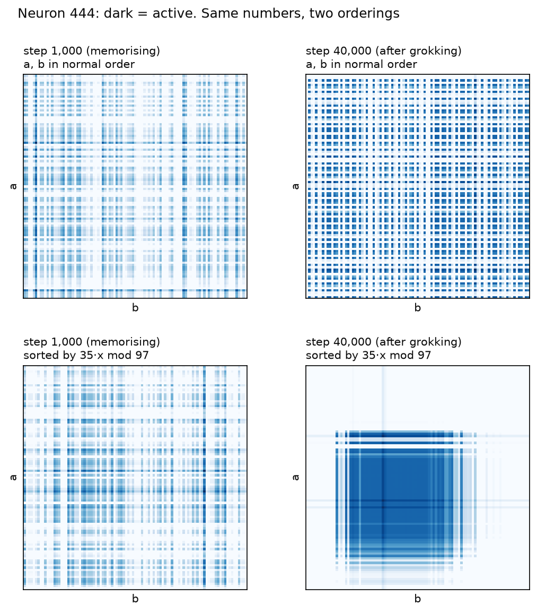
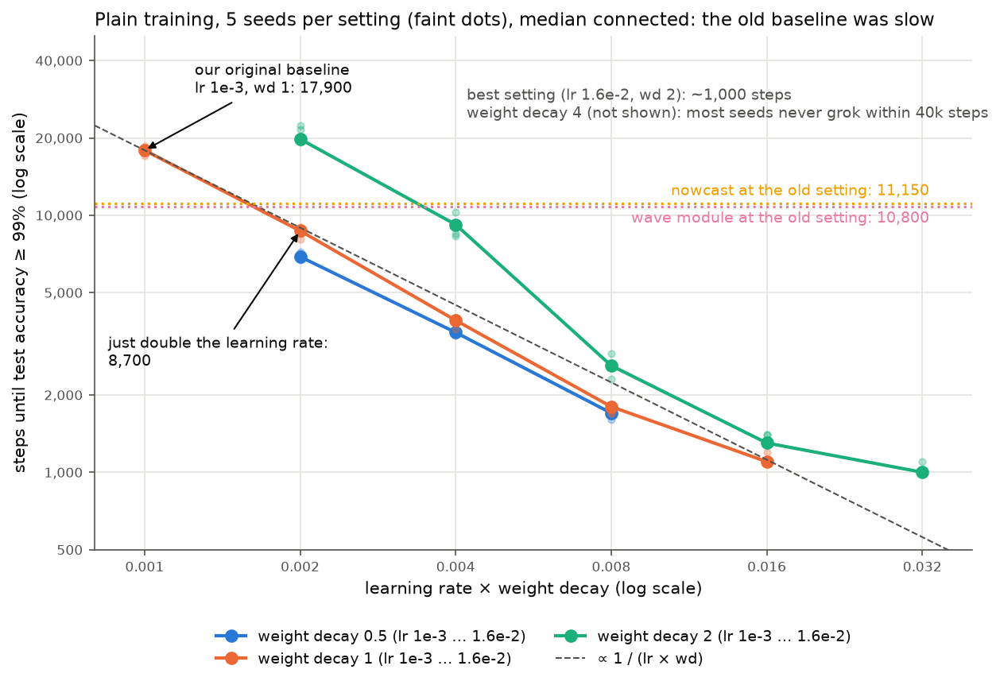
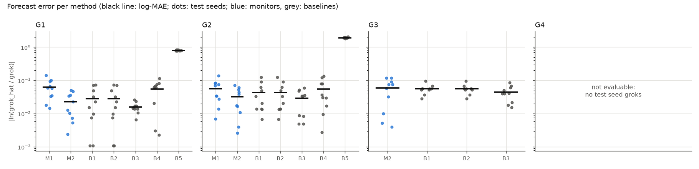

# Grokking, two speed-ups, and a tuned baseline

*An intuition-first tour of the quickgrok project for ML practitioners. Status: **concluded (8 November 2026)**. About 20 minutes.*

You should know training loops, AdamW, weight decay, learning-rate tuning and train/test splits. You do not need Fourier analysis: a clock covers the little we use. The numbers come from the research reports in [`../reports/`](../reports/README.md), which have the full tables, seeds and statistics.

## The short version

A one-hidden-layer MLP learning a + b mod 97 memorises its training set in ~200 steps and generalises ~18,000 steps later. That delay is called grokking. We built two tricks that cut the delay by about 40%. Then three things changed the story:

1. **A control showed the main gain is a prior.** Forcing neurons into waves of the *wrong* frequency helped almost as much as the right one.
2. **A tuned baseline was faster than both tricks.** Doubling the learning rate alone beat them at the old settings.
3. **A pre-registered test failed.** Signals computed from training data did not predict *when* a run groks better than cheap rules, so the project stopped. (The best "rule", the weight norm, only fires at the grok step itself.)

What a practitioner can take away is in [section 8](#8-takeaways-for-practitioners).

---

## 1. Grokking in one picture

The task: the inputs are two numbers a and b from 0 to 96, and the answer is (a + b) mod 97. There are 97 × 97 = 9,409 pairs. We train on a random 30% and test on the other 70%. The model is an MLP with one hidden layer of 512 ReLU neurons, trained full-batch with AdamW (lr 1e-3, weight decay 1). These settings came from a pilot and were never tuned. Remember that for section 5.

The x-axis is log scale. Train accuracy hits 100% by step 200. Test accuracy sits at 0% for thousands of steps, then climbs and passes 99% at step 18,200. With early stopping you would have quit long before that.

The usual explanation: memorising and learning the rule both reach zero training loss, but the rule needs smaller weights. Weight decay slowly taxes the large weights of the lookup table until the cheaper solution wins. The plateau is mostly that slow tax at work. Keep this picture in mind, because it explains most of what follows.

## 2. What the network learns: a clock

On a 12-hour clock, 5 + 9 lands on 2. Modular addition is turning by a, then by b. Write each number as an angle, or as the point (cos, sin) on a circle, and the wrap-around comes for free. Going round the clock k times instead of once gives a wave of **frequency k**.

For mod 97 the building blocks are cos(2πk·x/97) and sin(2πk·x/97). The angle-addition rule from school,

cos(w·(a + b)) = cos(w·a)·cos(w·b) − sin(w·a)·sin(w·b),  with w = 2πk/97,

says that waves in a and waves in b, multiplied together, give a wave in the answer that wraps correctly. Grokked networks on this task are known to compute something like this.

You can see it by feeding a neuron every (a, b) pair and drawing its output as a 97 × 97 image:

In the natural order (top row) the neuron looks like noise, before and after grokking. Sort a and b by 35·x mod 97, where they sit on a clock that goes round 35 times, and the grokked neuron becomes one clean rectangle (bottom right). It fires when a and b both fall in an interval on that clock. Its input weights are a **square wave** in 35·x mod 97: a base wave plus harmonics at 2×, 3×, … the frequency.

Two numbers to anchor this. A wave fit explains about 91% of a neuron's variance after grokking (on held-out pairs), a polynomial fit about 0%: polynomials cannot wrap 96 back to 0. And the structure is **visible early, from training data alone**. A probe that fits waves to every neuron, using training pairs only, sees 10% of neurons turn wave-shaped at 25–54% of the way to the grok step, while test accuracy is still near 0%.

## 3. Two ways to cut the plateau

If the destination is visible early, can we jump there?

### Trick 1: swap neurons for wave modules

Every 500 steps the probe fits each neuron's input weights with a constant plus cos and sin at its frequency and 3 harmonics. When a neuron fits well (check R² ≥ 0.8, at least half the variance in its frequency family), we replace its 97 input weights per input with those **9 trainable coefficients**. Training can still change the amplitudes and phases, but the neuron can no longer stop being a wave of that frequency.

Result at the original settings, 10 seeds: median **18,400 → 10,800** steps to 99% test accuracy, **41% fewer**. The slowest module run beat the fastest normal one.

Writing the fitted wave into the weights once and then training freely gave only 10%: the neuron drifts back. Constraining beats snapping.

### Trick 2: nowcasting

This trick needs no knowledge of the task. If the plateau is weights drifting slowly under weight decay, extrapolate the drift:

1. Snapshot every weight every 100 steps.
2. Every 1,000 steps, fit a straight line through each weight's last 8 snapshots and move the weight to where the line will be 1,000 steps from now.
3. If the training loss after the jump is more than 1.5× the loss before, undo the jump.

About 70% of jumps were kept. Result: **18,400 → 11,150** steps, **39% fewer**. (The figure uses the 500-step checkpoints of a plain run, so the line goes through 4 points.)

Three side results:

- **A better forecaster is not a better accelerator.** An LSTM forecast the weights about twice as accurately as the line, and grokked no sooner (11,350 steps).
- **Direction matters, not only size.** A control that rescales each weight tensor to the forecast's norm but keeps its direction gave 0%.
- **Nowcasting reaches the same place sooner.** Normal and nowcast runs pass 99% test accuracy at the same weight norm, about 124. The jumps get there ~7,000 steps earlier.

## 4. The control that changed the story

The tempting story for trick 1 is "the probe sees where the network is heading, and we jump there". That story makes a prediction you can test: if you give each neuron the **wrong** frequency, the gain should vanish. A second test: make every neuron a wave module at step 0, before there is anything to see.

Each dot is one seed; the black bar is the median.

- **Wrong frequency:** 12,350 steps, still **33% fewer**. The fitted frequency adds a smaller extra on top (wrong frequency is 14% slower than right).
- **All waves from step 0:** **~700 steps**, about **26× sooner** than normal training. With random frequencies: ~1,450.

So most of the gain is not "jumping to the solution". It is a strong **prior**: we told the network that its neurons should be waves, and the task happens to reward that. Building in the shape of the answer from the start beats waiting to see it.

Does the method work without that prior? We tried shapes that know nothing about the task, on a + b and on two tasks where clock waves are the wrong shape (a · b mod 97 and composing permutations of 5 items). All failed:

- **Global SVD** (directions shared by all neurons) never fires. The neurons use many different frequencies, so there is no small shared subspace.
- **k-means levels** (each weight column takes 2–3 values) light up on every task within a few thousand steps, a + b included. That is an optimizer artefact, not task structure. Freezing neurons onto them stalls test accuracy around 95%.
- **Self-expression** (describe each neuron by a few others) also stalls in the mid-90s. On a · b it reaches 99% eventually, 2.6× later than normal training.

Replacing neurons with a fixed shape helped only when we already knew the right shape.

## 5. The biggest effect: the baseline's learning rate

Every comparison so far used lr 1e-3 and weight decay 1, inherited from the pilot. So we ran plain training on a grid of learning rates and weight decays, 5 seeds each:

- **Grok time falls up to ~18×**, from 17,900 steps to about 1,000, roughly like **1 / (lr · wd)** (the dashed line).
- **Doubling the learning rate alone (8,700 steps) beat both tricks** at the old settings (10,800 and 11,150, the dotted lines).
- **The product is only a rough guide; the learning rate dominates.** At equal lr · wd the run with the larger lr is clearly faster (lr 8e-3 / wd 0.5: 3,500 steps; lr 2e-3 / wd 2: 9,200). At lr 1e-3, raising wd from 1 to 2 made grokking slightly slower (19,800). Weight decay 4 stopped most seeds from grokking within 40,000 steps.
- **It is still grokking.** Every setting memorises in 100–200 steps and generalises 10–90× later.

Why lr · wd? AdamW shrinks every weight by the fraction lr · wd at each step. If grokking waits for the weights to shrink to a certain size (about 124 at the original setting, 119 at the tuned one), doubling the shrink rate roughly halves the wait. This also explains part of nowcasting: its jumps go where decay was taking the weights anyway.

None of this is new. The dependence of grok time on lr and wd is in the literature (e.g. Pracher et al. 2026, arXiv 2609.26679), and the "weights must shrink into a good range" picture is Omnigrok's (Liu et al. 2023). A literature search before the first comparison would have saved a detour.

## 6. On a tuned baseline: steps are not seconds

Do the tricks still help on top of a tuned baseline? We re-ran everything at lr 4e-3 and weight decay 2, where normal training groks in ~2,900 steps. The tricks' own settings (probe interval, jump interval and horizon) were re-tuned on separate tuning seeds first, then fixed and re-tested on the same 10 seeds as before (0–9).

| Version | Steps to 99% (median, 10 seeds) | Fewer steps | Wall-clock vs normal |
|---|---|---|---|
| normal training | 2,920 | — | ×1.00 |
| nowcast | 1,840 | 37% | **×0.80** |
| wave module | 1,620 | 45% | ×1.53 |
| wave module, wrong frequency | 2,030 | 30% | ×1.90 |
| nowcast + wave module | 1,420 | 51% | ×1.50 |

- **In steps, both tricks still help about as much as before** (37% vs 39%, 45% vs 41%). The right frequency still beats the wrong one.
- **They combine, but less than independent gains would** (51%, against ~65% if the two speed-ups multiplied).
- **At the fastest setting** (lr 1.6e-2, ~920 steps) the gains shrink to **11%** (nowcast) and **24%** (wave module).
- **In seconds, only nowcasting wins.** A plain step of this tiny model takes 0.74 ms. The wave module adds probe fits (28–49 ms each), optimizer rebuilds, and makes every step 57% slower once ~270 neurons are parametrised. So it saves 45% of the steps and costs 53% more time; at lr 1.6e-2 it is 3.5× slower. Nowcasting is nearly free: 20% faster at lr 4e-3, no gain (×1.04) at lr 1.6e-2.

Steps tell you about the learning dynamics. Seconds tell you whether anyone should use the method.

## 7. The kill test: can training-data signals predict grokking?

After section 6 the speed-ups looked small next to tuning. What remained interesting was the early structure from section 2: a probe on training data sees neurons turn into waves long before test accuracy moves. Could that **forecast** grokking better than cheap signals?

Before any runs we wrote down and committed ([pre-registration](../reports/preregistration_monitor.md)) the monitors, the baselines, the pass criteria and the decision:

- **Monitors** (training data only): the Fourier probe from section 2 (M1), and a task-blind "self-expression" score that measures how well each neuron is described by a few others (M2).
- **Cheap baselines**: the lr · wd rule (B1), the median grok step of earlier runs (B2), the moment the total weight norm reaches the size at which earlier runs grokked (B3), a Fourier transform of the weights that uses no data (B4), and Nanda et al.'s excluded loss (B5).
- **Runs that should grok**: a + b at the old and tuned settings, a · b tuned, and permutations of 5 items. **Runs that should not**: weight decay 0, 10% training data, random labels.
- **To pass**, a monitor needed few false alarms, enough lead time, and a lower forecast error than *every* baseline on every grokking arm.
- **Decision**: if neither monitor passes, write a blog post and stop.

*From the report. Each dot is the forecast error of one test seed (log scale, lower is better); the black bar is the mean (log-MAE). Blue: monitors. Grey: baselines. G1: a + b at the old settings; G2: a + b tuned; G3: a · b tuned; G4: permutations.*

| Forecast error (log-MAE, lower is better) | a + b, old settings | a + b, tuned | a · b, tuned |
|---|---|---|---|
| Fourier probe (M1) | 0.062 | 0.057 | n/a |
| self-expression (M2) | 0.023 | 0.032 | 0.059 |
| weight norm (B3) | **0.016** | **0.029** | **0.044** |

- **Both monitors failed.** The weight norm had the lowest error on every arm, but it is not a real forecast: its threshold is the norm where earlier runs grokked, so it fires at the grok step itself. Against the rules known at step 0, the self-expression monitor was more accurate on both a + b arms. A log-MAE of 0.03 means forecasts off by about 3%; even the lr · wd rule, known at step 0, landed within ~3–6%.
- **Telling grokking from non-grokking runs is only a lead.** Both monitors stayed silent on all 30 control runs and fired before the grok step on the arms that grokked (median 25–73% of the way). But two of the controls are easy (the weight norm also stays silent on them; it only trips on the 10%-data control), the data-free weight transform did just as well, and on S5, where no seed reached 99%, the self-expression monitor fired on all 10 seeds. Those runs peaked at 97.8–98.9%, so that is either a false alarm or a sign that the 99% cutoff is arbitrary.
- **The data-free weight FFT (B4) matched the Fourier probe** in timing and error. Fitting activations added nothing over looking at the weights.
- **One arm did not behave as assumed.** Permutations at the tuned settings never grokked (peak test accuracy 97.8–98.9%), although they had grokked at the old settings (~23k steps). Nobody checked this before the pre-registration was frozen. The rules were applied anyway; the verdict does not depend on that arm.

Per the rule agreed in advance, the project stopped. Details: [monitor_killtest.md](../reports/monitor_killtest.md).

## 8. Takeaways for practitioners

1. **Tune the baseline before claiming a speed-up.** A 40% gain against an untuned baseline was smaller than doubling the learning rate. Give the baseline at least as much tuning as your method, and search the literature for known scaling laws first.
2. **Run the control that could falsify your story.** The wrong-frequency control turned "jumping to the solution" into "a strong prior". Ask what a boring explanation would predict, and design an arm where it predicts something different.
3. **A prior can look like an accelerator.** If your method injects knowledge of the answer's shape, compare it with injecting that knowledge from step 0. Here that was 26× faster.
4. **Constrain, don't snap.** Writing a good solution into the weights once is undone by training; a parametrisation that keeps the shape holds.
5. **Measure wall-clock, not only steps.** The best method in steps was 1.5× slower in time. Report both, and say which question each one answers.
6. **Check cheap baselines for your diagnostics too, and make them lead.** The weight norm "beat" both monitors only because it fires at the grok step.
7. **Pre-register the decisive test, and check every arm behaves as assumed before you freeze it.** The pre-registration made the stop decision easy. The S5 arm that never grokked shows the step it was missing.

## Where to read more

| Topic | Report |
|---|---|
| Baseline grokking and neuron shapes | [mlp_baseline.md](../reports/mlp_baseline.md), [pilot.md](../reports/pilot.md) |
| Probe lead time | [accel_probe.md](../reports/accel_probe.md) |
| Wave modules and controls | [substitution.md](../reports/substitution.md) |
| Nowcasting | [nowcast.md](../reports/nowcast.md) |
| Task-blind shapes | [generic_basis.md](../reports/generic_basis.md) |
| lr · wd grid | [tuned_baseline.md](../reports/tuned_baseline.md) |
| Re-test on the tuned baseline | [tuned_retest.md](../reports/tuned_retest.md) |
| Kill test | [preregistration_monitor.md](../reports/preregistration_monitor.md), [monitor_killtest.md](../reports/monitor_killtest.md) |
| Nowcasting on a tuned transformer (null: 22% fewer steps, ×0.95 wall-clock) | [preregistration_nowcast_transformer.md](../reports/preregistration_nowcast_transformer.md), [nowcast_transformer.md](../reports/nowcast_transformer.md) |

## Figures

`uv run python intuition/make_figures.py` (from the repo root) redraws the figures in [`figures/`](figures/). Set `QUICKGROK_RUN_ROOTS` if the training runs live elsewhere. The script skips, with a printed note, any figure whose runs are missing:

| Figure | Needs |
|---|---|
| `clock.png` | nothing |
| `story_curve.png`, `neuron_lens.png`, `nowcast_idea.png` | `runs/mlp_baseline/seed0` |
| `results_dots.png` | `runs/t6` |
| `baseline_lesson.png` | `runs/tuned_vanilla` (deleted; the committed PNG is kept) |
| `tuned_results.png` | `runs/tuned_retest` (deleted; the committed PNG is kept) |

The kill-test figure is reused from `reports/figures/monitor_killtest/`.

## Terms

- **Frequency k:** how many times a wave goes round the clock as x runs from 0 to 96.
- **Harmonic:** a wave at 2×, 3×, … the base frequency. A square wave is a base wave plus harmonics.
- **Prior (inductive bias):** knowledge about the problem built into the model, here "each neuron is a wave".
- **Seed:** fixes the initial weights and the train/test split of one run. Results are medians over 10 seeds.
- **log-MAE:** mean of |ln(forecast / actual)|. For small values it is roughly the typical relative error.
- **Pre-registration:** writing down the hypothesis, the analysis and the pass criteria before running the experiment.
