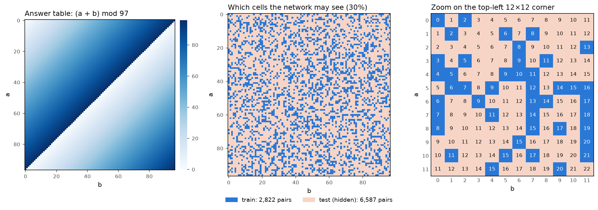
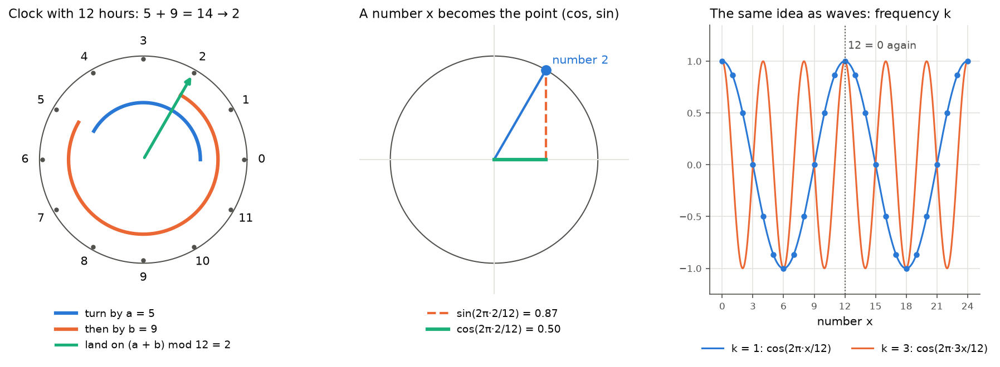
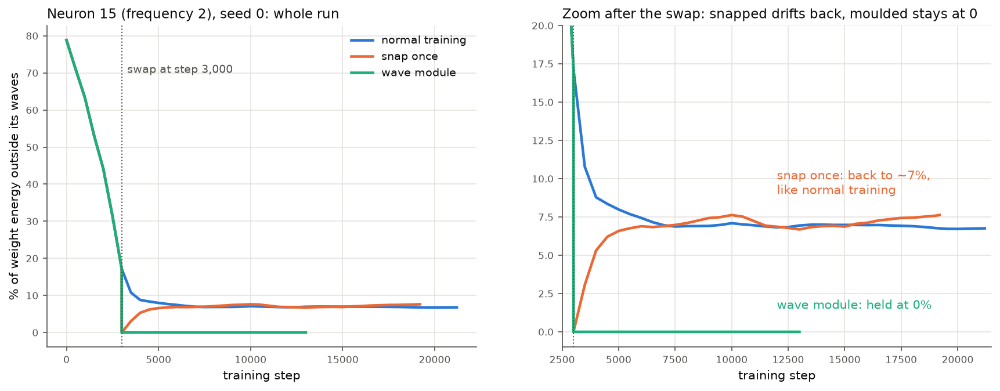
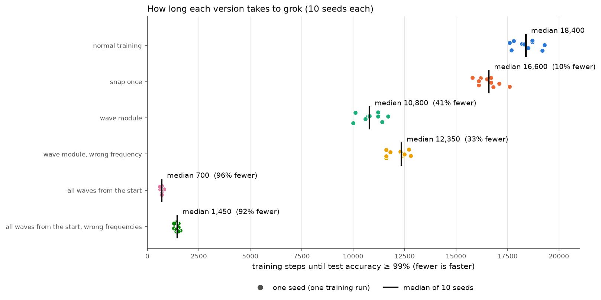
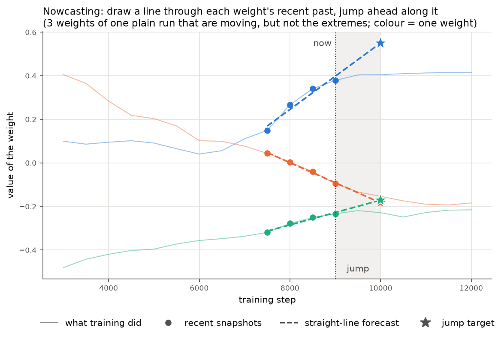
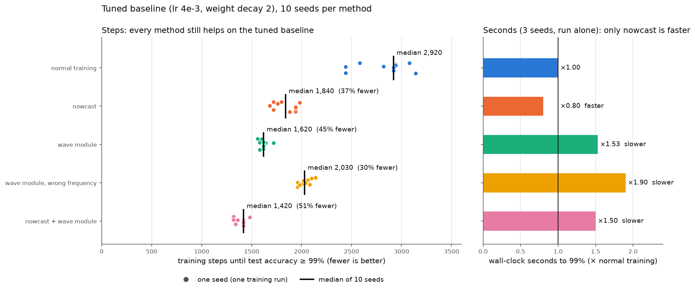

# Grokking, and can we make it happen sooner?

*An intuition-first tour of the quickgrok project, written for second-semester data science students. Status as of 7 November 2026: **the speed-up experiments are finished; the most interesting question is still open (section 12)**.*

You need: basic Python, mean and variance, linear regression with least squares, train/test splits and overfitting, and a rough idea of what a neural network is (layers, weights, ReLU, gradient descent). You do **not** need Fourier analysis. We build the little of it we need from a clock.

**Roadmap (about 45 minutes).** Sections 1–5: what grokking is and what the network learns (20 min). Sections 6–8: two ways to speed it up (10 min). Sections 9–10: the lesson that changed the project, a better-tuned baseline (10 min). Sections 11–12: what failed, and what is still open (5 min).

All new figures come from `make_figures.py` in this folder (`uv run python intuition/make_figures.py` from the repo root; set `QUICKGROK_RUN_ROOTS` if the training runs live elsewhere). A few figures are borrowed from the project's research reports in `../reports/`.

---

## 1. The puzzle: a network that memorises first and understands much later

Here is a real training run. A small neural network learns to add numbers "on a clock" (section 2 explains the task). The blue line is accuracy on the examples it trains on. The orange line is accuracy on examples it has **never** seen.

Read the x-axis carefully: it is on a **log scale**, so each grid line means ten times more training steps.

- By step **200** the network gets every training example right. It has **memorised** the training set.
- On the unseen examples it scores **0%**, and it stays at 0% for thousands of steps. That is textbook overfitting, and normally this is where you would stop training.
- But we keep going. Training accuracy is already perfect, so on paper there is nothing left to learn. Then, around step 7,000, test accuracy starts rising, and at step **18,200** it passes 99%. The network has found the actual rule.

The network "got it" about 90 times later than it memorised. This delayed understanding is called **grokking** (from a science-fiction novel, where "to grok" means to understand something deeply). It was first reported in 2022 (Power et al.).

The question behind this project: **can we make grokking happen sooner?** Short answer: our two tricks cut the number of training steps by about 40% (sections 7–8). But simply training with a larger learning rate was faster still (section 9), and that turned out to be the most important lesson of the project. Before we get there, we need to understand the task, what "understanding" looks like inside the network, and why it takes so long.

## 2. The task: clock arithmetic with 97 hours

On a normal clock, 9 o'clock plus 5 hours is 2 o'clock, not 14. You wrap around. Mathematicians call this **modular arithmetic** and write it as (9 + 5) mod 12 = 2. "mod 12" means "keep the remainder after dividing by 12".

Our network does the same thing on a clock with **97** hours (97 is a prime number, which keeps the maths clean). The input is two numbers a and b, each between 0 and 96. The correct output is (a + b) mod 97. For example (90 + 10) mod 97 = 3.

There are only 97 × 97 = **9,409** possible questions, so we can write down the whole answer table. We hand the network **30%** of the cells for training (2,822 pairs) and hide the other **70%** (6,587 pairs) as the test set.

- **Left:** the full answer table. Dark means a large answer. The diagonal "cliff" is where a + b reaches 97 and wraps back to 0.
- **Middle:** the real random split used in our experiments. Blue cells are training data. Pale cells are hidden.
- **Right:** a zoom on the top-left corner with the answers written in.

Look at the zoom and imagine you are the network. You have seen 0 + 0 = 0 and 1 + 1 = 2, but nobody has told you what 0 + 1 is. A lookup table cannot answer that. A rule ("add, then wrap at 97") can.

## 3. Memorising vs understanding

There are two very different ways to score 100% on the training cells:

1. **Memorise.** Store each training pair and its answer, like a lookup table. This is quick to learn, but it says nothing about the hidden cells. So test accuracy is about 0%, which is what we see for the first ~7,000 steps.
2. **Learn the rule.** Find a procedure that computes (a + b) mod 97 for *any* pair. This also scores 100% on training, and it scores 100% on the test cells too.

Both solutions have the same training loss (the error the network is minimising), so the loss alone gives the network no reason to switch from the first to the second. The push comes from **weight decay**.

**Weight decay** adds a small penalty for large weights to the loss, proportional to the sum of the squared weights. It is the same idea as ridge regression, which you may have met as a fix for overfitting in linear regression. The lookup table needs lots of large, specific weights, one bunch per training example. The rule turns out to need far fewer, smaller weights. So weight decay slowly "taxes" the lookup table. Gradient descent keeps the training answers correct while gradually moving the network towards the cheaper solution, which is the general rule.

**Analogy.** A student stores the answers to last year's exam word for word. That works on last year's exam. Now every word stored costs a little effort each day (weight decay). The cheapest way to keep passing last year's exam is eventually to understand the material, since a short explanation replaces hundreds of stored answers. This switch happens slowly, and that is why grokking is delayed.

In numbers: in the run above, the total size of the weights (the square root of the sum of all squared weights, the **weight norm**) falls from about 316 at the start to about 124 at the moment of grokking. Keep this number in mind: in section 9 it explains why the learning rate and weight decay set the clock.

## 4. Looking inside: a neuron as a function of (a, b)

Our network is small: the inputs a and b feed **one hidden layer of 512 ReLU neurons**, followed by an output layer that scores each of the 97 possible answers. We call it an **MLP** (multi-layer perceptron).

Because there are only 9,409 possible inputs, we can do something unusual: feed in **every** pair (a, b) and record what a single hidden neuron outputs. That gives a 97 × 97 picture of the neuron, one pixel per input pair. Dark means the neuron is active.

- **Top row, normal order (a = 0, 1, 2, … down; b = 0, 1, 2, … across).** Before grokking (left), the neuron looks like noise. After grokking (right) it still looks like noise, just a more regular kind.
- **Bottom row, same neuron, rows and columns re-ordered.** Here we sort a and b by the value of 35·x mod 97 (we explain where 35 comes from in section 5). Before grokking: still noise. After grokking: **one clean rectangle**. The neuron fires exactly when a is in a certain range *and* b is in a certain range, measured on a "frequency-35 clock".

The neuron has learned something very simple. We just had to look at it with the right "lens". In the project's report (`../reports/figures/mlp_baseline/probe/neuron_maps.png`) such rectangles are already visible at step 14,000, **before** test accuracy reaches 99% at step 18,200. Keep this in mind for section 6.

## 5. Why polynomials fail and waves work

### A number on a clock is an angle

Instead of writing a number x on a 12-hour clock as "x", write it as an **angle**: x hours is the fraction x/12 of a full turn, which is 2π·x/12 radians. Adding two numbers is then simply **turning twice**: turn by a, then turn by b. You automatically land in the right place, wrap-around included.

- **Left:** 5 + 9 on a 12-hour clock. Turn 5 hours (blue), then 9 more (orange), and you land on 2 (green).
- **Middle:** any angle is a point on the unit circle with coordinates (cos, sin). So the number 2 becomes the pair (cos(2π·2/12), sin(2π·2/12)) = (0.50, 0.87). This pair of numbers describes "2 on the clock" with no awkward jump from 11 back to 0.
- **Right:** the same cosine, drawn along a number line, is a **wave** that repeats every 12. You can also go round the clock k times as x goes from 0 to 12. That is the wave cos(2π·k·x/12), and k is called its **frequency**.

For our 97-hour clock, the building blocks are cos(2π·k·a/97) and sin(2π·k·a/97), and the same for b, for frequencies k = 1, 2, …, 48. These are the "Fourier features" you may meet later; for now they are just "where a sits on the clock when you go round k times".

The one formula worth showing: adding angles has a known identity from school trigonometry,

cos(w·(a + b)) = cos(w·a)·cos(w·b) − sin(w·a)·sin(w·b), with w = 2πk/97.

The left side depends only on the answer a + b mod 97. The right side uses only waves in a and waves in b, multiplied together. So a network that builds waves in a and b, and multiplies them, can compute an answer that wraps around correctly. That is roughly what grokked networks are known to do.

### Testing it with regression you already know

Here is how we check this with plain least-squares regression. Take one neuron and treat its output as y. Then compare two sets of input features (the columns of the design matrix X):

- **Polynomial:** 1, a, a², …, a⁶ (and the same for b, plus products). This is the usual "curve fitting".
- **Waves:** 1, cos(2πka/97), sin(2πka/97), and the same for b, plus products.

Then measure **R²**, the share of the neuron's variance that the fit explains (1 = perfect, 0 = no better than predicting the mean).

Here is that comparison for a single neuron, using the weights that connect each value of a to it:

- **Left, normal order:** the weights jump between two levels in a way that looks random. A degree-6 polynomial gives up and draws an almost flat line: **R² = 0.02**. A single wave with frequency 35 (blue circles) gets **R² = 0.83**. It looks scattered here only because the wave goes round the clock 35 times between 0 and 96.
- **Right, re-ordered by 35·a mod 97:** the same points now form a **square wave**, one block high and one block low. A single cosine follows it well, and adding two "harmonics" (cosines at 2× and 3× the frequency) sharpens the corners: **R² = 0.86**.

The same holds across the whole layer. Measured on held-out pairs over all 512 neurons (figure: `../reports/figures/mlp_baseline/probe/probe_r2.png`), **polynomial regression explains about 0%** of a neuron's variance throughout training, and **waves explain about 91%** after grokking (about 97% in a tiny transformer we also tried). Polynomials fail because they cannot wrap around: to a polynomial, 96 and 0 are far apart, while on the clock they are neighbours.

Better still, the waves show up **early**. By about step 11,000, a quarter of the neurons already get more than 85% of their wave fit from a single frequency, when test accuracy is still below 50%. Some neurons are "done" thousands of steps before the network as a whole has generalised.

## 6. Idea 1: jump to the wave shape, and how we tested it

**Analogy.** You are hiking in fog towards a summit. The path zig-zags slowly upwards. At some point the fog lifts for a moment and you see the summit. You could keep following the zig-zag, or you could walk straight towards it.

In our case the "zig-zag" is the long plateau where the network slowly trades its lookup table for the rule. The "summit" is the simple wave shape each neuron ends up with. The plan has three steps: (1) check that we can see the summit early, (2) jump towards it, (3) check fairly whether the jump saved time.

### Step 1: can we see the destination early?

We added a **probe** to training. Every 500 steps it runs the regression from section 5 on every one of the 512 neurons. It uses **training pairs only**: 80% of them to fit the waves and the other 20% to check the fit (a train/test split inside the training set). A neuron is flagged as "wave-shaped" when the waves explain at least 80% of its variance on the check pairs, and at least half of that comes from one frequency and its harmonics.

**Result:** 10% of the neurons are flagged at **36–54% of the way to grokking** (around step 6,000–10,000 of ~18,000, depending on how strict the thresholds are), while test accuracy is still about **0%**. So the summit really is visible early, for some neurons. (Running the probe did not change when the network grokked.)

### Step 2: jump, in two different ways

When the probe flags a neuron, we replace it by its fitted waves. We tried two versions:

- **Snap once.** Overwrite the neuron's weights with the fitted wave, then let training continue as normal. Gradient descent may change the weights back.
- **Wave module.** Replace the neuron's 97 weights per input with a small trainable function: a constant plus a cosine and sine at the neuron's frequency and 3 harmonics. That is **9 numbers instead of 97**. Training can still change the 9 numbers (how big each wave is and where it peaks), but the neuron can never stop being a wave of that frequency.

**Analogy: a sculpture of wet clay.** *Snap once* presses the clay into a mould once and takes it out again. It may sag back. The *wave module* leaves the clay in the mould: you can still push it around inside, but it keeps the mould's shape.

At the moment of the swap the two versions give exactly the same network. They differ only in what happens afterwards. This figure follows one neuron that was swapped at step 3,000 in both versions (same starting weights):

The y-axis shows how much of the neuron's weights its 9 waves **cannot** explain (roughly 1 − R²). At the start it is 79%: random weights are not waves. Normal training (blue) slowly pushes this down to ~7%. Snapping (orange) drops it to 0%, but within ~2,000 steps the neuron has drifted back to ~7%, where normal training would have it anyway. The wave module (green) holds it at 0% for good.

### Step 3: a fair comparison

A single run proves little, because each run groks at a slightly different time. So we compare **10 seeds** per version. A **seed** fixes the random choices of a run: the starting weights and which 30% of pairs are used for training. 10 seeds means 10 independent training runs of the same recipe. If a method is really faster, it should be faster for (nearly) every seed, not just on average.

How do scientists avoid fooling themselves? They ask: **what else could explain the result?** Then they design a **control experiment** in which that other explanation predicts something different. Our main worry: maybe the speed-up comes not from jumping to the *right* waves, but just from forcing the neuron to be *some* wave. The control: the **wrong frequency**. It uses the same trigger, the same neurons and the same moment, but each neuron gets a randomly chosen frequency that is *not* its own. If that helps just as much, "seeing where the network is heading" was not the reason.

We added a second, more extreme control: make **every neuron a wave module at step 0**, before any training (with right and with wrong frequencies). At step 0 there is nothing to "see" yet.

Two more fairness rules. The probe thresholds were tuned on 5 separate seeds (100–104) and fixed before the 10 final seeds were run, just like choosing settings on a validation set and not on the test set. And the probe never touches the test pairs.

## 7. What we found (first round, at the original settings)

All runs in this section use the training settings we inherited from our first pilot experiment: learning rate 0.001 and weight decay 1. Remember that; section 9 is about it.

Each dot below is one seed, so one complete training run. The black bar is the median of the 10 seeds.

The measured test-accuracy curves (median of 10 seeds) for the first four versions:

**1. The jump works, and the mould beats the snap.** Normal training reaches 99% test accuracy at a median of **18,400** steps. The wave module needs **10,800**: **41% fewer**, and even its slowest seed (11,700) beats the fastest normal one (17,600). Snap once gives only **10%** (16,600). That fits the figure above: a snapped neuron drifts back, so most of the push is lost.

**2. But the wrong frequency helps almost as much.** With wrong frequencies the wave module still needs only **12,350** steps (**33% fewer**). So most of the gain does not come from jumping to where the network was heading. It comes from forcing neurons to be waves *at all*. The right frequency adds a smaller but real extra (the wrong frequency is 14% slower than the right one).

**Analogy: the formula sheet.** One teacher waits until a student has nearly worked out a formula, then confirms it ("yes, that's the one"). Another hands out a formula sheet on day one. Our experiment says: most of the benefit comes from the *kind* of formula on the sheet (waves), and only a little from it being the exact formula the student was about to find.

**3. Waves from the start: 700 steps.** Making every neuron a wave module at step 0 groks after **~700 steps** instead of ~18,400, about 26× faster. With random frequencies it takes **~1,450**. This is no longer "accelerating training". We have built the shape of the answer into the network, so there is little left to discover. That is the real lesson. An assumption built into a model is called an **inductive bias** (or **prior**), and a good one can matter more than any training trick. You will meet the same idea later: convolutional networks for images build in "the same pattern can appear anywhere in the picture".

A statistical test (the Mann–Whitney test, which asks how often a run from one group beats a run from the other) says that none of these differences is likely to be luck.

**Honest framing.**

- **No cheating with test data.** All fits use training inputs only.
- **But we brought prior knowledge.** We chose waves as the replacement because section 5 told us the answer looks like waves. On a task whose answer is *not* clock-shaped, our wave module would be the wrong mould (section 11 tests this).
- **One task, one network size, one training setting.** That last limit turned out to matter most (section 9).

## 8. Idea 2: forecast the weights ("nowcasting")

The wave module needs to know that the answer is made of waves. Can we speed up grokking *without* knowing anything about the task?

Section 3 said that the long plateau is weight decay slowly moving the weights. Slow, steady movement is easy to predict. So here is the idea, which we call **nowcasting**: if every weight is drifting in a straight line, draw that line and jump ahead along it.

The recipe, for each of the network's ~150,000 weights separately:

1. Every 100 steps, save a snapshot of the weight.
2. Every 1,000 steps, fit a straight line (least squares, as in your course) through the last 8 snapshots of each weight, and move the weight to where its line will be 1,000 steps from now.
3. **Check the jump.** If the training loss after the jump is more than 1.5 times the loss before it, undo the jump and carry on as if nothing happened.

The figure shows the idea with 3 weights of one normal run (for the picture we use the checkpoints saved every 500 steps). For the orange and green weights the line lands close to where training actually went. For the blue weight it overshoots, because the weight is about to stop moving. That is why step 3 exists: a jump that makes the network worse on its own training data is thrown away. About 70% of the jumps were kept.

Note what the method does **not** use: no test data, no grokked network to copy from, and no knowledge that the task is about clocks. It only uses the run's own recent past.

**Results at the original settings** (10 seeds each, steps to 99% test accuracy, median):

| Version | Steps | Fewer steps than normal training |
|---|---|---|
| normal training | 18,400 | — |
| **nowcast, straight line** | **11,150** | **39%** |
| nowcast, a small neural network (LSTM) as forecaster | 11,350 | 38% (no better than the line) |
| only shrink each weight tensor to its forecast size, keep its direction | 18,400 | 0% |
| Grokfast (a published speed-up trick) | 18,350 | 0% |

Three lessons hide in this table:

- **A better forecast is not a better accelerator.** The LSTM predicts the weights twice as accurately as the straight line, but it groks no sooner. Fancy is not automatically better.
- **Direction matters, not just size.** The "shrink only" control gives each group of weights the size the forecast predicts, but keeps the direction they point in. It does nothing. So nowcasting works because it moves the weights the way they were heading, not just because it makes them smaller.
- **Published tricks do not always transfer.** Grokfast gave 0% in our setting. That does not mean the paper is wrong: its gains were reported with other settings.

So both of our ideas cut about 40% of the steps. That is where we would have liked to write "success". Then we checked our baseline.

## 9. The baseline lesson: tune the thing you compare against

Every comparison so far used learning rate 0.001 and weight decay 1. We never chose those numbers for speed: we inherited them from the pilot experiment. Settings like these, which you pick before training rather than learn from the data, are called **hyperparameters**. So we ran normal training (no tricks at all) on a grid of learning rates and weight decays, 5 seeds each:

- **Grokking time falls roughly as 1 / (learning rate × weight decay).** Going along the x-axis, each doubling of lr × wd roughly halves the number of steps (the dashed line). From our original baseline at **17,900** steps, the fastest setting needs about **1,000**: about 18 times faster.
- **Simply doubling the learning rate beats both of our methods.** With learning rate 0.002 and weight decay 1, normal training groks after **8,700** steps. Our two methods needed 10,800 (wave module) and 11,150 (nowcast) at the old setting: the dotted horizontal lines.
- **It is a rule of thumb, not a law.** At the smallest learning rate, doubling the weight decay did *not* help (green line, left: 19,800 steps). The curve flattens out near 1,000 steps. And with weight decay 4, most runs never grokked within 40,000 steps: the tax was too high.
- It is still grokking: every setting memorises within 100–200 steps and generalises 10–40 times later.

**Why does weight decay set the clock?** The training algorithm we use (AdamW) does two things at every step:

1. it nudges each weight in the direction that lowers the loss, by an amount of about the learning rate;
2. it shrinks every weight by the fraction **lr × wd**. With lr = 0.001 and wd = 1, that is 0.1% per step.

Section 3 said that the network switches to the rule once its weights are small enough (weight norm about 124 here). The nowcasting runs confirm this: whether a run jumps or not, it passes 99% test accuracy at the same weight norm, about 124. So the plateau is mostly *waiting for the weights to shrink*. Double the shrink per step, and you get there in about half the steps. **Analogy:** a bank account with negative interest. How long it takes to fall below some amount depends mainly on the interest rate, and lr × wd is that rate.

This also explains part of nowcasting's success. Its jumps go where the weights were drifting anyway, so they act a bit like a higher weight decay, learned on the fly.

**This was known.** Other groups have measured the same dependence of grokking time on learning rate and weight decay: Pracher et al. 2026 (arXiv 2609.26679), Lyu et al. (ICLR 2024) and Xu et al. (ICML 2026). The "the weights must shrink into a good range" picture is also the explanation proposed by Omnigrok (Liu et al., 2023). A literature search before our first comparisons would have saved us a detour.

**The lesson.** "Our method is 40% faster" means nothing if the baseline was slow for a boring reason. Before you claim a speed-up, **tune the baseline** at least as carefully as your own method. This is one of the most common mistakes in machine-learning papers, so do not feel bad when you catch yourself making it. Catching it is the point.

## 10. Re-test on the tuned baseline: steps vs seconds

Fair question: do our methods still help **on top of** a well-tuned baseline? We re-ran everything at learning rate 0.004 and weight decay 2, where normal training groks after about 2,900 steps. The methods' own settings (how often to probe, how far to jump) were re-tuned on 5 separate seeds first, then fixed for the 10 final seeds.

| Version | Steps to 99% (median of 10 seeds) | Steps saved | Wall-clock vs normal training |
|---|---|---|---|
| normal training | 2,920 | — | ×1.00 |
| nowcast | 1,840 | 37% | **×0.80 (faster)** |
| wave module | 1,620 | 45% | ×1.53 (slower) |
| wave module, wrong frequency | 2,030 | 30% | ×1.90 (slower) |
| nowcast + wave module | 1,420 | 51% | ×1.50 (slower) |

(Normal training took 2,600 steps in the grid of section 9 and 2,920 here because these are different seeds; all comparisons in this table use the same 10 seeds.)

- **In steps, both methods still help about as much as before** (nowcast 37%, was 39%; wave module 45%, was 41%). Tuning the baseline and our tricks seem to shorten different parts of the plateau.
- The right frequency still beats the wrong one (1,620 vs 2,030 steps), and the two methods **combine**, though less than you would hope: 51%, not the ~65% you would get if the two speed-ups multiplied.
- **At the very fastest setting** (learning rate 0.016, about 920 steps), the gains shrink to **11%** (nowcast) and **24%** (wave module).

**Steps vs seconds.** A step is not a fixed amount of time. A normal training step of this tiny network takes 0.74 milliseconds on our GPU. The wave module adds work: every 100 steps it fits a regression to all 512 neurons (30–50 ms each time), and once ~270 neurons are reshaped, every step is about 57% slower. So the wave module saves 45% of the *steps* but takes 53% *more seconds*. Nowcasting is nearly free (a few snapshots and one line fit per jump), so it is the only method that actually saves time: 20% at learning rate 0.004, and nothing at 0.016. Which number to report depends on the question: steps tell you about the learning dynamics, seconds tell you whether anyone should use the method. A paper that reports only one of them can mislead.

## 11. Can the method find the shape by itself? (No)

The wave module only works because *we* told it "use waves". To make it honest, we tried shapes that know nothing about the task, and let the method fit each neuron with them. We also added two tasks where clock waves in a and b are the wrong shape: **a · b mod 97** and combining shuffles of 5 cards (**permutations**). On these, the wave probe never fires.

The task-blind shapes we tried, and what happened (mostly single training runs, so these are feasibility checks, not precise numbers):

- **Global SVD** (a few directions shared by all neurons, found by the singular value decomposition, the maths behind PCA). It **never fires**: no small set of shared directions describes the neurons, because they use many different frequencies.
- **"Pick the best shape per neuron"** from waves, polynomials and SVD. It helped on a + b, but only because it picked waves for 116 of 117 neurons. That is our prior again, found in a roundabout way.
- **Level sets** (each weight column takes only 2–3 distinct values). These light up on **every** task within ~2,000 steps, at the memorising stage, including a + b, where we know the true shape is waves. So they reflect how the optimizer moves the weights, not the task. Freezing neurons onto them makes test accuracy stall at **~95%** and never reach 99%.
- **Self-expression** (describe each neuron with a few other neurons). Test accuracy also **stalls in the mid-90s**. On a · b it eventually reaches 99%, but 2.6 times later than normal training.

The likely reason, for both: the shapes are copied from a network that is still changing, and freezing a neuron onto an unfinished shape takes away the freedom it needs for the last stretch.

**Lesson.** Replacing neurons with a fixed shape only works when you already know the right shape. That is **prior knowledge, not discovery**. The 700-step "all waves from the start" result of section 7 says the same thing from the other side.

## 12. The honest verdict so far, and the open question

We asked a five-perspective review panel (we called it the "council") to judge where the project stands. Its verdict:

- **The speed-up angle is not the interesting part.** A tuned learning rate and weight decay beat our tricks at the original setting, and the one trick that is faster in seconds (nowcasting) saves 20% at best.
- **The Fourier probe is close to circular.** It finds the wave structure because we told it to look for waves.

What *might* be interesting is the probe as a **monitor**. Section 6 showed that some neurons become wave-shaped long before test accuracy moves. So the open question is:

> Can a signal computed only from training data predict **whether and when** a run will generalise, better than cheap baselines such as the weight norm or the 1 / (lr × wd) rule of thumb?

Answering this properly needs a **pre-registered** test: write down the prediction rule, the baselines and the success criterion *before* running the experiment, and include runs that never grok (for example weight decay 4, or the card-shuffling task with 30% training data), so a monitor that always says "it will grok" cannot look good. We have not run this test, and we do not know the answer.

## 13. Things to try / discussion questions

1. **Overfitting revisited.** In your course, the advice for overfitting is "stop training when test error starts going up" (early stopping). What would early stopping have done in the training run of section 1? When is it the wrong advice?
2. **Clock features by hand.** Make a 12 × 12 table and use as target y = cos(2π·((a + b) mod 12)/12), the answer's position on the clock. Fit it by least squares (`numpy.linalg.lstsq`) twice: once with features 1, a, b, a², ab, b², and once with features cos/sin(2πa/12), cos/sin(2πb/12) and their four products. Compare the R². Why is one of them perfect? (Hint: the angle-addition formula in section 5.)
3. **Why 30%?** The project found that with 40–50% training data the delay mostly disappears. Why might more data make memorising less attractive compared with the rule?
4. **Weight decay as a dial.** Use the "shrink by lr × wd per step" picture of section 9 to predict what happens with no weight decay at all. Then explain why weight decay 4 never grokked: what does a very high tax do to the rule itself?
5. **Fair comparison.** Suppose the jump method reaches 99% test accuracy at step 17,000 in one run, against 18,200 for normal training. Is that evidence that it works? Look at the normal-training dots in the results figure of section 7: how far apart are the fastest and slowest seeds? What would you need to see?
6. **Cheating check.** Why does it matter that the regression probe only uses training pairs? Describe how using test pairs could make the method look better than it is.
7. **Design a control.** The wave module has 9 trainable numbers per input instead of 97. Maybe it is faster simply because it has fewer numbers to learn, not because they are waves. Design a control that tests this. What result would make you drop the "waves" explanation?
8. **Prior or cheating?** "All waves from the start" groks in 700 steps. Is that a fair way to "speed up grokking"? Name another model you know that builds an assumption about the data into its design (hint: think of linear regression itself).
9. **Why must you tune the baseline before claiming a speed-up?** Our methods saved ~40% of the steps at the old setting, and doubling the learning rate saved 51%. Write the one-sentence claim we could honestly have made before section 9, and the one we can make after it. How much tuning effort should a baseline get compared with your own method?
10. **Steps vs seconds: which should we report?** The wave module saves 45% of the steps but costs 53% more time. Give one reader for whom steps are the right number and one for whom seconds are. Would the answer change for a network a thousand times larger, where each step is much more expensive?

## 14. Glossary

- **Accuracy:** share of examples where the network's top-scoring answer is correct.
- **AdamW:** the training algorithm we use; a version of gradient descent that also shrinks every weight by lr × wd at each step.
- **Baseline:** the standard method you compare against (here: normal training).
- **Baseline tuning:** choosing the baseline's hyperparameters as carefully as your own method's, so that a speed-up is not just a badly-set baseline.
- **Control experiment:** an extra experiment designed so that a boring explanation of the result would show up there too (here: replacing neurons with the wrong frequency).
- **Fourier features / waves:** cos(2πk·x/p) and sin(2πk·x/p). They describe where x sits on a clock with p hours when you go round k times.
- **Frequency (k):** how many times a wave repeats as x goes from 0 to p.
- **Generalise:** perform well on data not seen in training.
- **Grokking:** test accuracy jumping to near 100% long after training accuracy did.
- **Grokfast:** a published method to speed up grokking by amplifying the slow, consistent part of the gradient. It did not help in our setting.
- **Harmonic:** a wave at 2×, 3×, … the base frequency. Square waves are made of a base wave plus harmonics.
- **Hyperparameter:** a setting chosen before training rather than learned from the data, such as the learning rate, the weight decay or the network size.
- **Inductive bias:** an assumption built into a model's design that makes some solutions easier to learn than others (here: "each neuron is a wave").
- **IQR (interquartile range):** the range covering the middle 50% of values.
- **Learning rate (lr):** how big a step gradient descent takes at each update.
- **Loss:** the error the network minimises during training (here cross-entropy).
- **MLP:** a network of fully-connected layers; ours has one hidden layer of 512 ReLU neurons.
- **mod p:** the remainder after dividing by p ("clock arithmetic").
- **Memorisation:** fitting the training data without learning a rule that transfers to new data.
- **Median:** the middle value when sorted; with 10 seeds, the average of the 5th and 6th. Unlike the mean, one odd run cannot drag it far.
- **Neuron:** one unit in a hidden layer; here its output is ReLU(weight for a + weight for b + bias).
- **Nowcasting:** our name for forecasting each weight from its own recent history (here with a straight line) and jumping ahead, keeping the jump only if the training loss does not get much worse.
- **PCA:** principal component analysis, a way to find the few directions that explain most of the variance in data.
- **Pre-registration:** writing down the hypothesis, the analysis and the success criterion before running an experiment, so the result cannot quietly change what counts as success.
- **Prior:** knowledge about the problem that you bring in before seeing the data; built into a model, it becomes an inductive bias.
- **Probe:** a small analysis (here a regression) used to look inside a network, during or after training.
- **R²:** share of variance explained by a regression; 1 is perfect, 0 is no better than the mean.
- **Seed:** the number that fixes all random choices in a run (starting weights and which pairs go into the training set); different seeds give different runs. Running many seeds shows how much a result varies by chance.
- **Transformer:** the network architecture behind modern language models; we use a tiny one-layer version as a second test case.
- **Wall-clock time:** the real time a run takes, in seconds, as a clock on the wall would measure it. It includes all extra work a method does, unlike a count of training steps.
- **Weight decay (wd):** a penalty on large weights, related to ridge regression; in AdamW it shrinks every weight by lr × wd per step.
- **Weight norm:** the overall size of the weights: the square root of the sum of all squared weights.
