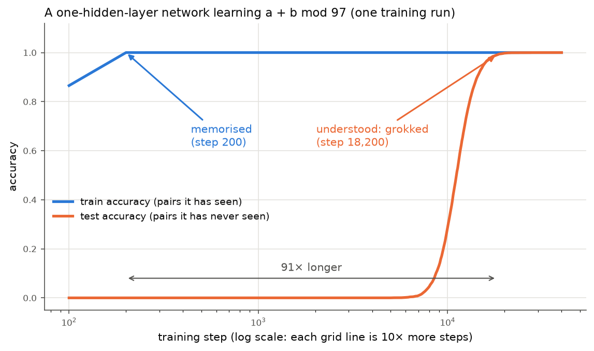
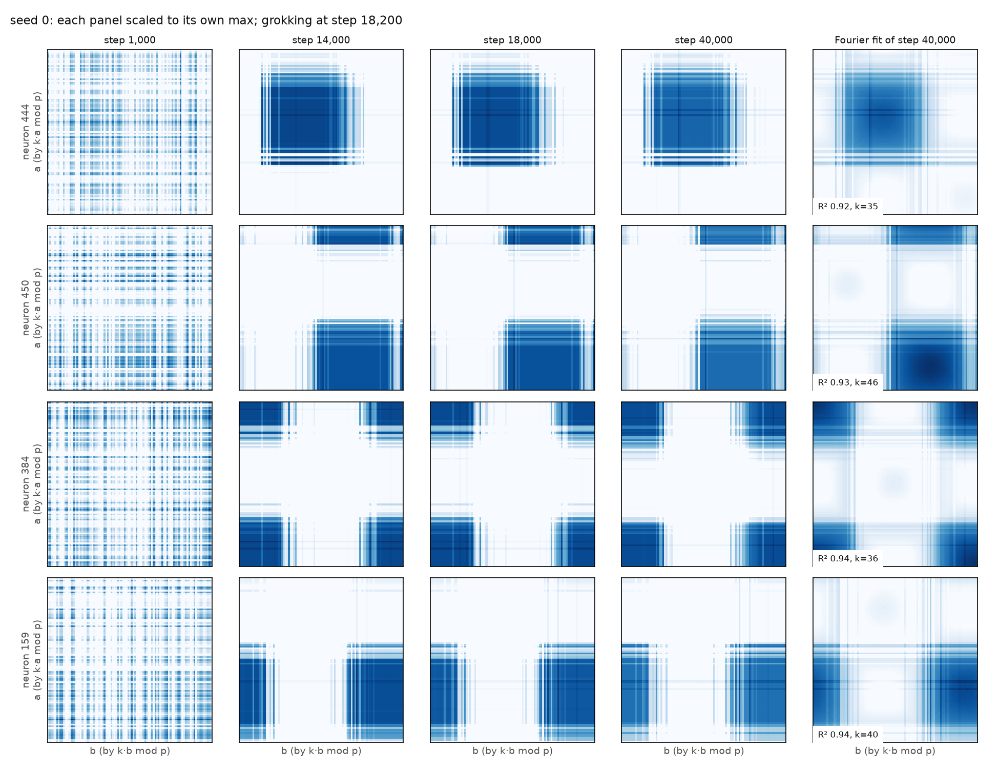
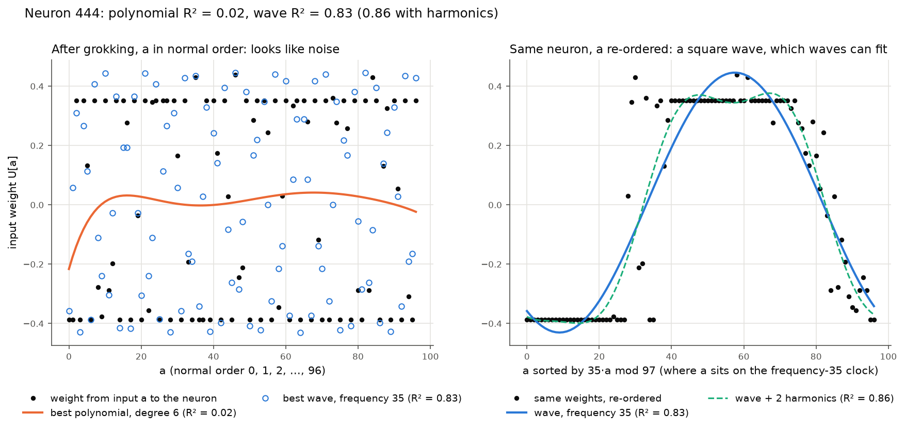
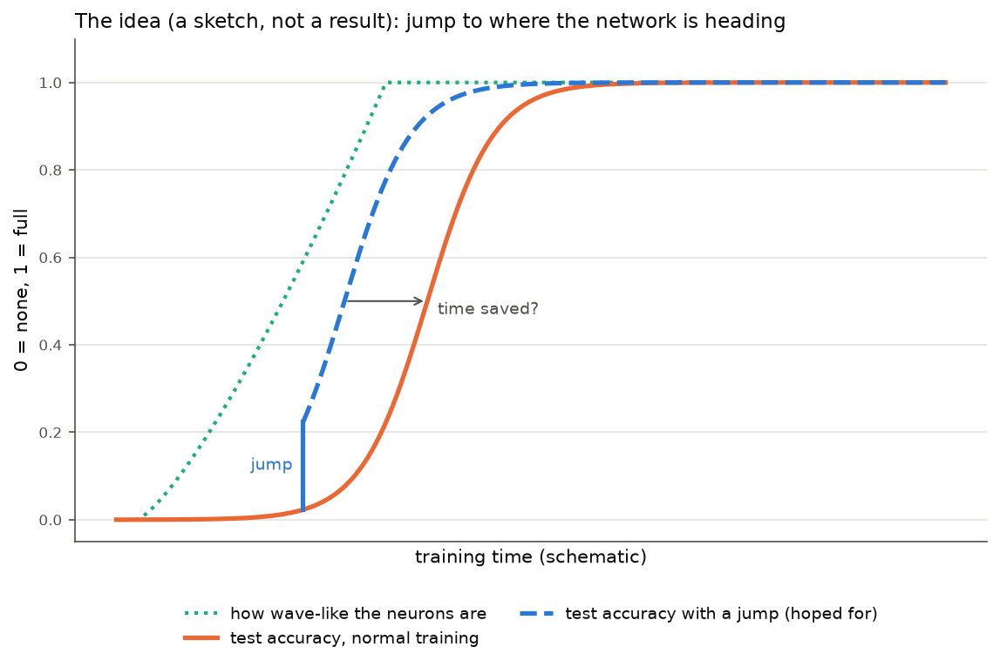
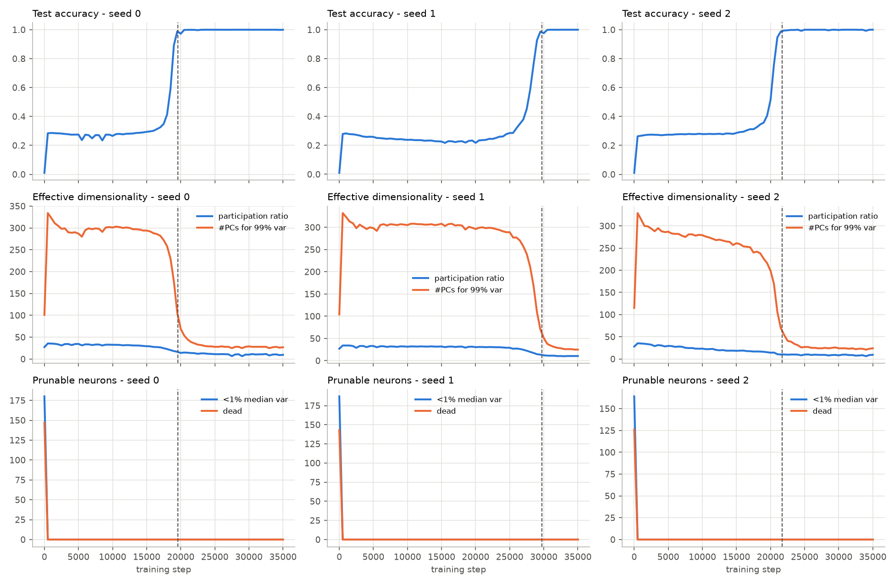

# Grokking, and can we make it happen sooner?

*An intuition-first tour of the quickgrok project, written for second-semester data science students. Status as of 7 November 2026: **work in progress**.*

You need: basic Python, mean and variance, linear regression with least squares, train/test splits and overfitting, and a rough idea of what a neural network is (layers, weights, ReLU, gradient descent). You do **not** need Fourier analysis. We build the little of it we need from a clock.

All new figures come from `make_figures.py` in this folder (`uv run python intuition/make_figures.py` from the repo root). A few figures are borrowed from the project's research reports in `../reports/`.

---

## 1. The puzzle: a network that memorises first and understands much later

Here is a real training run. A small neural network learns to add numbers "on a clock" (section 2 explains the task). The blue line is accuracy on the examples it trains on. The orange line is accuracy on examples it has **never** seen.

Read the x-axis carefully: it is on a **log scale**, so each grid line means ten times more training steps.

- By step **200** the network gets every training example right. It has **memorised** the training set.
- On the unseen examples it scores **0%**, and it stays at 0% for thousands of steps. That is textbook overfitting, and normally this is where you would stop training.
- But we keep going. Training accuracy is already perfect, so on paper there is nothing left to learn. Then, around step 7,000, test accuracy starts rising, and at step **18,200** it passes 99%. The network has found the actual rule.

The network "got it" about 90 times later than it memorised. This delayed understanding is called **grokking** (from a science-fiction novel, where "to grok" means to understand something deeply). It was first reported in 2022 (Power et al.).

The question behind this project: **can we make grokking happen sooner?** Before we can answer that, we need to understand the task, what "understanding" looks like inside the network, and why it takes so long.

## 2. The task: clock arithmetic with 97 hours

On a normal clock, 9 o'clock plus 5 hours is 2 o'clock, not 14. You wrap around. Mathematicians call this **modular arithmetic** and write it as (9 + 5) mod 12 = 2. "mod 12" means "keep the remainder after dividing by 12".

Our network does the same thing on a clock with **97** hours (97 is a prime number, which keeps the maths clean). The input is two numbers a and b, each between 0 and 96. The correct output is (a + b) mod 97. For example (90 + 10) mod 97 = 3.

There are only 97 × 97 = **9,409** possible questions, so we can write down the whole answer table. We hand the network **30%** of the cells for training (2,822 pairs) and hide the other **70%** (6,587 pairs) as the test set.

- **Left:** the full answer table. Dark means a large answer. The diagonal "cliff" is where a + b reaches 97 and wraps back to 0.
- **Middle:** the real random split used in our experiments. Blue cells are training data. Pale cells are hidden.
- **Right:** a zoom on the top-left corner with the answers written in.

Look at the zoom and imagine you are the network. You have seen 0 + 0 = 0 and 1 + 1 = 2, but nobody has told you what 0 + 1 is. A lookup table cannot answer that. A rule ("add, then wrap at 97") can.

## 3. Memorising vs understanding

There are two very different ways to score 100% on the training cells:

1. **Memorise.** Store each training pair and its answer, like a lookup table. This is quick to learn, but it says nothing about the hidden cells. So test accuracy is about 0%, which is what we see for the first ~7,000 steps.
2. **Learn the rule.** Find a procedure that computes (a + b) mod 97 for *any* pair. This also scores 100% on training, and it scores 100% on the test cells too.

Both solutions have the same training loss (the error the network is minimising), so the loss alone gives the network no reason to switch from the first to the second. The push comes from **weight decay**.

**Weight decay** adds a small penalty for large weights to the loss, proportional to the sum of the squared weights. It is the same idea as ridge regression, which you may have met as a fix for overfitting in linear regression. The lookup table needs lots of large, specific weights, one bunch per training example. The rule turns out to need far fewer, smaller weights. So weight decay slowly "taxes" the lookup table. Gradient descent keeps the training answers correct while gradually moving the network towards the cheaper solution, which is the general rule.

**Analogy.** A student stores the answers to last year's exam word for word. That works on last year's exam. Now every word stored costs a little effort each day (weight decay). The cheapest way to keep passing last year's exam is eventually to understand the material, since a short explanation replaces hundreds of stored answers. This switch happens slowly, and that is why grokking is delayed.

In numbers: in the run above, the total size of the weights (the square root of the sum of all squared weights) falls from about 316 at the start to about 124 at the moment of grokking.

## 4. Looking inside: a neuron as a function of (a, b)

Our network is small: the inputs a and b feed **one hidden layer of 512 ReLU neurons**, followed by an output layer that scores each of the 97 possible answers. We call it an **MLP** (multi-layer perceptron).

Because there are only 9,409 possible inputs, we can do something unusual: feed in **every** pair (a, b) and record what a single hidden neuron outputs. That gives a 97 × 97 picture of the neuron, one pixel per input pair. Dark means the neuron is active.

- **Top row, normal order (a = 0, 1, 2, … down; b = 0, 1, 2, … across).** Before grokking (left), the neuron looks like noise. After grokking (right) it still looks like noise, just a more regular kind.
- **Bottom row, same neuron, rows and columns re-ordered.** Here we sort a and b by the value of 35·x mod 97 (we explain where 35 comes from in section 5). Before grokking: still noise. After grokking: **one clean rectangle**. The neuron fires exactly when a is in a certain range *and* b is in a certain range, measured on a "frequency-35 clock".

The neuron has learned something very simple. We just had to look at it with the right "lens". The project's report shows four such neurons at several points in training:

Look at the columns for step 14,000 and step 18,000: the rectangles are already there **before** test accuracy reaches 99% at step 18,200. Keep this in mind for section 6.

## 5. Why polynomials fail and waves work

### A number on a clock is an angle

Instead of writing a number x on a 12-hour clock as "x", write it as an **angle**: x hours is the fraction x/12 of a full turn, which is 2π·x/12 radians. Adding two numbers is then simply **turning twice**: turn by a, then turn by b. You automatically land in the right place, wrap-around included.

- **Left:** 5 + 9 on a 12-hour clock. Turn 5 hours (blue), then 9 more (orange), and you land on 2 (green).
- **Middle:** any angle is a point on the unit circle with coordinates (cos, sin). So the number 2 becomes the pair (cos(2π·2/12), sin(2π·2/12)) = (0.50, 0.87). This pair of numbers describes "2 on the clock" with no awkward jump from 11 back to 0.
- **Right:** the same cosine, drawn along a number line, is a **wave** that repeats every 12. You can also go round the clock k times as x goes from 0 to 12. That is the wave cos(2π·k·x/12), and k is called its **frequency**.

(The figure draws angles the way mathematicians do: 0 on the right, turning counter-clockwise. Real clocks start at the top and turn clockwise, but the idea is the same.)

For our 97-hour clock, the building blocks are cos(2π·k·a/97) and sin(2π·k·a/97), and the same for b, for frequencies k = 1, 2, …, 48. These waves are the "Fourier features" you may hear about later in your studies. For now they are just "where a sits on the clock, read off as (cos, sin), when you go round k times".

The one formula worth showing: adding angles has a known identity from school trigonometry,

cos(w·(a + b)) = cos(w·a)·cos(w·b) − sin(w·a)·sin(w·b), with w = 2πk/97.

The left side depends only on the answer a + b mod 97. The right side uses only waves in a and waves in b, multiplied together. So a network that builds waves in a and b, and multiplies them, can compute an answer that wraps around correctly. That is roughly what grokked networks are known to do.

### Testing it with regression you already know

Here is how we check this with plain least-squares regression. Take one neuron and treat its output as y. Then compare two sets of input features (the columns of the design matrix X):

- **Polynomial:** 1, a, a², …, a⁶ (and the same for b, plus products). This is the usual "curve fitting".
- **Waves:** 1, cos(2πka/97), sin(2πka/97), and the same for b, plus products.

Then measure **R²**, the share of the neuron's variance that the fit explains (1 = perfect, 0 = no better than predicting the mean).

Here is that comparison for a single neuron, using the weights that connect each value of a to it:

- **Left, normal order:** the weights jump between two levels in a way that looks random. A degree-6 polynomial gives up and draws an almost flat line: **R² = 0.02**. A single wave with frequency 35 (blue circles) gets **R² = 0.83**. It looks scattered here only because the wave goes round the clock 35 times between 0 and 96.
- **Right, re-ordered by 35·a mod 97:** the same points now form a **square wave**, one block high and one block low. A single cosine follows it well, and adding two "harmonics" (cosines at 2× and 3× the frequency) sharpens the corners: **R² = 0.86**.

The same holds across the whole layer, measured on held-out data in the project's report:

The middle row shows the median R² over all 512 neurons. **Polynomial regression explains about 0%** throughout training. **Wave (Fourier) regression explains about 91%** after grokking (about 97% in the transformer model we also tried). Polynomials fail because they cannot wrap around: to a polynomial, 96 and 0 are far apart, while on the clock they are neighbours.

The bottom row is the share of each neuron's explained variance that comes from its single best frequency. It climbs **long before** test accuracy jumps. In the shaded band (the middle 50% of neurons), the top quarter of neurons are already above 0.85 by about step 11,000, when test accuracy is still below 50%. Some neurons are "done" thousands of steps before the network as a whole has generalised.

## 6. The idea: if we can see where the network is heading, can we jump there?

**Analogy.** You are hiking in fog towards a summit. The path zig-zags slowly upwards. At some point the fog lifts for a moment and you see the summit. You could keep following the zig-zag, or you could walk straight towards it.

In our case the "zig-zag" is the long plateau where the network slowly trades its lookup table for the rule. The "summit" is the simple wave shape each neuron ends up with. And we can see that shape early, at least for some neurons.

*This figure is a sketch of the hope, not a measured result.*

The planned method:

1. Train normally. Every few hundred steps, run the regression from section 5 on every neuron.
2. When a neuron is fitted well (high R², one frequency dominating), **jump**: replace that neuron by its fitted wave function. The wave function's amplitude and phase stay trainable, so the network can still adjust it.
3. Keep training, and measure how many steps it takes to reach 99% test accuracy.

How we will judge it fairly:

- **Many random seeds.** A **seed** fixes the random starting weights and the random choices during training. Different seeds grok at different times. For this MLP, five seeds grokked between steps 18,200 and 18,700 (that is the middle 50%, the interquartile range), so we need a speed-up clearly bigger than that spread. Even with identical settings, training on a GPU is not exactly reproducible, which is one more reason to use many seeds.
- **No peeking at the test set.** The regression that decides when to jump may only use **training** pairs. If it used test pairs, we would be quietly leaking the answers.
- **Controls.** We will also replace neurons with the **wrong** frequency. If that helps just as much, the speed-up didn't come from finding the right structure. It may come from the replacement itself, for example from shrinking the weights, which is what weight decay already does.
- **Compare with known tricks.** There are existing methods to speed up grokking, such as **Grokfast**, which amplifies the slow-moving part of the gradient. Our idea is only interesting if it can compete with them, or teaches us something they don't.

## 7. How it is going (honest status)

**Done:**

- Grokking is reproduced in two models: the MLP (99% test accuracy at step ~18,500, very consistent over 5 seeds) and a small one-layer transformer (between ~19,600 and ~29,700 steps over 3 seeds, a much bigger spread). The MLP is therefore the better test bed.
- The "inside view" is clear: after grokking, neurons are periodic in a and b with one dominant frequency. Waves explain ~91–97% of their variance; polynomials ~0%.
- Neurons drift towards these shapes well before test accuracy jumps.

**Side results:**

- We tried **PCA** (principal component analysis) on the hidden layer. The number of directions needed to explain 99% of the variance drops from ~300 to ~25 as the network generalises. But no individual neuron goes idle: every neuron stays active and the structure is shared among them. So simply **pruning** (deleting) neurons does not help.

  

- The MLP's neurons are **square waves**, not smooth cosines. So the replacement function must allow harmonics (as in the green dashed line in the regression figure above), not just one cosine.

**In progress:** an online "probe" that runs the regression *during* training using training pairs only. After that come the actual replacement experiments.

**What could realistically happen:**

- **It helps:** grokking arrives clearly earlier than the seed spread, and the wrong-frequency control does not help. That would be a nice result.
- **No effect:** the network may undo our replacement, or the early structure (only partly formed) may not be good enough to be useful. Related work ("grokking tickets") found that structure taken from the middle of training did not help.
- **It helps for the wrong reason:** the wrong-frequency control helps just as much. Then the speed-up comes from something generic, like shrinking weights, not from "jumping to the answer". This is exactly why the controls are in the plan.

A negative result is still informative: it would tell us that seeing the destination early is not enough to get there faster.

## 8. Things to try / discussion questions

1. **Overfitting revisited.** In your course, the advice for overfitting is "stop training when test error starts going up" (early stopping). What would early stopping have done in the training run of section 1? When is it the wrong advice?
2. **Clock features by hand.** Make a 12 × 12 table and use as target y = cos(2π·((a + b) mod 12)/12), the answer's position on the clock. Fit it by least squares (`numpy.linalg.lstsq`) twice: once with features 1, a, b, a², ab, b², and once with features cos/sin(2πa/12), cos/sin(2πb/12) and their four products. Compare the R². Why is one of them perfect? (Hint: the angle-addition formula in section 5.)
3. **Why 30%?** The project found that with 40–50% training data the delay mostly disappears. Why might more data make memorising less attractive compared with the rule?
4. **Weight decay as a dial.** With weaker weight decay (0.3 instead of 1.0), grokking took longer (between steps 20k and 25k instead of 15k–20k). Explain this with the "tax on stored answers" analogy. What would you expect with no weight decay at all?
5. **Fair comparison.** Suppose the jump method reaches 99% test accuracy at step 17,000 in one run, against 18,200 for normal training. Is that evidence that it works? What would you need to see?
6. **Cheating check.** Why does it matter that the regression probe only uses training pairs? Describe how using test pairs could make the method look better than it is.

## 9. Glossary

- **Accuracy:** share of examples where the network's top-scoring answer is correct.
- **Controls:** extra experiments designed to rule out boring explanations (here, a wrong-frequency replacement).
- **Fourier features / waves:** cos(2πk·x/p) and sin(2πk·x/p). They describe where x sits on a clock with p hours when you go round k times.
- **Frequency (k):** how many times a wave repeats as x goes from 0 to p.
- **Generalise:** perform well on data not seen in training.
- **Grokking:** test accuracy jumping to near 100% long after training accuracy did.
- **Grokfast:** a known method to speed up grokking by amplifying the slow, consistent part of the gradient.
- **Harmonic:** a wave at 2×, 3×, … the base frequency. Square waves are made of a base wave plus harmonics.
- **IQR (interquartile range):** the range covering the middle 50% of values.
- **Loss:** the error the network minimises during training (here cross-entropy).
- **MLP:** a network of fully-connected layers; ours has one hidden layer of 512 ReLU neurons.
- **mod p:** the remainder after dividing by p ("clock arithmetic").
- **Memorisation:** fitting the training data without learning a rule that transfers to new data.
- **Neuron:** one unit in a hidden layer; here its output is ReLU(weight for a + weight for b + bias).
- **PCA:** principal component analysis, a way to find the few directions that explain most of the variance in data.
- **Probe:** a small analysis (here a regression) used to look inside a trained network.
- **R²:** share of variance explained by a regression; 1 is perfect, 0 is no better than the mean.
- **Seed:** the number that fixes all random choices in a run; different seeds give different runs.
- **Transformer:** the network architecture behind modern language models; we use a tiny one-layer version as a second test case.
- **Weight decay:** a penalty on large weights added to the loss, related to ridge regression.
