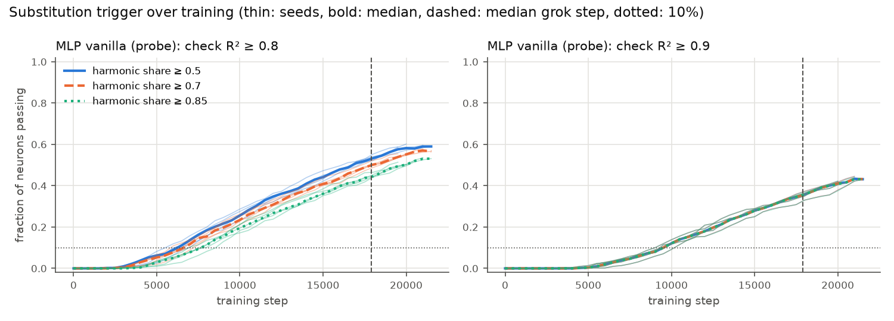

# Online probe and substitution trigger (T3, 2026-11-07)

**Question (go/no-go, pre-registered).** Does a cheap online regression probe flag well-fit neurons early enough for substitution to have room to help? GO if, for at least one (τ_share, τ_r2) pair, on ≥ 4 of 5 seeds, ≥ 10% of neurons pass the trigger before 80% of that seed's grok step.

**Answer: GO.** Every one of the 6 threshold pairs passes on 5/5 seeds. The trigger fires at 36–54% of the grok step (median over seeds).

## Setup
- `GrokMLP` baseline settings (a + b mod 97, 30% train, AdamW lr 1e-3, wd 1.0, full batch). Tuning seeds 100–104, `--stop-after-grok 3000`. Branch `feat/accel`.
- New hook API in `src/quickgrok/accel.py`: `Hook` (`after_backward`, `after_step` that can return a replacement optimizer), `Accelerator` (runs hooks in order), and `ProbeHook`.
- `ProbeHook` runs every 500 steps (from step 0). It feeds **only the training inputs** to the model and splits the training rows 80% fit / 20% check (fixed seed). It fits all 512 hidden neurons by least squares on the trig basis (all frequencies, built once, pseudo-inverse precomputed), using the fit rows only.
- Trigger per neuron: **harmonic share** ≥ τ_share AND **check-split R²** ≥ τ_r2. Harmonic share is the share of explained variance at the top frequency k* plus its harmonics 2k*, 3k*, 4k* (folded mod p). For an ideal 50%-duty square wave this caps at 0.90 with 4 harmonics.

```
uv run python -m quickgrok.train --model mlp --steps 40000 --seed $s --probe-every 500 \
    --stop-after-grok 3000 --out-dir runs/accel_probe/seed$s          # s = 100..104, in parallel
uv run python -m quickgrok.plot_compare --arm "MLP vanilla (probe)" runs/accel_probe/seed10{0..4} \
    --out reports/figures/accel_probe
```

The probe only reads activations. Grokking is unchanged: 99% test accuracy at **17,900 [17,500–18,200]** (seeds 100–104), versus 18,500 [18,200–18,700] for seeds 0–4 without the probe. All 5 runs took 70 s in parallel.

## Overhead
Seed 100, 5,000 steps, process wall clock, 3 interleaved repeats (medians):

| | no probe | probe every 500 | difference |
|---|---|---|---|
| first version | 6.91 s | 8.04 s | **+16%** |
| final version | 7.29 s | 6.85 s | within noise (≤ ~6%) |

- **Cause.** Per probe, `lstsq` (gelsd) took ~50 ms. After each CPU fit, MKL/OpenMP worker threads (20) kept spin-waiting, which slowed the GPU training loop by about as much again.
- **Fix 1.** Precompute `pinv(X_fit)` once in the hook (`fit_neurons(..., features=, pinv=)`); a probe is then a matrix product. Measured in-process: ~30 ms per probe, i.e. ≤ ~6% of the ~475 ms that 500 training steps take. The fits are identical to the lstsq path (max |ΔR²| 2e-16; the design matrix has condition number 3.2).
- **Fix 2.** `train.py` sets `OMP_WAIT_POLICY=PASSIVE` (unless already set) before importing torch. Without it, the spinning alone cost ~0.6 s per 5k steps.

## Lead time
First probe step with ≥ 10% of neurons passing (in brackets: that step / the seed's grok step):

| τ_share | τ_r2 | seed100 | seed101 | seed102 | seed103 | seed104 | median ratio | ratio < 0.8 |
|---|---|---|---|---|---|---|---|---|
| 0.5 | 0.8 | 6,500 (0.37) | 6,000 (0.35) | 7,000 (0.39) | 6,500 (0.36) | 6,500 (0.35) | 0.36 | 5/5 |
| 0.5 | 0.9 | 9,500 (0.54) | 10,000 (0.59) | 10,500 (0.59) | 9,500 (0.52) | 10,000 (0.54) | 0.54 | 5/5 |
| 0.7 | 0.8 | 7,000 (0.40) | 6,000 (0.35) | 7,500 (0.42) | 7,000 (0.38) | 7,000 (0.38) | 0.38 | 5/5 |
| 0.7 | 0.9 | 9,500 (0.54) | 10,000 (0.59) | 10,500 (0.59) | 9,500 (0.52) | 10,000 (0.54) | 0.54 | 5/5 |
| 0.85 | 0.8 | 8,000 (0.46) | 7,000 (0.41) | 9,000 (0.50) | 8,000 (0.44) | 8,000 (0.43) | 0.44 | 5/5 |
| 0.85 | 0.9 | 9,500 (0.54) | 10,000 (0.59) | 10,500 (0.59) | 9,500 (0.52) | 10,000 (0.54) | 0.54 | 5/5 |



## What stands out
- **The trigger fires very early and consistently.** With τ_r2 = 0.8, 10% of neurons pass at step 6–9k. Test accuracy is still ~0% then; it starts to rise around step 7k. The spread across seeds is ±500 steps, about one probe interval.
- **At τ_r2 = 0.9 the share threshold does not matter.** All three τ_share lines coincide: every neuron with check R² ≥ 0.9 already has a harmonic share ≥ 0.87. The R² condition is the binding one. At τ_r2 = 0.8, τ_share does separate the lines.
- **Fewer than 60% of neurons ever pass.** Even 3k steps after grokking, only ~59% (R² ≥ 0.8) or ~43% (R² ≥ 0.9) pass. Early on, many neurons are fit moderately well by a broad mix of frequencies: at step 6.5k (seed 100), median check R² is 0.75 but median harmonic share is only 0.20. No neuron is dead in seed 100. Substitution will replace at most about half the layer, so the rest must keep training.
- **Caveat.** A GO only means there is time to act. Whether substituting these neurons speeds up grokking is the next experiment.
- With 4 harmonics the share of an ideal square wave caps at 0.90, so τ_share = 0.85 sits close to that ceiling. Real neurons are rectangles with even harmonics too, and they reach 0.87+.
