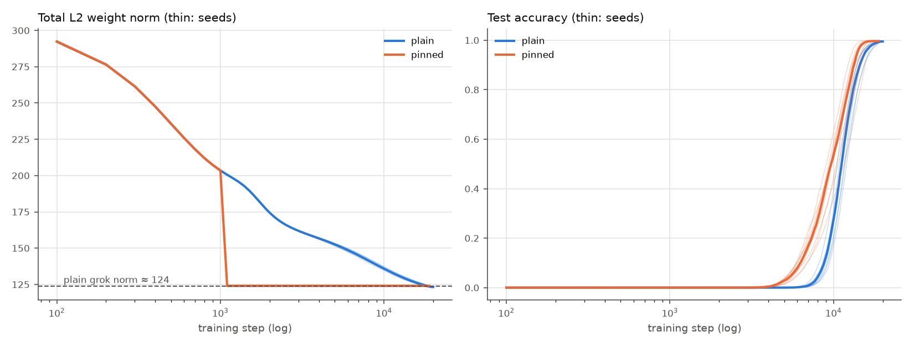
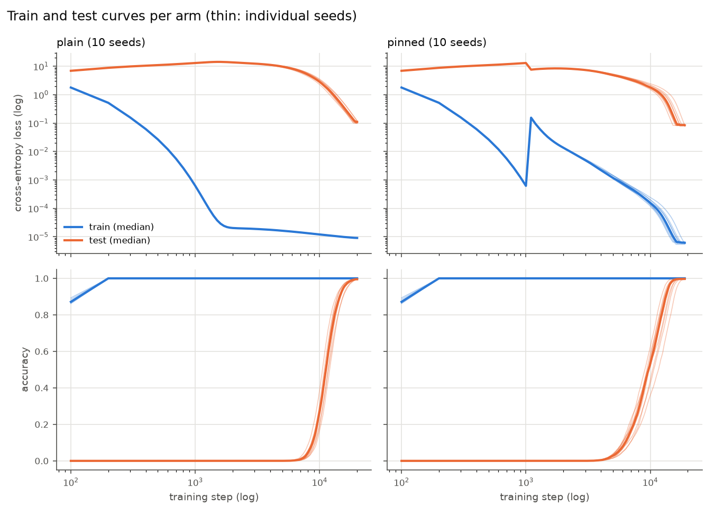

# Pinning the weight norm at its grok value: lever or readout? (2026-11-08)

**Question.** Plain and nowcast MLP runs pass 99% test accuracy at the same total weight norm (~124 at lr 1e-3, wd 1; `nowcast.md`). Does forcing the norm to that value make grokking happen sooner (the norm is a **lever**), or does the network still take about as long (the norm is a **readout**)? The earlier norm-only nowcast control could not tell: it shrank the norm by only ~8%, at norm ~200, and was undone by step 3,000.

Pre-registered in [`preregistration_fix_norm.md`](preregistration_fix_norm.md) (commit fbf16a4, before any non-smoke run). Literature: [`literature_final.md`](literature_final.md). The closest prior work (Khanh et al. 2026, arXiv 2606.13753) reports that pinning at the free grok norm groks "on essentially the free-training timescale".

## Setup

- Untuned MLP (`GrokMLP`, 512 ReLU), a + b mod 97, 30% train, full-batch AdamW lr 1e-3, wd 1, betas 0.9/0.98; seeds 0–9; cap 20,000 steps; evaluation every 100 steps.
- **plain:** no extra flags, re-run fresh. It matches `runs/t6/vanilla` (40k cap) exactly, seed for seed, in test accuracy and weight norm at every logged step.
- **pinned:** `--fix-norm 124 --fix-norm-from 1000`. After every optimizer step from step 1,000 on, all parameters are scaled by one common factor so their total L2 norm is 124. At step 1,000 the plain norm is 203.5, so the first rescale shrinks every weight by 39%. AdamW moments are not reset.
- Metric: first logged step with test accuracy ≥ 99%; two-sided Mann–Whitney U, pinned vs plain.

```bash
uv run python experiments/fix_norm.py run       # 20 runs -> runs/fix_norm/<arm>/seed<s>
uv run python experiments/fix_norm.py figures   # -> reports/figures/fix_norm/
```

## Pre-registered rule

- pinned median ≤ half the plain median AND Mann–Whitney p < 0.01 → "forcing the norm to the grok value advances grokking ≥2× (confounded with logit scale and Adam's effective step size)";
- pinned median within ±15% of plain, or no grok → "readout, not lever";
- anything in between, or pinned runs fail to stay memorised → "inconclusive".

## Result

| Arm | Steps to 99% test acc, per seed | Median [IQR] | Grokked | Memorised from step 2,000 on |
|---|---|---|---|---|
| plain | 18.2k, 18.5k, 17.7k, 19.2k, 18.7k, 17.8k, 18.3k, 17.6k, 19.3k, 18.7k | 18,400 [17,900–18,700] | 10/10 | 10/10 |
| pinned | 15.1k, 15.4k, 15.2k, 16.3k, 15.5k, 15.0k, 16.3k, 14.2k, 16.8k, 17.9k | **15,450 [15,125–16,300]** | 10/10 | 10/10 |

pinned / plain median = **0.84** (16% fewer steps, bootstrap 95% CI of the difference [+9%, +19%]); Mann–Whitney **p = 4.4e-4**. Tables: `figures/fix_norm/decision.md`, `stats.md`, `summary.md`.

**Verdict under the pre-registered rule: inconclusive.** The pinned median is 16% below plain, just outside the ±15% "readout" band and far from the ≤ 0.5× "lever" bar. All pinned runs stayed memorised (train accuracy 100% at every logged step from 1,100 on), so the memorisation clause does not apply.




Medians over seeds at selected steps:

| Step | 1,000 | 1,100 | 3,000 | 5,000 | 10,000 | 15,000 |
|---|---|---|---|---|---|---|
| plain: norm | 203.5 | 200.6 | 161.9 | 152.6 | 135.8 | 127.0 |
| pinned: norm | 203.5 | 124.0 | 124.0 | 124.0 | 124.0 | 124.0 |
| plain: train loss | 6.2e-4 | 3.1e-4 | 1.9e-5 | 1.6e-5 | 1.2e-5 | 1.0e-5 |
| pinned: train loss | 6.2e-4 | 1.6e-1 | 5.0e-3 | 1.2e-3 | 1.6e-4 | 1.2e-5 |
| plain: test acc | 0.00 | 0.00 | 0.00 | 0.00 | 0.27 | 0.93 |
| pinned: test acc | 0.00 | 0.00 | 0.00 | 0.03 | 0.53 | 0.98 |

Test accuracy first passes 10% at step 6,300 (pinned) vs 8,800 (plain), and 50% at 9,750 vs 11,250 (medians).

## Interpretation

- **Reaching the grok norm is not enough to grok.** Pinned runs sit at exactly the norm where plain runs generalise for ~14,000 steps before they reach 99%. Most of the plateau survives: pinned runs still take 84% as many steps. Whatever sets the timescale is mostly not the norm value itself. A likely candidate is the slow reorganisation of the weights' *direction* (feature learning) that weight decay drives, which matches the nowcast result that moving along the forecast direction helps and rescaling alone does not.
- **The norm has some effect, which is why the verdict is "inconclusive" and not "readout".** Test accuracy starts rising ~2,500 steps sooner and the median grok is 2,950 steps sooner, consistently (every pinned seed beat the plain median, and 9/10 beat the fastest plain run). The rule's ±15% band was set in advance and the result lands 1 point outside it. In plain words: a modest lever at most, much smaller than what tuning lr does (doubling lr gives 2×).
- **Agrees with the literature.** Khanh et al. 2026 (arXiv 2606.13753) also report that pinning at the free grok norm groks on about the free-training timescale. Their strong effect comes from pinning *away* from that norm (above it slows grokking exponentially). This experiment does not test that direction.

## Confounds (stated in the pre-registration)

- **Logit scale.** The MLP is roughly 2-homogeneous in its weights, so the 39% shrink cuts the logits by ~63%. The train loss jumps from 6e-4 to 0.16 and takes until ~15k steps to return to plain's level. For most of the run the pinned network is in a higher-loss, lower-margin regime, so its gradients differ from plain's for that reason too.
- **Adam's effective step size.** Adam's update size does not depend on the weight scale, so at norm 124 each step is a larger relative change than at plain's 150–200 (about 1.2–1.6× over the plateau). Some or all of the 16% could be this "larger effective learning rate" rather than the norm being "right".
- **No weight-decay drift.** Once pinned, weight decay cannot shrink the norm and acts only on direction.

These pull in different directions, and this experiment cannot separate them. They do not change the main reading: holding the norm at the right value for 14k steps still left most of the plateau.

## Limits

- One task (a + b mod 97), one MLP width, one setting (untuned lr 1e-3, wd 1), one pin value (124) and one start step (1,000), 10 seeds.
- Pins below 124, pins starting later, or pinning per layer were not tried.

Compute: 20 runs, 10 at a time, 174 s wall-clock on the GPU (~3 GPU-minutes; 28 run-minutes summed), plus one 200-step smoke run.
