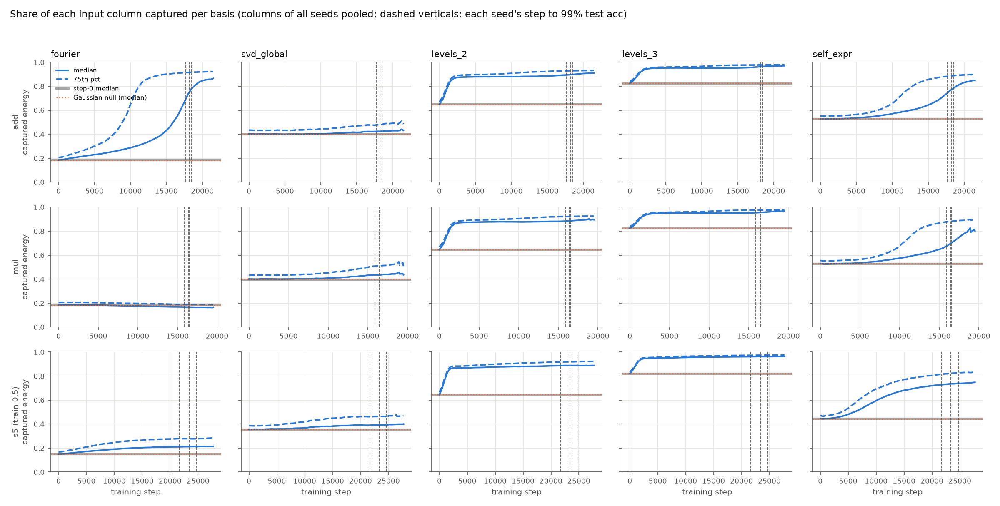
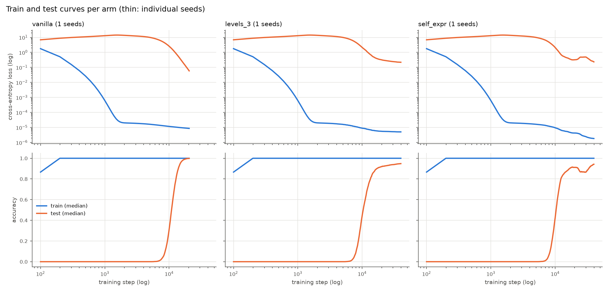
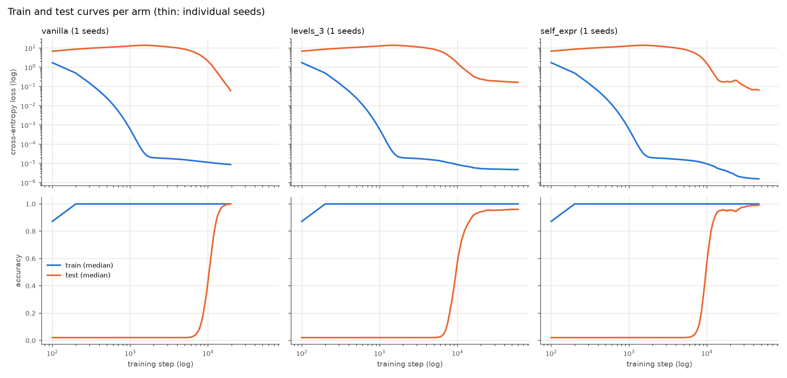
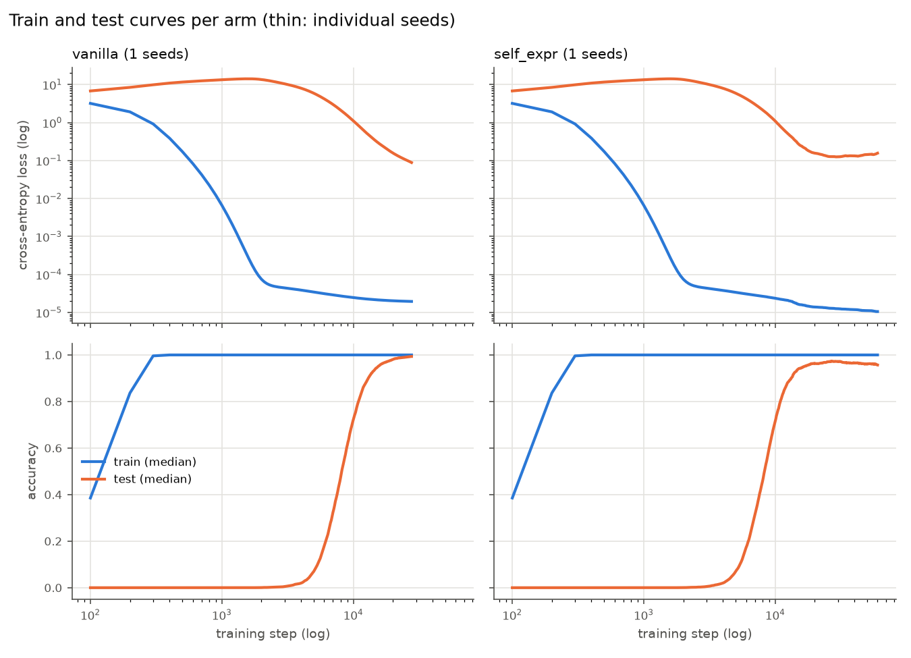
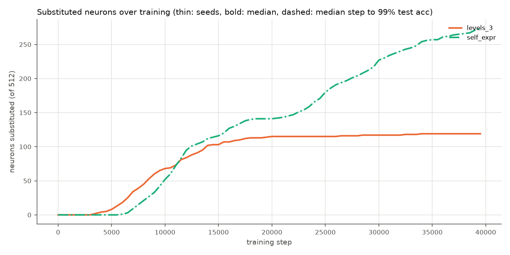

# Generic substitution bases (G1, G1b, self_expr look; 2026-11-07)

**Question.** T6 showed that constraining a triggered neuron's incoming weights to a few Fourier harmonics makes the MLP grok ~41% sooner on a + b mod 97. But random frequencies still gave +33%, so most of the effect may be prior knowledge: we told the method the inputs are cyclic. Can the method instead choose the shape of each neuron's incoming weights from a library, including options that know nothing about the task, and does that still help on tasks where clock waves in a and b are the wrong shape (a·b mod 97, composition in S5)?

**Answer so far: no.** None of the task-agnostic bases tried here helps.
- The global-SVD basis never captures enough of a column to trigger.
- The two data-driven bases that do trigger (levels, self_expr) both end *below* vanilla. They freeze a structure that is still changing.
- The one basis that helps on add (`auto`, +30% on one seed) helps because it chooses the Fourier basis for 116 of 117 neurons.

Everything after the vanilla regimes is single-seed (seed 100) or offline analysis. These are feasibility looks, not effect-size estimates.

## Setup
- `GrokMLP`: 512 ReLU neurons, pre-activation U[a, i] + V[b, i] + bias_i. Full-batch AdamW (lr 1e-3, wd 1.0, betas 0.9/0.98). All runs use `--model mlp --probe-every 500 --stop-after-grok 3000`. Branch `feat/generic-basis`.
- **Tasks.**
  - add, mul: a op b mod 97.
  - s5 (new in `data.py`): the 120 permutations of 0..4 in `itertools.permutations` order. Token ids 0..119, "=" is 120, answer = index of a∘b, the permutation x ↦ a(b(x)). `p` is set to 120 automatically.
  - Even n is now handled everywhere: frequencies run 1..n//2, and the Nyquist sin column is zero.
- **Substitution** (`SubstitutionHook`, `--substitute module`). A triggered neuron's columns u_i, v_i are replaced by `basis @ coef` with trainable coefficients, a snapshot basis fixed at trigger time.
  - `--basis probe` is the unchanged T6 behaviour: harmonics of the activation fit's k*, trigger on harmonic share and check R². It was checked byte-identical against the previous code on a CPU run.
  - Every other basis uses one generic trigger: captured energy ≥ τ_e (`--tau-energy`) AND check R² ≥ τ_r2.
  - **Captured energy** = ‖P[u_i, v_i] − mean‖² / ‖[u_i, v_i] − mean‖², with P the least-squares projection onto the basis.
  - **Check R²** compares the neuron's activation with its activation after projecting u_i and v_i. It uses the 20% check split of the **training rows only** (tested).

```
# vanilla regimes (seeds 100-102)
uv run python -m quickgrok.train --model mlp --probe-every 500 --stop-after-grok 3000 \
    --op mul --train-frac 0.3 --steps 60000 --seed $s --out-dir runs/g1/mul_vanilla/seed$s
#   s5: --op s5 --train-frac 0.3 (and 0.5) --steps 60000 -> runs/g1/s5_vanilla[_tf0.5]/seed$s
uv run python -m quickgrok.plot_compare --arm vanilla_tf0.3 runs/g1/s5_vanilla/seed10{0,1,2} \
    --arm vanilla_tf0.5 runs/g1/s5_vanilla_tf0.5/seed10{0,1,2} --out reports/figures/g1/s5   # same for mul

# substitution looks (seed 100), common: --model mlp --probe-every 500 --stop-after-grok 3000 --substitute module --seed 100
add, G1:        --op add --steps 40000 --basis auto|svd --tau-energy 0.8 --tau-r2 0.8
levels_3:       --op add|mul --steps 40000|60000 --basis levels_3 --tau-energy 0.975 --tau-r2 0.8
self_expr:      --op add|mul --steps 40000|60000 --basis self_expr --tau-energy 0.8 --tau-r2 0.8
                --op s5 --train-frac 0.5 --steps 60000 --basis self_expr --tau-energy 0.8 --tau-r2 0.8
# output: runs/g1/<task>_module_<basis>/seed100; vanilla seed-100 references: runs/accel_probe/seed100 (add),
# runs/g1/mul_vanilla/seed100, runs/g1/s5_vanilla_tf0.5/seed100

# offline capture analysis (CPU, ~4 min; --cached replots)
uv run python scripts/basis_capture.py
```

Compute:
- 11 vanilla and G1 runs: 4.6 min wall-clock, 10 in parallel on the RTX 5080.
- 2 levels runs: ~4 min.
- 3 self_expr runs: ~10 min. s5 with self_expr is the slowest, because of the per-probe matching pursuit and the 481-column probe fit.

## Vanilla regimes (seeds 100–102)

| Task | Train frac | Train acc ≥ 99% | Test acc ≥ 95% | Test acc ≥ 99% |
|---|---|---|---|---|
| add (T6, seeds 0–9) | 0.3 | 200 | 15,650 [15,200–15,875] | 18,400 [17,900–18,700] (10/10) |
| mul | 0.3 | 200 | 14,200 [14,100–14,200] | 16,400 [16,150–16,450] (3/3) |
| s5 | 0.3 | 200 | — | never within 60k (test acc 3–5% at 60k) (0/3) |
| s5 | 0.5 | 300 | 15,400 [15,400–15,650] | 23,400 [22,550–24,050] (3/3) |

- mul groks like add. s5 needs half of the table.
- The T6 probe trigger (harmonic share in a and b) never fires on mul or s5: 0% of neurons at any τ. Both tasks are therefore genuinely outside what the Fourier prior can see.

Figures: `figures/g1/mul/`, `figures/g1/s5/`.

## Basis library (`accel.py`)
Every basis is per neuron, built from the current effective weights only. Columns are scaled to RMS 1.

| Name | Directions | Built from | Knows the task? |
|---|---|---|---|
| `fourier` | constant + cos/sin of 4 harmonics of the k that maximises the captured energy (from the columns' DFT) | the neuron's two columns | yes: assumes cyclic symbols |
| `poly` | Legendre polynomials of degree 0–8 in the symbol index | nothing | assumes ordered symbols |
| `svd` | constant + the 8 left singular vectors of the mean-removed [U, V] that capture u_i, v_i most | all columns | no |
| `random` | constant + 8 random orthonormal directions (seeded per run and neuron) | nothing | control |
| `auto` | per neuron the best of {svd, fourier, poly} by captured energy (ties → svd) | as above | through `fourier` |
| `levels_2/3` | indicators of the optimal 1-D k-means groups of the column's values (separately for u_i and v_i) | the column | no; invariant to relabelling the symbols |
| `self_expr` | constant + 8 *other* neurons' columns of the same matrix, picked by greedy orthogonal matching pursuit (u_i from U, v_i from V), orthonormalised | all columns | no |

Tested (`tests/test_basis.py`):
- shapes, rank and the constant column;
- exact capture of a harmonic, a cubic, a low-rank matrix, an L-valued column and a column in the span of 3 others;
- `auto`'s choice, seeding, and that the check R² uses only training check rows;
- the S5 table: 14,400 entries, identity, inverses, associativity.

## G1 on add: `auto` and `svd` (seed 100, τ_e = τ_r2 = 0.8)
- **auto:** 99% at **12,300**. Vanilla seed 100: 17,500; the T6 probe-basis module, same seed: 10,200–11,200.
  - 117 neurons were substituted, from step 3,500.
  - `auto` chose `fourier` for 116 of them and `poly` for one. The weight-DFT k agreed with the activation probe's k* for 113 of 116.
  - So `auto` is the Fourier prior again, found through the weights instead of the activations.
- **svd:** 0 neurons substituted, so it is effectively vanilla (99% at 17,500). See the next section.

## Offline capture analysis (G1b)
For every checkpoint of the vanilla runs, we measured the share of each mean-removed input column (u and v separately) captured by each basis.
- Runs: add = T6 seeds 0–2, mul = seeds 100–102 at 0.3, s5 = seeds 100–102 at 0.5.
- **Nulls:** the step-0 checkpoint, and Gaussian matrices of the same shape.
- **Skill** = (capture − null) / (1 − null), against the Gaussian null's median. Step-0 values equal the null everywhere.
- Cells: median over seeds of the median over columns. This is a full-grid analysis of weights, not of data rows.

| Task | Basis | Gaussian null | 50% of grok | 80% of grok | End |
|---|---|---|---|---|---|
| add | fourier | 0.18 | 0.27 (+0.11) | 0.41 (+0.28) | 0.86 (+0.83) |
| add | svd_global | 0.40 | 0.40 (+0.00) | 0.41 (+0.02) | 0.43 (+0.05) |
| add | levels_2 | 0.65 | 0.88 (+0.66) | 0.88 (+0.67) | 0.91 (+0.74) |
| add | levels_3 | 0.82 | 0.95 (+0.73) | 0.95 (+0.73) | 0.97 (+0.83) |
| add | self_expr | 0.53 | 0.56 (+0.07) | 0.64 (+0.23) | 0.85 (+0.68) |
| mul | fourier | 0.18 | 0.18 (−0.00) | 0.17 (−0.02) | 0.16 (−0.02) |
| mul | svd_global | 0.40 | 0.40 (+0.01) | 0.42 (+0.03) | 0.45 (+0.07) |
| mul | levels_2 | 0.65 | 0.88 (+0.65) | 0.88 (+0.66) | 0.90 (+0.71) |
| mul | levels_3 | 0.82 | 0.95 (+0.72) | 0.95 (+0.72) | 0.97 (+0.82) |
| mul | self_expr | 0.53 | 0.56 (+0.06) | 0.61 (+0.17) | 0.81 (+0.60) |
| s5 (train 0.5) | fourier | 0.15 | 0.19 (+0.05) | 0.21 (+0.07) | 0.21 (+0.07) |
| s5 (train 0.5) | svd_global | 0.36 | 0.38 (+0.03) | 0.39 (+0.05) | 0.40 (+0.06) |
| s5 (train 0.5) | levels_2 | 0.65 | 0.88 (+0.65) | 0.88 (+0.67) | 0.89 (+0.69) |
| s5 (train 0.5) | levels_3 | 0.82 | 0.96 (+0.76) | 0.96 (+0.78) | 0.96 (+0.79) |
| s5 (train 0.5) | self_expr | 0.44 | 0.62 (+0.31) | 0.71 (+0.48) | 0.74 (+0.54) |

Cells: raw capture (skill).



`fourier` behaves as expected:
- On add it rises towards 0.86 around the grok step.
- On mul it stays exactly at its null, because the structure is cyclic in the discrete log, not in a.
- On s5 it barely moves.

**Pre-registered rule.** A basis is a "generic winner" if, on both mul and s5, its median skill at 80% of the grok step is ≥ 0.3 above step 0 and clearly above its null.
- levels_2 and levels_3 pass; levels_3 has the larger gain.
- self_expr passes on s5 but not on mul (+0.17).
- svd_global and fourier fail.

## The levels result: an optimizer artefact the rule could not see
- **What changes.** Within the first ~2,000 steps, at memorisation, on every task including add, the input columns become nearly two-valued.
  - At step 8,000 on add (seed 0), the median column kurtosis is 1.3. It is 2.8 at initialisation; a two-point distribution has 1.0, a sampled cosine 1.5.
  - The best two-group split is balanced: ~46 vs ~51 symbols.
  - The levels capture therefore jumps from its null (0.65/0.82) to ~0.88/0.95 and then stays flat until grokking, on all three tasks.
- **Why the rule was fooled.** The effect is the same on add, where the true structure is known to be Fourier waves. So it is a property of the training dynamics, probably AdamW's sign-like updates pushing weights towards ± equal magnitudes (not tested), and not task structure. The rule only compares against a Gaussian null and step 0. It cannot tell "structure the task needs" from "structure the optimizer imposes everywhere". A future rule needs a task control, for example the same statistic on add with shuffled labels or on a task with known structure, and a stability criterion.
- **The groupings are not stable.** For each column, we compared the two-group partition with the final one (fraction of symbols on the same side, maximised over swapping the labels; chance ≈ 0.54):
  - 0.70 at step 2,000;
  - 0.81–0.85 at ~8,000;
  - 0.93–0.96 at ~80% of the grok step.

  The two-valued shape appears early, but which symbols share a value keeps changing until grokking.
- **Single-seed look** (implemented as `--basis levels_3`, seed 100). τ_e = 0.975 was chosen offline so that ~13–35% of neurons would pass before 80% of grok.

| Task | Arm | 50% | 90% | 95% | 99% | Final test acc | Substituted |
|---|---|---|---|---|---|---|---|
| add | vanilla | 10,900 | 13,900 | 14,900 | 17,500 | 99.8% | — |
| add | levels_3 | 10,400 | 17,000 | — | — | 94.8% (40k) | 119, from step 3,500 |
| mul | vanilla | 10,400 | 13,100 | 14,200 | 16,500 | 99.9% | — |
| mul | levels_3 | 9,600 | 15,200 | 22,400 | — | 96.0% (60k) | 121, from step 2,500 |

Each substituted column is frozen into a 3-valued step function over a grouping taken at trigger time, which is mostly before the grouping has settled. Test accuracy rises slightly earlier, then plateaus below 99% for the rest of training. Train-loss jumps at the swaps were tiny (×1.01 median, ×1.03 max). **Levels is rejected as a substitution basis.** It stays in the code for analysis.

## Global SVD: a negative result
- **On add after grokking,** the singular spectrum of the mean-removed [U, V] is flat. The top 8 of 96 directions hold only 12% of the energy at step 20.5k, about the same as at step 1,000.
- **Why.** The neurons use many different frequencies (44 distinct k among the 116 neurons `auto` substituted on seed 100; T6 found a near-uniform k distribution), so no small shared subspace exists. Nearly-equal singular values then mix frequencies freely: a top singular vector has only 10–67% of its energy at its main frequency (median 12% beyond the top 20).
- **Effect on the basis.** Per-neuron svd capture stays at 0.31 → 0.36 (90th percentile 0.49) on add, while the median neuron has 85% of its energy in 4 harmonics of one k. mul and s5 look the same.
- **Bias in `auto`.** At initialisation svd already captures 0.31 against 0.15 for fourier and 0.08 for random, because it picks its best 8 of 96 directions. `auto` is therefore biased towards svd before any structure exists.
- **Conclusion.** A single shared low-dimensional subspace is the wrong model for these networks. A data-driven basis must be per neuron or per group of neurons.

## self_expr single-seed look
self_expr is the per-neuron data-driven basis whose capture rises with generalisation on every task: late on add and mul, early on s5. Implemented as `--basis self_expr`.

τ_e per task: the check-R² gate binds. For any τ_e ≤ 0.8, the offline share of neurons that would pass before 80% of grok plateaus at 24% (add), 21% (mul) and 18% (s5); above 0.85 it drops. So **τ_e = 0.8 for all three**, τ_r2 = 0.8.

| Task | Arm | 50% | 90% | 95% | 99% | Final test acc | Substituted (cumulative at 5k / 10k / 15k / 20k → end) |
|---|---|---|---|---|---|---|---|
| add | vanilla | 10,900 | 13,900 | 14,900 | 17,500 | 99.8% | — |
| add | self_expr | 10,400 | 16,700 | — | — | 94.2% (40k) | 0 / 52 / 116 / 141 → 273 |
| mul | vanilla | 10,400 | 13,100 | 14,200 | 16,500 | 99.9% | — |
| mul | self_expr | 9,700 | 12,600 | 14,600 | 43,500 | 99.1% (46.5k) | 2 / 44 / 123 / 170 → 330 |
| s5 (0.5) | vanilla | 8,200 | 13,000 | 15,400 | 24,700 | 99.3% | — |
| s5 (0.5) | self_expr | 8,300 | 13,300 | 16,600 | — | 95.7% (60k) | 7 / 14 / 69 / 92 → 140 |

- Train-loss jumps at the swaps are small: median ×1.00–1.02, max ×1.15–1.20, at train loss ~1e-5.
- Energy at trigger has median 0.85, check R² median 0.82.






Reading:
- self_expr is neutral to slightly ahead up to ~90% test accuracy on mul (12,600 vs 13,100) and on par on s5. It then stalls in the mid-90s on all three tasks.
- mul eventually reaches 99%, but 2.6× later than vanilla.
- The number of substituted neurons up to 80% of the vanilla grok step (~110 on add and mul) roughly matches the offline 20–25% estimate. After that, substitution keeps going (273–330 neurons by the end): frozen neurons make their neighbours easier to express.
- **Likely mechanism**, the same as for levels: the basis is a snapshot of other neurons' columns taken before they have settled. Freezing a neuron into that span removes the freedom it needs for the last stretch of generalisation.

**Limits.**
- One seed per arm, and GPU runs are not bit-reproducible (~10% grok-step jitter). The plateaus are large and consistent across three tasks, but the early-milestone differences (a few hundred steps) are within noise.
- One width, one optimizer setting, τ_r2 fixed at 0.8, τ_e set from the offline numbers.
- Every basis here is a frozen snapshot. A basis that is refreshed while training continues (re-fitting the span or the grouping at each probe) was not tried.
