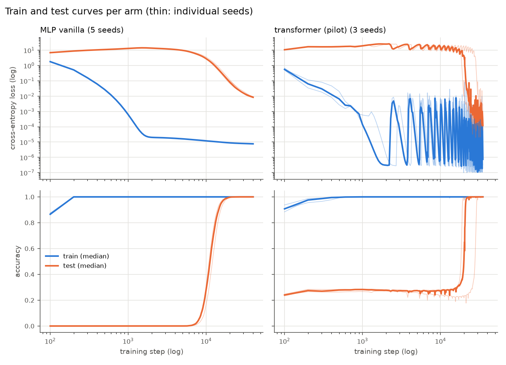
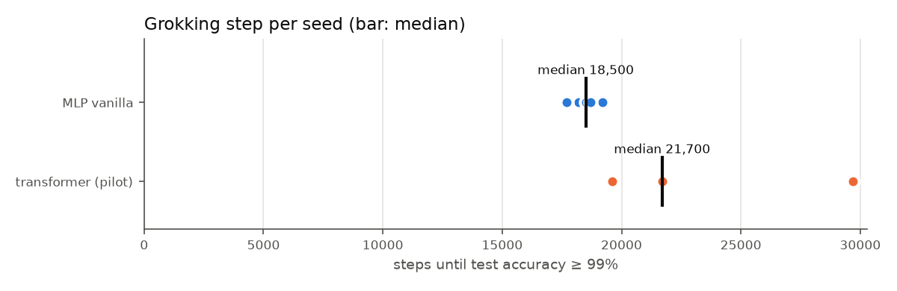
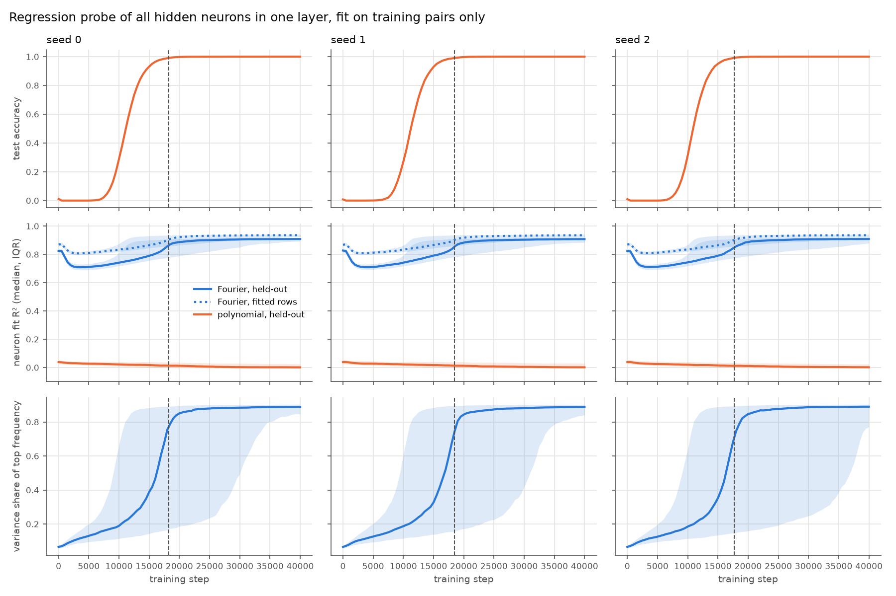
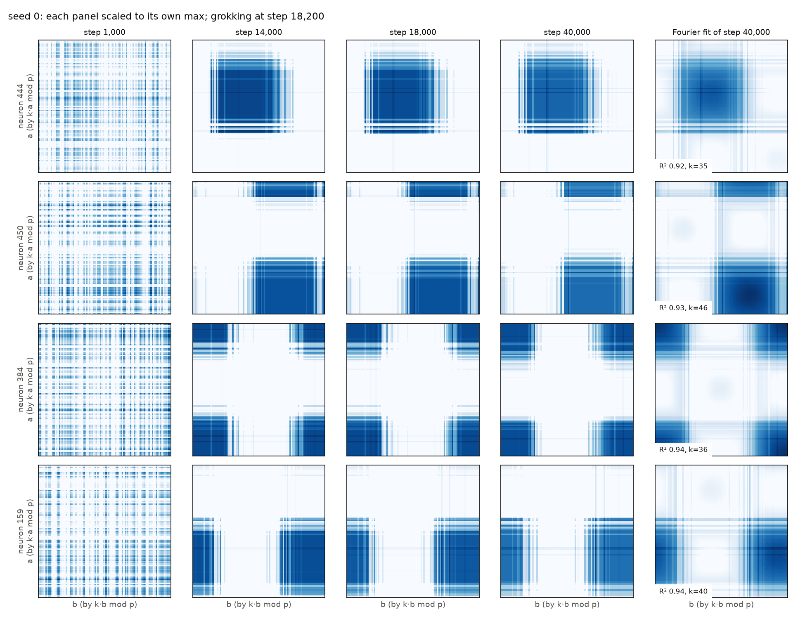

# MLP baseline (T2, 2026-11-07)

**Setup.** `GrokMLP`: one-hot a and b feed one hidden layer of 512 ReLU neurons (pre-activation U[a] + V[b] + bias), then a linear readout to 97 logits. Task: a + b mod 97, 30% of pairs for training. Full-batch AdamW, lr 1e-3, wd 1.0, betas (0.9, 0.98), 40k steps, seeds 0–4. These are the pilot's settings, unchanged. Branch `feat/mlp-baseline`. 5 seeds ran in parallel in 1.5 min on the RTX 5080.

```
uv run python -m quickgrok.train --model mlp --steps 40000 --seed $s --out-dir runs/mlp_baseline/seed$s
uv run python -m quickgrok.plot_compare --arm "MLP vanilla" runs/mlp_baseline/seed{0..4} \
    --arm "transformer (pilot)" runs/pilot/seed{0..2} --out reports/figures/mlp_baseline
uv run python -m quickgrok.plot_pilot runs/mlp_baseline/seed{0,1,2} --layer 0 --out reports/figures/mlp_baseline/probe
```

## Choosing the regime
Single-seed exploration over 30k steps:

| Train fraction | Weight decay | Test acc ≥ 99% |
|---|---|---|
| 0.3 | 1.0 | between 15k and 20k |
| 0.3 | 0.3 | between 20k and 25k |
| 0.4 | 1.0 | between 5k and 10k |
| 0.5 | 1.0 | before 5k |

At 40–50% training data the delay mostly disappears. We keep the pilot's 0.3 / 1.0.

## Result: a clear and very consistent grokking delay

| Arm | Runs | Train acc ≥ 99% | Test acc ≥ 95% | Test acc ≥ 99% |
|---|---|---|---|---|
| MLP vanilla | 5 | 200 [200–200] (5/5) | 15,600 [15,500–15,700] (5/5) | 18,500 [18,200–18,700] (5/5) |
| transformer (pilot) | 3 | 400 [350–450] (3/3) | 21,100 [20,150–25,100] (3/3) | 21,700 [20,650–25,700] (3/3) |

Cells: median [IQR] step (reached / total).




- The MLP fits the training set by step 200 and reaches 99% test accuracy ~90× later. Checkpoint 1's "≥ 5× later" holds on 5/5 seeds.
- **Noise floor:** the seed IQR is only 500 steps (18.2k–18.7k), versus 5k for the transformer. A speed-up of ~1k steps or more is therefore detectable with 5–10 seeds. The MLP is a much better test bed.
- Unlike the transformer, test accuracy on the plateau is **0%**, not ~27%: separate input weights for a and b give no shortcut from a + b = b + a. The rise is also smoother, starting around step 7k rather than as a sudden jump.

## Probe: MLP neurons are square waves, not cosines




- With a and b reordered by k·x mod p, each grokked neuron is a **rectangle**: it fires when both a and b fall inside an interval. The input weights U[:, i] and V[:, i] are square-wave-like in k·x mod p. This matches Swaroop (2026) for ReLU MLPs and differs from the smooth bumps in the transformer.
- The single-frequency Fourier fit therefore plateaus lower: held-out R² ≈ 0.91 and top-frequency share ≈ 0.89 after grokking, versus 0.97 for the transformer. The missing variance sits in harmonics of k (3k, 5k, … mod p), which the share metric counts as other frequencies.
- **Structure forms early and per neuron.** The rectangles are fully formed by step 14k (test acc ~0.85) and look almost the same at 40k. The top-frequency share has a wide spread across neurons: the upper quartile reaches ~0.85 by step ~11k, before test accuracy reaches 0.5, while the lower quartile is still rising at 40k. Some neurons are ready to substitute long before others, which supports per-neuron substitution.

## Consequences for the plan
- **Checkpoint 1 met:** clear delay, and the noise floor is recorded (IQR 500 steps).
- **(A) module:** a single cosine per neuron is mis-specified for the ReLU MLP. The module should use a truncated Fourier series over harmonics of k (trainable amplitude and phase per harmonic), or a smooth square-wave parametrisation.
- **Trigger:** the share should count harmonics of k (k, 2k, 3k, … mod p) together, otherwise square-wave neurons never pass a high threshold.
