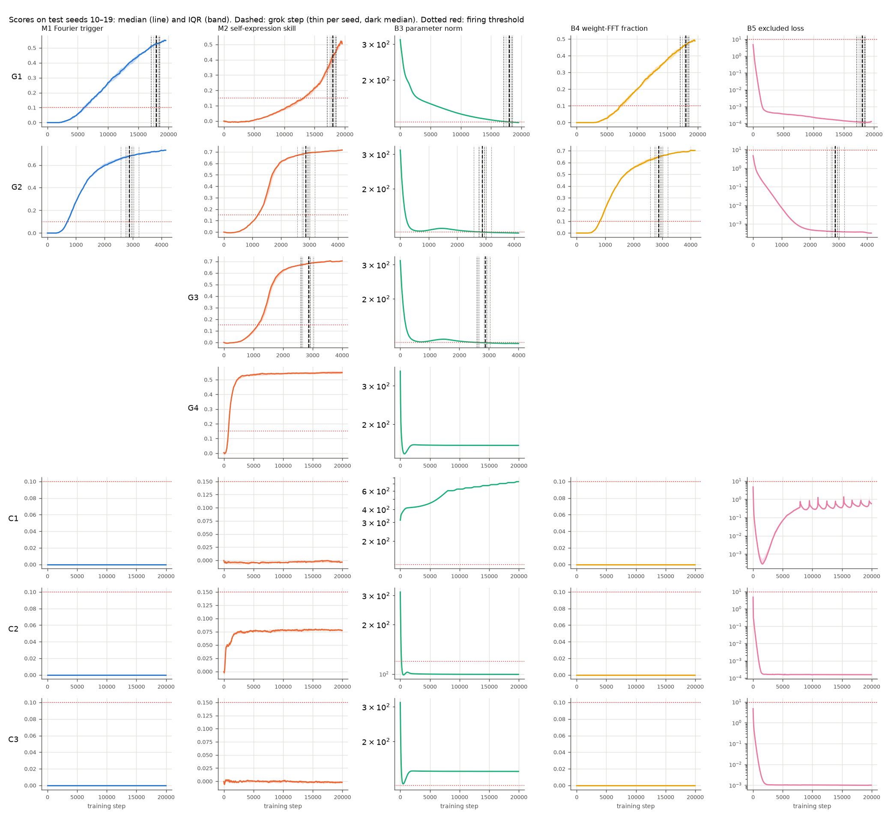
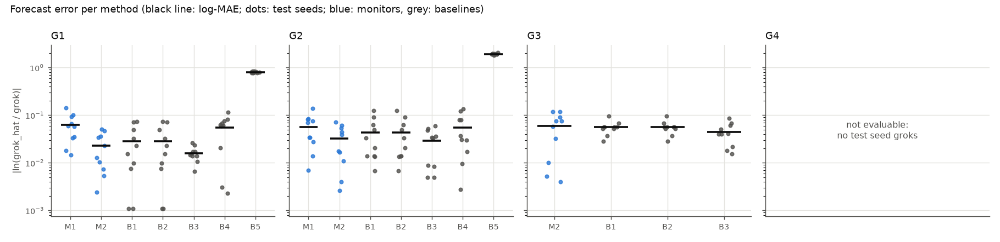

# Monitor kill test: results (2026-11-07)

Pre-registration: [`preregistration_monitor.md`](preregistration_monitor.md) (commit b190967, made before any run and left unedited). This report applies its rules. Everything that departs from it, or that it left open, is listed under **Deviations**.

## Verdict

**Neither monitor passes. Per the pre-registered decision: write "What survives a tuned baseline in grokking research" as a blog post, keep the teaching material, and stop the project.**

- **M1 (Fourier trigger): FAIL.** It has no false alarms and leads well, but its forecasts lose to the weight-norm baseline B3 on G1 and G2 (log-MAE 0.062 vs 0.016 and 0.057 vs 0.029). It also loses to B1/B2 on both arms.
- **M2 (self-expression): FAIL.** It has no false alarms, leads on G2 and G3, and passes the Spearman criterion on G3 and G4. It fails the forecast criterion on every evaluable arm: B3 beats it on G1 (0.023 vs 0.016), G2 (0.032 vs 0.029) and G3 (0.059 vs 0.044). It also fails the lead criterion on G4, because no G4 seed ever groks. The verdict is FAIL with or without the G4 checks.
- **The total parameter norm (B3)** is the cheapest baseline and also the best forecaster on all three evaluable arms. It needs no probing at all.

## Setup and commands

Branch `exp/monitor-killtest`. Every run uses the one-hidden-layer `GrokMLP` (512 ReLU neurons) with full-batch AdamW, betas (0.9, 0.98). Each run was launched as:

```bash
OMP_NUM_THREADS=2 uv run python -m quickgrok.train --model mlp --eval-every 20 --save-every 1000 \
    --stop-after-grok 1000 --monitor-every 50 $ARM_FLAGS --seed $s --out-dir runs/killtest/$ARM/seed$s
```

| Arm | `$ARM_FLAGS` | Seeds |
|---|---|---|
| G1 | `--op add --train-frac 0.3 --lr 1e-3 --weight-decay 1.0 --steps 40000` | 0–9, 10–19 |
| G2 | `--op add --train-frac 0.3 --lr 4e-3 --weight-decay 2.0 --steps 20000` | 0–9, 10–19 |
| G3 | `--op mul --train-frac 0.3 --lr 4e-3 --weight-decay 2.0 --steps 20000` | 0–9, 10–19 |
| G4 | `--op s5 --train-frac 0.5 --lr 4e-3 --weight-decay 2.0 --steps 20000` | 0–9, 10–19 |
| C1 | `--op add --train-frac 0.3 --lr 4e-3 --weight-decay 0.0 --steps 20000` | 10–19 |
| C2 | `--op add --train-frac 0.1 --lr 4e-3 --weight-decay 2.0 --steps 20000` | 10–19 |
| C3 | `--op add --train-frac 0.3 --lr 4e-3 --weight-decay 2.0 --steps 20000 --random-labels` | 10–19 |

Ten processes ran in parallel on one RTX 5080, launched with `xargs -P 10`. The order was: a pre-flight with seed 100, then all calibration seeds (0–9), then all test seeds (10–19). The evaluation script was committed (4846fdf) after the calibration runs and before any test-seed output was read. It was first checked on calibration data copied in as stand-in test seeds.

```bash
uv run python scripts/eval_monitor_killtest.py   # tables + figures -> reports/figures/monitor_killtest/
```

**GPU time.** Wall-clock with 10 processes sharing the GPU: pre-flight 458 s (5 runs), calibration 1,372 s (40 runs), test 3,109 s (70 runs). **Total 4,939 s ≈ 82 min, inside the 90-minute budget.** Summed process time was 46,250 s. The runs are CPU-bound by the monitor: the GPU sat at about 50% utilisation.

## Merge notes (step 1)

- `origin/exp/nowcast` and `origin/feat/generic-basis` were already ancestors of `exp/monitor-killtest`, through PRs #6 and #7 into `main`. Merging them was a no-op.
- `origin/exp/tuned-retest` merged without conflicts (3dea2c0). Its changes to `train.py` (the `--nowcast-snapshot-every` flag) sit in different hunks from generic-basis's flags, and git combined them automatically. It does not touch `accel.py`. All flags and behaviour from all three branches are present.
- Checks after the merge:
  - all five `tests/test_*.py` scripts and the `quickgrok.data` self-check pass;
  - 200-step smoke runs of `--op add`, `--op mul` and `--op s5` pass;
  - a smoke run combining `--substitute module --basis self_expr` with `--nowcast linear --nowcast-snapshot-every 20` on mul writes all three logs.

## What was implemented (step 2)

- **`--random-labels`** (`train.make_tensors`/`permute_labels`): the training targets are permuted with `torch.randperm`, seeded by the run seed. Test inputs and test labels are untouched.
- **`MonitorHook`** (`src/quickgrok/monitor.py`, a `ProbeHook` subclass, `--monitor-every 50`). It writes one line to `monitor.jsonl` per probe, from the training rows only:
  - **M1:** `ProbeHook.probe` on hidden layer 0, with its 80/20 fit/check split of the training rows. The score is the fraction of all 512 neurons with harmonic share (4 harmonics) ≥ 0.5 and check R² ≥ 0.8. Dead neurons count as not passing. Computed on add tasks only.
  - **M2:** for every column of U and of V (1,024 columns, mean removed), the capture by `self_expr_basis` (greedy OMP over q = 8 other columns of the same matrix) through `captured_energy`, exactly as `scripts/basis_capture.py` does. The Gaussian null is the median capture on Gaussian matrices of the same shape, computed once per run. The score is the median of (capture − null) / (1 − null).
  - **B3:** the L2 norm of all effective parameters, computed with the same formula as `metrics.json`'s `weight_norm`.
  - **B4:** `make_basis("fourier", …)` with m = 9 (4 harmonics), then `captured_energy` of each neuron's (u, v) pair. The score is the fraction of neurons with energy ≥ 0.8. No data is used. Add only.
  - **B5:** see the Deviations section. Add only.
- **Per-call cost** of the hook: 0.21 s on add (all five scores) and 0.12 s on s5 (M2 and norm) for a single process. In the actual runs, with 10 processes sharing the CPU, the median was 1.3–1.4 s per call. M2's OMP accounts for most of it. Over a typical 4,000-step G2 run that is 80 calls.
- **`scripts/eval_monitor_killtest.py`** implements the firing rules, the calibration, the forecasts, log-MAE, the lead criterion, the false-alarm counts, the Spearman criterion and the verdict. The firing rule (`fire_step`) and `log_mae` live in `quickgrok.monitor` and are tested in `tests/test_monitor.py`, together with the random-label permutation and the excluded loss.

## Results (step 3)

Calibration seeds 0–9 fit the constants below. Every number in the criterion tables comes from test seeds 10–19. The tables are copied from [`figures/monitor_killtest/tables.md`](figures/monitor_killtest/tables.md), which the script writes.

### Grok steps (first eval step with test acc ≥ 99%)

| Arm | Split | Grokked | Median | Min–max |
|---|---|---|---|---|
| G1 | calib | 10/10 | 18,380 | 17,560–19,300 |
| G1 | test | 10/10 | 18,030 | 17,060–18,560 |
| G2 | calib | 10/10 | 2,920 | 2,440–3,140 |
| G2 | test | 10/10 | 2,880 | 2,580–3,200 |
| G3 | calib | 10/10 | 2,760 | 2,420–3,120 |
| G3 | test | 10/10 | 2,880 | 2,580–3,040 |
| G4 | calib | 0/10 | — | — |
| G4 | test | 0/10 | — | — |
| C1 | test | 0/10 | — | — |
| C2 | test | 0/10 | — | — |
| C3 | test | 0/10 | — | — |

### Calibration constants (seeds 0–9; controls use G2's)

| Arm | c (B1) | clock (B2) | B3 norm threshold | r M1 (n) | r M2 (n) | r B3 (n) | r B4 (n) | r B5 (n) |
|---|---|---|---|---|---|---|---|---|
| G1 | 18.380 | 18,380 | 123.86 | 3.00 (10) | 1.38 (10) | 1.00 (10) | 2.49 (10) | — (0) |
| G2 | 23.360 | 2,920 | 119.41 | 3.97 (10) | 2.41 (10) | 1.00 (10) | 3.49 (10) | — (0) |
| G3 | 22.080 | 2,760 | 118.45 | n/a | 2.26 (10) | 0.99 (10) | n/a | n/a |
| G4 | — | — | — | n/a | — (0) | — (0) | n/a | n/a |

(n) = calibration seeds behind r; — = undefined (never fired / never grokked).

### Criterion 1: false alarms (test seeds; fires at any probe step; pass ≤ 1/10)

| Control | Grokked (excluded) | M1 | M2 | B3 | B4 | B5 |
|---|---|---|---|---|---|---|
| C1 (wd 0) | 0 | 0/10 | 0/10 | 0/10 | 0/10 | 1/10 |
| C2 (train 0.1) | 0 | 0/10 | 0/10 | 10/10 | 0/10 | 0/10 |
| C3 (random labels) | 0 | 0/10 | 0/10 | 0/10 | 0/10 | 0/10 |

### Criterion 2: lead, t_fire ≤ 0.8 × grok on ≥ 8/10 test seeds (judged on G2–G4)

| Arm | M1 | M2 | B3 | B4 | B5 |
|---|---|---|---|---|---|
| G1 | 10/10 (0.34) | 10/10 (0.73) | 0/10 (1.02) | 10/10 (0.41) | 0/10 (never fires) |
| G2 | 10/10 (0.25) | 10/10 (0.42) | 0/10 (1.01) | 10/10 (0.29) | 0/10 (never fires) |
| G3 | n/a | 10/10 (0.43) | 0/10 (1.01) | n/a | n/a |
| G4 | n/a | 0/10 (fires 10/10, no grok) | 0/10 (no threshold) | n/a | n/a |

In parentheses: median t_fire / grok over the test seeds.

### Criterion 3: forecast log-MAE of grok_hat (test seeds that grok; lower is better)

| Arm | n | M1 | M2 | B1 | B2 | B3 | B4 | B5 | best baseline |
|---|---|---|---|---|---|---|---|---|---|
| G1 | 10 | 0.062 | 0.023 | 0.028 | 0.028 | **0.016** | 0.055 | 0.802 | B3 0.016 |
| G2 | 10 | 0.057 | 0.032 | 0.043 | 0.043 | **0.029** | 0.055 | 1.938 | B3 0.029 |
| G3 | 10 | n/a | 0.059 | 0.056 | 0.056 | **0.044** | n/a | n/a | B3 0.044 |
| G4 | 0 | not evaluable: no test seed groks | | | | | | | |

### Criterion 4 (M2 only): Spearman ρ with test accuracy, steps 0 to grok + 1,000 (pass: M2 − (−norm) ≥ 0.1)

| Arm | median ρ M2 | median ρ −norm | difference |
|---|---|---|---|
| G3 | 0.997 | 0.858 | +0.138 |
| G4 (whole run) | 0.833 | 0.533 | +0.300 |

### Per-monitor verdict

| Criterion | M1 | M2 |
|---|---|---|
| 1. False alarms C1 / C2 / C3 | 0 / 0 / 0: pass | 0 / 0 / 0: pass |
| 2. Lead G2 | 10/10: pass | 10/10: pass |
| 2. Lead G3 | n/a | 10/10: pass |
| 2. Lead G4 | n/a | 0/10: **FAIL** |
| 3. Forecast G1 | 0.062 vs B3 0.016: **FAIL** | 0.023 vs B3 0.016: **FAIL** |
| 3. Forecast G2 | 0.057 vs B3 0.029: **FAIL** | 0.032 vs B3 0.029: **FAIL** |
| 3. Forecast G3 | n/a | 0.059 vs B3 0.044: **FAIL** |
| 3. Forecast G4 | n/a | not evaluable |
| 4. Spearman G3 / G4 | n/a | +0.138 / +0.300: pass |
| **Overall** | **FAIL** | **FAIL** |
| Sensitivity, not pre-registered: G4 checks dropped | FAIL | FAIL |

**Reading the tables.**
- **Arm checks:**
  - G1–G3 grok on every seed, tightly clustered: G2 and G3 at ~2,900 steps, G1 at ~18,000.
  - The controls never grok (test acc ~1% after 20k steps), so no control seed was excluded.
  - G4 never groks; see Deviations.
- **Calibration constants:**
  - B1 and B2 give the same forecast within an arm: lr·wd is fixed per arm, so c / (lr·wd) is just the median calibration grok step.
  - B3's r is 1.00 by construction: its threshold is the norm at the grok step, so it fires at the grok step. It therefore cannot lead (0/10 everywhere), but it forecasts best.
- **What beats M2.** M2 fires well before grokking (median t_fire/grok 0.42–0.73) and correlates with test accuracy better than −norm does. Its forecasts still don't beat the norm crossing. On G3 they don't even beat the clock (0.059 vs 0.056).
- **B5** never fires on G1 or G2 (see Deviations). It fires once on C1, where the excluded loss oscillates once wd = 0 lets the norm grow.
- **B3 on C2** fires on 10/10 seeds: with 10% training data the norm settles below G2's norm-at-grok without grokking.
- **B4**, the data-free weight FFT, matches M1 closely in timing (t_fire/grok 0.29 vs 0.25 on G2) and in forecast error. Fitting activations adds nothing over the FFT of the weights.

### Figures



Every score on the test seeds: median and IQR, with each seed's grok step dashed and the firing threshold dotted. On G1–G3, the norm reaches its threshold (calibrated on seeds 0–9) at the grok step itself. M1, B4 and M2 cross theirs well before it. On G4, M2 rises to 0.55 within ~1,500 steps and then stays flat while test accuracy plateaus at ~98%.



The false-alarm table is the Criterion 1 table above, also in `figures/monitor_killtest/tables.md`.

## Deviations and decisions the pre-registration left open

1. **G4 (S5, train 0.5, lr 4e-3, wd 2) never groks within its 20,000-step budget.**
   - 0/10 calibration seeds and 0/10 test seeds reach 99% test accuracy, and neither did the seed-100 pre-flight. Peak test accuracy is 97.8–98.9%, and 95% is reached by step ~2,200. The tuned settings were never checked on S5 before the pre-registration; the old setting (lr 1e-3, wd 1) grokked at ~23k.
   - As instructed, the runs were kept and the rules applied anyway. The following was fixed after seeing calibration and **before any test seed was read**, and committed in 4846fdf:
     - nothing can be calibrated for G4;
     - the lead criterion counts a seed without a grok step as not meeting t_fire ≤ 0.8 × grok, so M2 fails lead on G4;
     - the forecast criterion is not evaluable on G4 (no grok steps), so it counts as neither pass nor fail;
     - the Spearman window is the whole run.
   - The verdict table adds a sensitivity row with every G4 check dropped. It is not pre-registered and doesn't change anything: M2 still fails forecast on G1–G3.
2. **B5's definition.**
   - The rule says "train loss after removing the key-frequency components from the logits". It is implemented per training row: the cos/sin(2πkc/p) components of the logits over the answers c are projected out for the 5 key frequencies k, which are the top 5 by DFT energy of the mean-removed embeddings U, V. That removes every cos(w_k(a + b − c)) term, Nanda's key-frequency directions, without needing the full (a, b) grid, which would touch test inputs.
   - The firing rule is the pre-registered one, ≥ 2× the step-0 value. It never fires on any G1/G2 seed (0/20 calibration, 0/20 test), so r is undefined and every B5 forecast is the step budget.
   - Cause, checked on G2 seed 0: this 512-neuron MLP spreads its embedding energy over ~43 of the 48 frequencies. The top 5 hold only 11–13% of the embedding and logit energy, so removing them leaves the train loss tiny (excluded loss 4e-4 at step 3,000). Nanda's sparse key-frequency picture (a transformer with ~5 key frequencies) doesn't hold here.
   - The rule was not changed. B5 drops out of every comparison, which leaves the verdict untouched: both monitors already lose to B3.
3. **Controls use G2's calibration** for the B3 threshold, because C1–C3 are defined as changes to G2. The pre-registration doesn't say which calibration controls use.
4. **Probe timing.** The hook measures in `after_backward`, i.e. on the weights before the optimizer step of step s, so that a probe at step s and `metrics.json` at step s describe the same weights. "Step 0" for B5 is therefore the initialisation.
5. **Spearman criterion.** Test accuracy is logged every 20 steps and probes run every 50. Test accuracy was linearly interpolated at the probe steps. The comparison uses the median over seeds of each ρ.
6. **log-MAE** uses natural logs. Only test seeds that grok enter it. A firing method that never fires, or has no calibrated r, forecasts the step budget, as pre-registered.
7. **Extra runs.** A pre-flight check ran C1–C3, G3 and G4 on seed 100, which is outside both seed sets, to confirm that the controls don't grok and that G3/G4 do. It is what first showed G4 not grokking. These runs are not used in any table.
8. **Process.** The run was interrupted once by an API rate limit while the test batch ran in the background. All 110 runs had already completed with intact logs (final step = min(grok + 1,000, budget), probes every 50 steps without gaps), so nothing was re-run.

## Pre-registered decision

Neither M1 nor M2 passes, so the pre-registration says: **write "What survives a tuned baseline in grokking research" as a blog post, keep the teaching material, and stop the project.** The material for that post is in the tables above. A tuned lr·wd sets the grok step to within ~3–6% (B1/B2 log-MAE 0.03–0.06). The plain parameter norm forecasts it at least as well as either train-only monitor, on add, on mul, and on the slow G1 setting.
