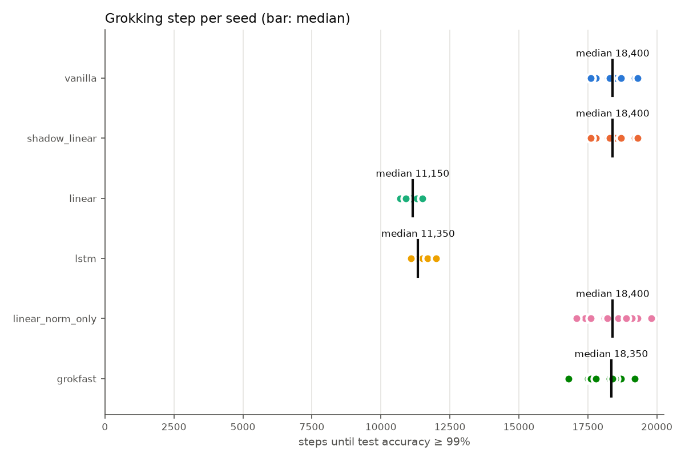
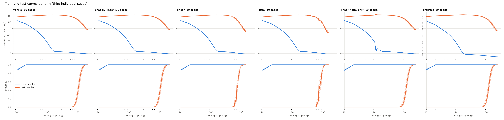
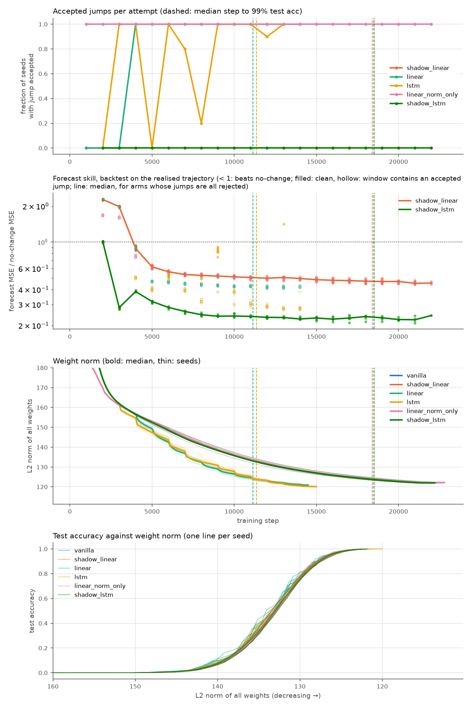

# Online weight nowcasting (2026-11-07)

> **Read with `reports/tuned_baseline.md`.** The +39% below is measured against vanilla at lr 1e-3, wd 1.0. Plain training with a tuned learning rate and weight decay groks up to ~18× faster (lr·wd scaling), [`tuned_retest.md`](tuned_retest.md) re-tests nowcasting there: 37% fewer steps at lr 4e-3, wd 2.

**Question.** Can an online "nowcaster" cut the grokking plateau short? It forecasts where the weights are heading from the current run's own recent history and jumps there. It never uses a grokked run or test data. Omnigrok's account is that weight decay slowly shrinks the weights into a "generalising" norm band. If that is right, a forecaster that extrapolates the slow drift should shortcut it.

## Setup
- Same task and baseline as `reports/substitution.md`: `GrokMLP` (512 ReLU), a + b mod 97, 30% train, full-batch AdamW (lr 1e-3, wd 1.0, betas 0.9/0.98). Branch `exp/nowcast` (based on `feat/accel`).
- **`NowcastHook`** (`src/quickgrok/nowcast.py`):
  - Every 100 steps it snapshots all parameters into a ring buffer.
  - Every 1000 steps (from step 1000, once enough history exists) it forecasts every parameter `horizon` steps ahead and sets the parameters to the forecast.
  - **Verify:** if the full-batch *train* loss after the jump is above `max_loss_ratio` (1.5) × the loss before, the jump is reverted bit-for-bit (tested). AdamW state is left as is.
  - Every attempt is logged to `nowcast.jsonl`.
- **Forecasters**
  - `linear`: a per-weight least-squares line through the last K = 8 snapshots (700 steps), extended `horizon` steps.
  - `lstm`: one shared LSTM (hidden 16, one layer) over a weight's last 8 deltas, normalised by the RMS of all deltas in that window. It predicts the normalised change over the horizon.
    - It is trained online at every attempt on the run's own history: inputs are the window ending at t − horizon, targets the realised change up to t, on a random 50k of the ~150k weights, for 200 Adam steps (lr 1e-2).
    - The model persists across attempts.
- **Forecast skill** (logged at every attempt, before the forecaster is retrained): the forecast made from the window ending at t − horizon, compared with the realised weights at t. MSE / MSE of the no-change forecast; < 1 means it beats "weights stay put".
  - A backtest is **clean** if no accepted jump lies in its window. Otherwise the realised trajectory contains a jump that was itself the forecast, and the ratio is not a forecast skill. With horizon = jump interval = 1000, every backtest after an accepted jump is contaminated.
  - For a clean skill measure over the whole plateau I added **shadow** runs with `--nowcast-max-loss-ratio 0`: every jump is rejected and restored bit-for-bit, so training is plain vanilla and every backtest is clean. These also serve as a fresh vanilla baseline.
- **Control `--nowcast-norm-only`** (added by me, not in the brief): the same linear forecast and verification, but each parameter tensor keeps its current direction and is only rescaled to the norm of its forecast. It tests whether the jump helps through its direction or only through shrinking the weights.

```bash
uv run python experiments/nowcast.py run       # tuning (seeds 100-104) and final arms (seeds 0-9)
uv run python experiments/nowcast.py figures   # vanilla: runs/t6/vanilla from experiments/substitution.py
# arms and flags: top of experiments/nowcast.py
```

## Tuning (seeds 100–104; pre-registered rule: lowest median steps to 99% test accuracy)

| Arm | Steps to 99% test acc, per seed | Median [IQR] | Jumps accepted before grokking | Clean skill (median) |
|---|---|---|---|---|
| **linear, horizon 1000** | 10.8k, 10.7k, 11.1k, 11.1k, 11.3k | **11,100 [10,800–11,100]** | 38/53 (72%) | 1.97 (n = 15, steps 2k–4k only) |
| linear, horizon 3000 | 15.3k, 14.7k, 15.8k, 16.1k, 16.4k | 15,800 [15,300–16,100] | 6/76 (8%) | 1.14 (n = 55) |
| **lstm, horizon 1000** | 11.3k, 11.0k, 11.1k, 11.1k, 11.1k | **11,100 [11,100–11,100]** | 34/49 (69%) | 0.52 (n = 20) |

**Chosen:** linear with horizon 1000, LSTM with horizon 1000 (the better linear horizon, as pre-registered). Linear accepted jumps and helped at horizon 1000, so the ratio-3.0 fallback was not needed. At horizon 3000 most linear jumps raise the train loss more than 1.5× and are rejected. Its few accepted late jumps *raise* the weight norm (see the figure).

## Result (seeds 0–9)

| Arm | Test acc ≥ 95% | Test acc ≥ 99% | Grokked | Speed-up vs vanilla (95% CI) | Mann–Whitney p |
|---|---|---|---|---|---|
| vanilla (`runs/t6/vanilla`, main checkout) | 15,650 [15,200–15,875] | 18,400 [17,900–18,700] | 10/10 | — | — |
| shadow_linear (fresh vanilla, all jumps rejected) | 15,650 [15,200–15,875] | 18,400 [17,900–18,700] | 10/10 | +0% [−4%, +4%] | 1 |
| **linear** (horizon 1000) | 10,100 [9,750–10,100] | **11,150 [11,100–11,275]** | 10/10 | **+39% [+36%, +42%]** | 1.8e-4 |
| **lstm** (horizon 1000) | 10,250 [10,100–10,475] | **11,350 [11,100–11,700]** | 10/10 | **+38% [+34%, +41%]** | 1.7e-4 |
| linear_norm_only (control) | 15,650 [15,075–16,275] | 18,400 [17,725–19,050] | 10/10 | +0% [−5%, +5%] | 0.94 |

How to read the table:
- Cells are median [IQR] steps.
- Speed-up = (vanilla median − arm median) / vanilla median. The CI is a percentile bootstrap of the difference in medians; p is a two-sided Mann–Whitney U test of steps to 99%, n = 10 vs 10 (`figures/nowcast/stats.md`). Complete separation gives p ≈ 2e-4.
- Accuracy is logged every 100 steps.

Notes:
- **linear vs lstm:** 11,150 vs 11,350, p = 0.14. No detectable difference.
- **The fresh vanilla equals t6 vanilla seed for seed** (18.2k, 18.5k, 17.7k, … identical). So the shadow hook leaves training untouched (a rejected jump is restored bit-for-bit), and t6 vanilla is a fair baseline. shadow_lstm (seeds 0–4) is also identical to vanilla.





In `nowcast.png` the vanilla line lies exactly under shadow_linear.

### Jumps and forecast skill (before each run's grok step)

| Arm | Jumps accepted | First accepted | ‖Δ‖/‖w‖ of accepted jumps | Train-loss ratio of accepted jumps | Skill, clean backtests | Forecaster time per attempt |
|---|---|---|---|---|---|---|
| linear | 78/108 (72%) | step 4000 (all seeds) | 0.147 [0.123–0.162] | 1.15 [1.10–1.19] | 1.98 [0.91–2.25] (n = 30, steps 2k–4k only) | ~0 |
| lstm | 70/100 (70%) | step 3000 (all seeds) | 0.133 [0.101–0.150] | 1.25 [1.15–1.39] | 0.55 [0.44–0.93] (n = 40) | 5.6 s |
| linear_norm_only | 180/180 (100%) | step 1000 | 0.004 [0.002–0.006] | 1.11 [1.03–1.17] | — | ~0 |
| shadow_linear | 0/179 (by design) | — | — | — | **0.51 [0.49–0.57]** (n = 169) | ~0 |
| shadow_lstm | 0/85 (by design) | — | — | — | **0.24 [0.23–0.28]** (n = 85) | 5.1 s |

How to read the table:
- Skill = MSE of the 1000-step forecast / MSE of the no-change forecast, on the realised trajectory.
- In the jump arms a backtest is only clean when the previous jump was rejected. After an accepted jump the logged ratio (~0.45) mostly says that the weights stayed near the point the jump put them, so it is not a skill.
- The shadow arms give the clean answer over the whole plateau.
- LSTM fit time is per attempt (200 Adam steps on 50k weights), with 8 runs sharing the GPU with another job. Alone it takes 2.1–2.5 s.

### Zoom on one jump (linear, seed 0, eval every 10 steps; scratch run, not in the tables)

| step | 3950 | 4000 | (jump) 4010 | 4050 | 4100 | 4200 | 4300 |
|---|---|---|---|---|---|---|---|
| weight norm | 156.79 | 156.56 | 155.17 | 154.78 | 154.03 | 153.03 | 152.31 |
| train loss | 1.75e-5 | 1.75e-5 | 1.89e-5 | 1.60e-5 | 1.58e-5 | 1.58e-5 | 1.57e-5 |

Vanilla's norm falls by ~0.0046 per step here. The jump removes ~1.4 at once, which is ~300 vanilla steps' worth. The norm then keeps falling at about twice the vanilla rate for the next 300 steps (−2.9 vs ~−1.4), and the train loss ends *lower* than before the jump.

### Weight norm at milestones (median [IQR])

| Arm | step 5k | step 10k | test acc first ≥ 50% | test acc first ≥ 99% |
|---|---|---|---|---|
| vanilla | 152.6 | 135.8 | 132.9 [132.9–133.0] | 123.8 [123.7–124.0] |
| linear | 149.3 | 126.5 | 133.0 [132.5–133.1] | 124.0 [123.8–124.1] |
| lstm | 147.4 | 127.8 | 133.0 [132.9–133.1] | 123.9 [123.7–124.0] |
| linear_norm_only | 152.9 | 136.2 | 133.0 [132.8–133.1] | 123.9 [123.7–124.1] |

## Interpretation
- **Does the forecaster predict anything? Yes.** On the plain vanilla trajectory, the linear forecast 1000 steps ahead has half the error of "no change" (skill 0.51). The online LSTM has a quarter (0.24), and it gets there from step 3000, right after its first fit.
  - Both are worse than no-change early on (linear 2.0–2.3 at steps 2–3k), while the weights still shrink fast and curve. From ~step 4000 to grokking, skill is steady.
  - The LSTM forecasts clearly better than the linear one but does not grok faster (11,350 vs 11,150, p = 0.14). The extra accuracy does not translate into speed.
- **Are jumps accepted? Yes, about 70% of them**, from step 3–4k on. They move the weights by ~13–15% and raise the train loss by 15–25%. The loss recovers within ~40 steps (zoom table).
  - Linear jumps at steps 1–3k are always rejected: the extrapolated early shrinkage overshoots, and the loss rises 2–1400×.
  - At horizon 3000 nearly all linear jumps were rejected (8%), and the arm was only mildly faster in tuning (15.8k).
- **Is the gain a shortcut through the slow norm decay? Yes, as far as the outcome goes; the forecast's direction is what gets it there.**
  - Every arm passes 50% and 99% test accuracy at the same weight norm as vanilla (133 and 124). Plotted against weight norm, the accuracy curves of vanilla, linear and LSTM fall on top of each other (bottom panel of `nowcast.png`). The jumping arms simply reach that norm ~7k steps sooner (126.5 vs 135.8 at step 10k).
  - The jump itself removes only ~1% of the norm. The rest comes from faster shrinking in the few hundred steps after each jump.
  - The **norm-only control**:
    - It gives each tensor the forecast's norm but keeps its direction. It is accepted every time and has no effect (18,400, p = 0.94).
    - At step 1000 it shrinks the weights ~30%, and training undoes this by step ~3000. Afterwards the forecast's per-tensor norm is only ~0.5% below the current one, so the control barely moves anything.
    - Rescaling alone does not shortcut the decay; moving along the forecast direction does.
    - Caveat: this control is not norm-matched to what the linear arm eventually achieves. A "shrink by 2% per jump" control would be the stronger test, and I did not run it.
- **Cost:**
  - Linear is free: ~150k weights × 8 snapshots, one least-squares fit and two loss evaluations per 1000 steps.
  - The LSTM roughly doubles wall-clock under GPU contention (~5 s per attempt). It buys a better forecast but no extra speed-up.

**Limits.**
- One task (a + b mod 97), one MLP width, one optimizer setting, 10 seeds.
- Horizon, interval and K were barely tuned (two horizons for linear, one for the LSTM), so larger gains may exist; e.g. jumping every 500 steps, or a longer horizon with a better forecaster.
- With horizon = jump interval, forecast skill can only be measured cleanly in the shadow arms, not in the arms that jump.
- GPU runs are not bit-reproducible in general (CLAUDE.md), although here the same seeds reproduced t6 exactly.

Compute: smoke tests ~1 min; tuning 15 + 10 runs in 76 s + 225 s wall-clock; final 55 runs in 772 s (8 in parallel, GPU shared with another agent's job); one zoom run 15 s. About **19 min** in total.
