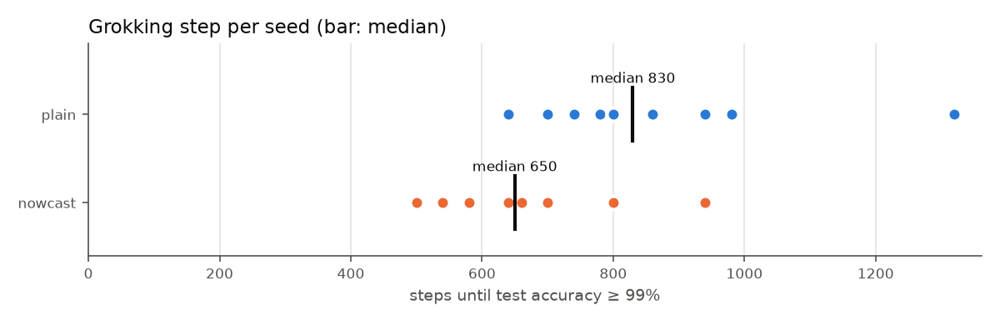
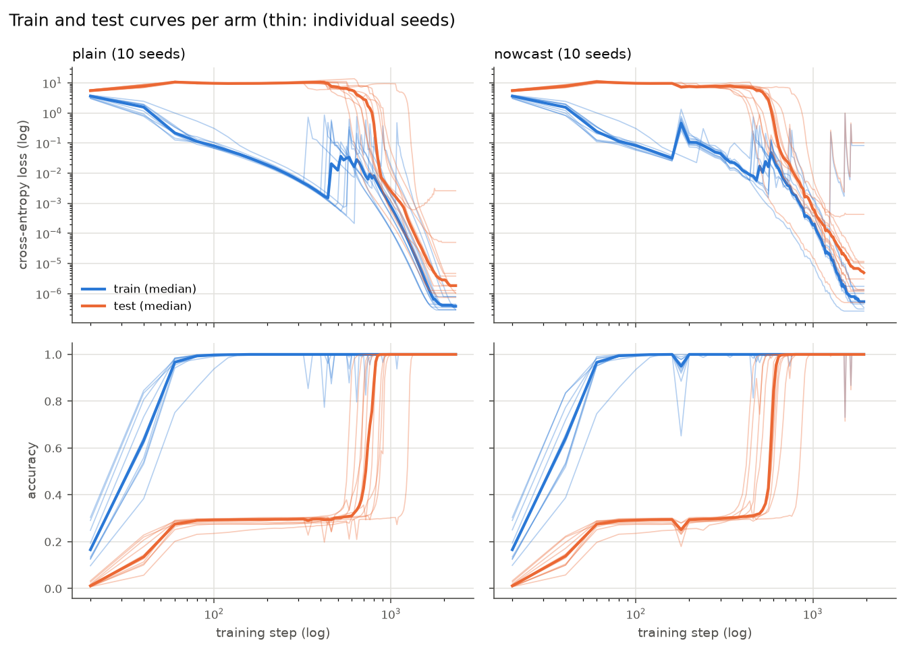

# Nowcasting on the transformer against a tuned learning rate (2026-11-08)

**Question.** On the tuned MLP, linear weight nowcasting saved 37% of steps and ×0.80 wall-clock (lr 4e-3, wd 2), but only ×1.04 at lr 1.6e-2 (`reports/tuned_retest.md`). Does it still save steps *and* wall-clock time on the 1-layer transformer?

**Answer: null under the pre-registered rule.** Nowcasting saves 22% of steps (p = 0.011), but only ×0.95 wall-clock, short of the ×0.90 the rule requires.

## Setup
- 1-layer transformer (`--model transformer`: d_model 128, 4 heads, MLP 512, no LayerNorm), a + b mod 97, 30% train, full-batch AdamW (betas 0.9/0.98). Every run uses `--steps 20000 --eval-every 20`, so step counts have a 20-step resolution.
- Nowcast: `NowcastHook`, linear forecaster, K = 8 snapshots, jumps reverted if the train loss rises more than 1.5×. It ran unchanged on the transformer; no code changes were needed.
- Pre-registration: `reports/preregistration_nowcast_transformer.md`, committed (`e74c9ca`) before any tuning run. Its addendum with the tuning results and frozen choices was committed (`01c9564`) before the final runs.
- **Kill rule:** "nowcasting helps on the transformer" only if the median step saving is ≥ 10% with Mann–Whitney p < 0.05 **and** the solo wall-clock ratio is ≤ 0.90.

```bash
uv run python experiments/nowcast_transformer.py tune                  # baseline grid, seeds 100-102
uv run python experiments/nowcast_transformer.py tune_nowcast          # 3 nowcast configs, seeds 100-104
uv run python experiments/nowcast_transformer.py run                   # final, seeds 0-9
uv run python experiments/nowcast_transformer.py timing --parallel 1   # solo wall-clock, seeds 0-2
uv run python experiments/nowcast_transformer.py figures               # -> reports/figures/nowcast_transformer/
```

## Tuning
**Baseline** (seeds 100–102; rule: fastest setting where 3/3 seeds reach 99% test, nothing diverges, and median grok step ≥ 5 × median memorisation step):

| lr | wd | Steps to 99% test, per seed | Median |
|---|---|---|---|
| 2e-3 | 1 | 7,400, 7,420, 11,680 | 7,420 |
| 4e-3 | 1 | 3,060, 3,440, 5,560 | 3,440 |
| 8e-3 | 1 | 1,560, 2,120, 1,420 | 1,560 |
| 4e-3 | 2 | 1,220, 1,580, 1,960 | 1,580 |
| **8e-3** | **2** | 880, 1,060, 740 | **880** |
| 1.6e-2 | 2 | never, never, 7,860 | fails |

- **Chosen: lr 8e-3, wd 2.** Memorised by step ~100, grokked at ~880, so a ~9× delay remains.
- lr 1.6e-2 was the pre-registered extension past the grid edge. It is unstable: two seeds never even memorise (train accuracy 10–17% at step 20k), and the third memorises and generalises together at 7,860. Attention at high lr, as expected.
- The transformer scales with lr·wd much like the MLP (`reports/tuned_baseline.md`): ~20k steps at lr 1e-3 (pilot) down to 880.

**Nowcast** (seeds 100–104 at lr 8e-3, wd 2; snapshot interval S = round(0.06 · 880 / 8) = 7; rule: lowest median):

| Config | Steps to 99% test, per seed | Median | Jumps accepted / tried before grok |
|---|---|---|---|
| plain (reference) | 880, 1,060, 740, 940, 400 | 880 | — |
| A: jump every 56, horizon 56 | 740, 960, 680, 800, 380 | 740 | 8/62 |
| B: jump every 112, horizon 56 | 700, 1,000, 740, 880, 400 | 740 | 7/30 |
| **C: jump every 56, horizon 28** | 680, 900, 660, 760, 400 | **680** | 30/59 |

**Chosen: C.** As on the MLP, a horizon that is too long gets most jumps rejected (A, B); halving it gets half of them accepted.

## Result (seeds 0–9)

| Arm | Test acc ≥ 95% | Test acc ≥ 99% | Grokked | Saving vs plain (95% CI) | Mann–Whitney p | Wall-clock to 99%, solo (× plain) |
|---|---|---|---|---|---|---|
| plain (lr 8e-3, wd 2) | 800 [725–915] | 830 [750–940] | 10/10 | — | — | 2.82 s (×1.00) |
| nowcast (C) | 620 [545–660] | **650** [550–700] | 10/10 | **+22%** [+6%, +43%] | 0.011 | 2.68 s (**×0.95**) |

- Step cells are median [IQR]. CI: percentile bootstrap of the difference in medians; p: two-sided Mann–Whitney U, n = 10 vs 10 (`figures/nowcast_transformer/stats.md`).
- Nowcast is faster on every seed (by 100–380 steps), but the two distributions overlap, so p = 0.011 rather than the ~2e-4 of complete separation.
- Nowcast jumps before the grok step: 58/112 accepted (52%), moving the weights by 11% of their norm (median). Accepted jumps *lower* the train loss (median ratio 0.83).
- Both arms memorise at step 80.




## Wall-clock
Seeds 0–2 of both arms, run one at a time with no other training process on the GPU, stopped at the 99% step. Time = process wall-clock minus the median start-up (3.13 s, three `--steps 0` runs).

| Arm | Steps to 99%, seeds 0–2 | Seconds, seeds 0–2 | Median | ms per step |
|---|---|---|---|---|
| plain | 660, 580, 780 | 2.82, 2.40, 3.11 | 2.82 s | 4.3 |
| nowcast | 560, 480, 680 | 2.68, 2.17, 2.92 | 2.68 s | 4.8 |

- **Ratio 2.68 / 2.82 = 0.95.** Nowcast saves 100 steps on each seed (13–17%), but the hook makes each step ~12% more expensive. At this short a run its costs are a snapshot every 7 steps and two full-batch loss evaluations per jump attempt every 56 steps.
- The solo runs grokked at slightly different steps than the same seeds in the parallel final runs (plain 60–80 steps earlier, nowcast −20 to +40). Unlike the MLP in `tuned_retest.md`, the transformer runs were not reproducible across the two launches. The solo step saving (100 per seed) is smaller than in the parallel runs for these seeds (140–220).
- Three seeds per arm and sub-second differences: the ratio is noisy. Its sign is the same on all three seeds (×0.95, ×0.90, ×0.94).

## Verdict
**Null under the pre-registered rule.**
- Steps: passes (+22% ≥ 10%, p = 0.011 < 0.05).
- Wall-clock: fails (×0.95 > ×0.90).

This matches the MLP picture. Nowcasting still cuts steps on a tuned transformer, but at lr 8e-3, wd 2 the run is under 1,000 steps and ~3 s, so the hook's fixed costs eat most of the saving. The rule was written for the practical claim, and it does not hold. The step saving is a real effect in the dynamics, and it has survived three settings now (MLP lr 4e-3, MLP lr 1.6e-2, transformer lr 8e-3).

**Limits.**
- One task, one transformer size, one tuned setting, 10 seeds; wall-clock on 3 seeds.
- Only three nowcast configs, scaled from the MLP. The hook was not optimised (e.g. fewer loss evaluations); a cheaper hook could pass the wall-clock bar, but that would be a new test.
- lr 1.6e-2 failed only on stability; the baseline might go faster with warm-up or gradient clipping, which were not tried.

**Compute.** GPU wall-clock ~14 min: smoke run 25 s, baseline tuning ~8.5 min (15 runs at once, then the lr 1.6e-2 extension and one OOM rerun), nowcast tuning 91 s, final 141 s, solo timing 44 s. Runs are in `runs/nowcast_transformer/` and `runs/nowcast_transformer_timing/` in the main checkout (gitignored).
