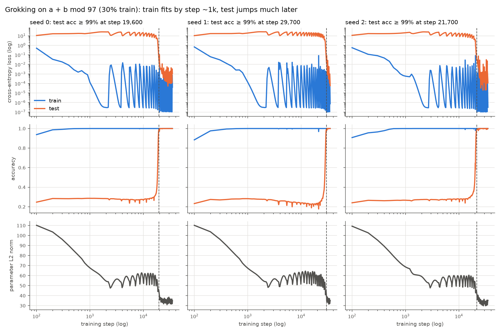
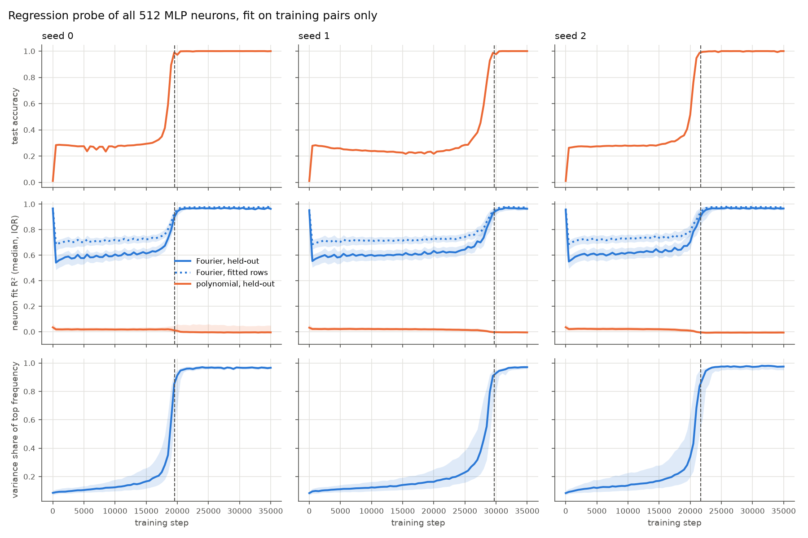
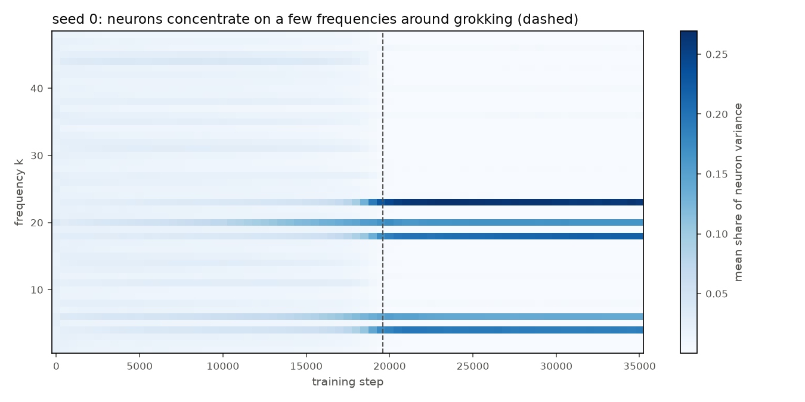
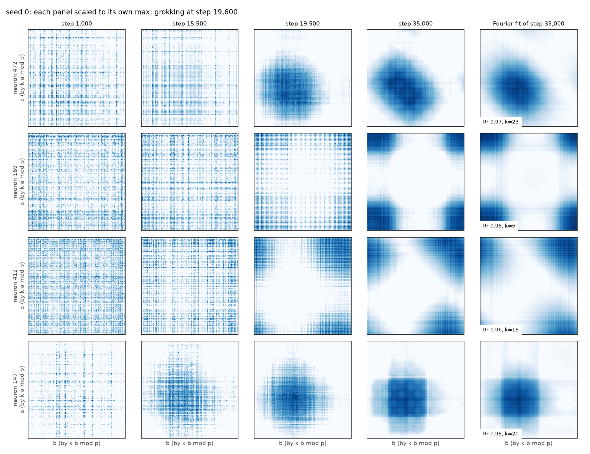
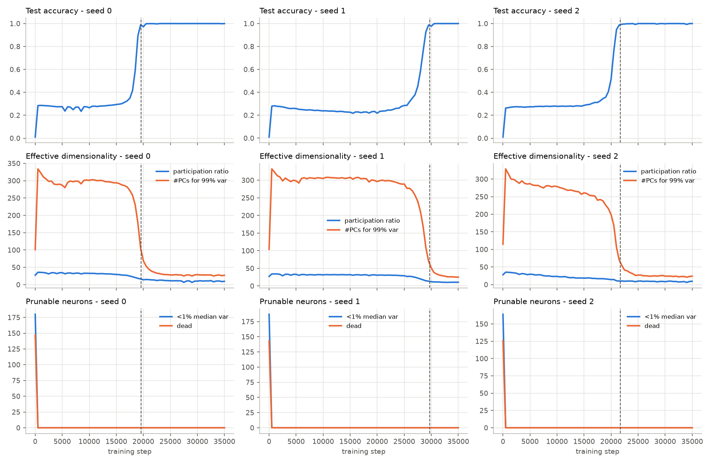

# Pilot: grokking and a regression probe of MLP neurons (2026-11-07)

**Setup.** 1-layer transformer (d_model 128, 4 heads, MLP 512 ReLU, no LayerNorm) on a + b mod 97, 30% of pairs for training. Full-batch AdamW (lr 1e-3, wd 1.0, betas 0.9/0.98), 35k steps, seeds 0–2. Branch `exp/pilot-probe`. Runs are in `runs/pilot/seed*/` (gitignored). Figures are made by `uv run python -m quickgrok.plot_pilot runs/pilot/seed0 runs/pilot/seed1 runs/pilot/seed2`.

## Result 1: grokking reproduces, with a large seed spread

| Seed | Train acc 100% | Test acc ≥ 99% |
|---|---|---|
| 0 | ~step 500 | step 19,600 |
| 1 | ~step 500 | step 29,700 |
| 2 | ~step 500 | step 21,700 |

- Test accuracy sits at ~27% for ~20k steps after memorisation, then jumps within ~1–2k steps.
- The parameter norm falls from ~110 to ~55, oscillates, then drops to ~35 exactly when test accuracy jumps.
- Train loss shows periodic spikes from ~1e-7 up to ~1e-2 during the plateau, the "slingshot" pattern. The floor at 1e-7 suggests float32 limits in the softmax (see "Grokking at the edge of numerical stability" in the research log).
- **Noise floor.** Seed 0 reached 99% at step ~22k in an earlier run with identical settings, versus 19.6k here. GPU runs are not bit-reproducible, so any claimed speed-up must clearly exceed this spread.

## Result 2: neurons become Fourier-structured before test accuracy jumps

Each MLP neuron (512, read at the "=" position) is fit by least squares **on training pairs only**. Fits are scored on the held-out pairs.
- **Fourier basis:** for each k = 1..48, cos/sin(2πk·a/p), cos/sin(2πk·b/p) and their 4 products. This is a degree-2 polynomial in Fourier features.
- **Polynomial basis:** monomials in rescaled a and b up to degree 6.

- **Plain polynomials are useless** (held-out R² ≈ 0 throughout), because the inputs wrap around mod p.
- **Fourier held-out R²** is ~0.6 during the plateau and ~0.97 after grokking.
- **Caveat: R² alone is a weak signal.** For p = 97 the basis contains 96 functions of a alone, which can represent *any* function of a, and likewise for b. Any additive neuron f(a) + g(b) therefore fits perfectly. That explains R² ≈ 0.96 at initialisation. Only the a × b interaction is constrained (same-frequency products only).
- **The better signal is concentration:** the share of a neuron's explained variance carried by its top frequency (bottom row). It rises slowly from ~0.1 at init to ~0.2–0.35 *before* test accuracy moves, then jumps to ~0.97 at grokking. In seed 1 the rise is visible ~5k steps ahead. This is the property substitution would exploit, and the probe suggests it is a usable trigger.

Averaged over neurons, a handful of frequencies (seed 0: k = 4, 6, 18, 20, 23) gain weight thousands of steps before grokking. k = 20 is already visible by ~step 8k. After grokking the network uses only these frequencies. **Caveat:** this figure uses full-grid fits (test inputs, no labels) and is for analysis only.

Four neurons with different dominant frequencies, with a and b reordered by k·x mod p so that a frequency-k wave appears smooth. During memorisation (step 1k, 15.5k) activations look like noise along rows and columns. Neuron 147 already shows a blob at 15.5k. After grokking each neuron is a smooth single-frequency bump, and its Fourier fit (last column, R² 0.96–0.98) reproduces it.

## What this means for the substitution idea

- A cyclic (Fourier-feature) basis is necessary; plain polynomials in a and b can't model these neurons.
- Neurons move gradually towards single-frequency forms during the plateau. The structure isn't only present at the end, so there is something to "jump" to early.
- The trigger should use frequency concentration and held-out R² on a split of the **training** pairs, not raw R².
- **Unknown, and the key risk:** whether the early, partial structure (top share ~0.2–0.35) is good enough to substitute. Grokking-tickets found transition-phase structure didn't help.

## Result 3: PCA and pruning of the hidden layer (user idea, 2026-11-07)

The question: could we periodically run PCA on hidden activations to prune idle neurons or filter noise? We ran PCA on the activations of the 512 MLP neurons on the **training pairs** at every checkpoint (`uv run python scripts/pca_probe_pilot.py`).

- **No idle neurons to prune.** About 130–150 neurons are dead at initialisation, but from step 500 on there are **zero** dead neurons and zero neurons below 1% of median variance, in every seed. Zeroing the 50% lowest-variance neurons cuts accuracy in every phase: test 0.27 → 0.14 on the plateau and 1.00 → ~0.56 after grokking.
- **Compression is a rotation, not neurons switching off.** The number of principal components needed for 99% of variance falls from ~300 on the plateau to ~25 after grokking (participation ratio 30–35 → ~10). The low-dimensional structure is spread over all 512 neurons, which matches the Fourier picture: a few frequencies, each shared by many neurons.
- **Timing.** The drop coincides with test accuracy starting to rise (seeds 0 and 1, ~3k steps before 99%). Seed 2 shows a slow decline from ~5k. Dimensionality is a marker of generalisation more than an early warning, so it is weaker than the top-frequency share in Result 2.
- **Projection.** On the plateau, projecting activations onto the top PCs (99% variance) changes nothing (train 1.00, test within 0.005). As a one-off filter it neither helps nor hurts.

Verdict: neuron pruning by activation variance is a dead end here. Repeatedly forcing low rank *during* training is untested. It would be a basis-free sibling of the planned weight projection (B), which matters for other datasets, so it is kept as a low-priority lead.
