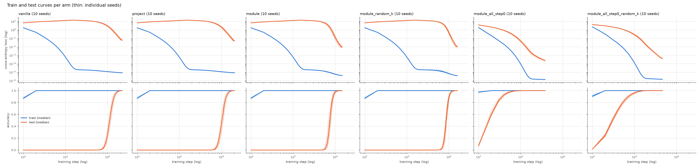
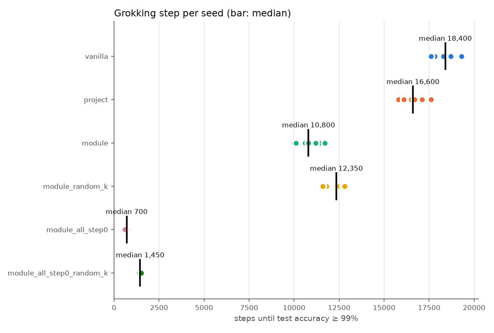
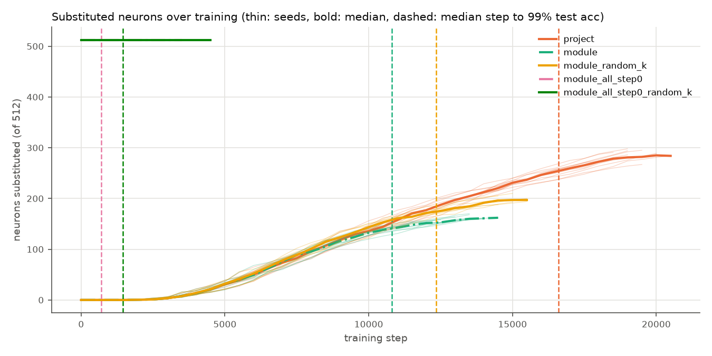
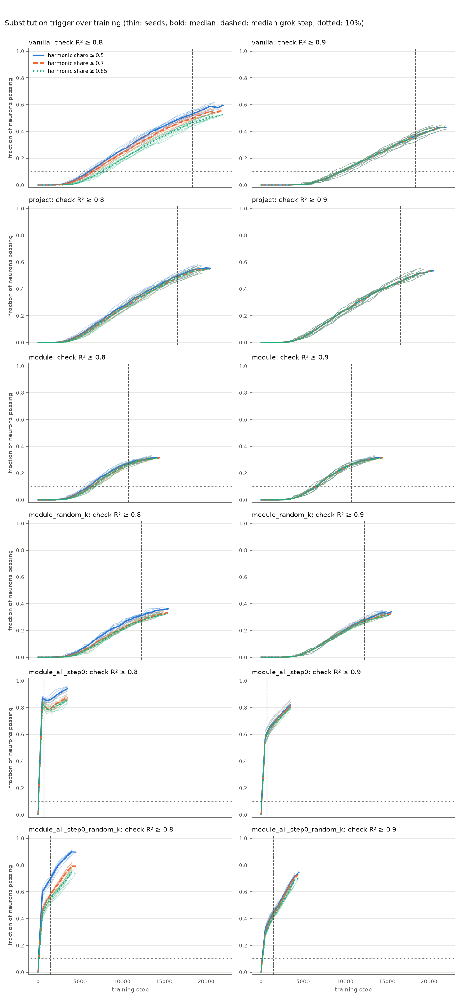

# Neuron substitution (T4–T6, 2026-11-07)

**Question.** If a hidden neuron is "jumped" to its fitted Fourier structure as soon as the online probe flags it, does the MLP grok sooner? And if so, is it the *fitted* frequency and the *timing* that help, or just any harmonic structure?

## Setup
- `GrokMLP` baseline settings: a + b mod 97, 30% train, full-batch AdamW (lr 1e-3, wd 1.0, betas 0.9/0.98), 512 hidden ReLU neurons, pre-activation U[a, i] + V[b, i] + bias_i. Branch `feat/accel`.
- Every 500 steps `ProbeHook` fits all neurons on Fourier features of the **training inputs only** (80/20 fit/check split of the training rows) and records per neuron the base frequency k*, the harmonic share (k*, 2k*, 3k*, 4k* folded mod p) and the check-split R².
- **Trigger:** harmonic share ≥ τ_share and check R² ≥ τ_r2, first time only.
- **Substitution:** both input columns U[:, i] and V[:, i] are projected (least squares) onto span{1, cos(2π f x/p), sin(2π f x/p) : f ∈ harmonics(k*)}, x = 0..96, 4 harmonics, so 9 basis functions out of 97 dimensions.
  - **project:** overwrite the columns in place, then train freely (they may drift back).
  - **module:** the columns become `basis_i @ coef_i` with trainable coefficients (a `torch.nn.utils.parametrize` parametrization). The original entries are no longer used. The AdamW optimizer is rebuilt at each growth event: existing state is kept, new coefficient rows start with zero moments.
  - At the moment of the swap both modes give exactly the same network (tested).
- **Controls:**
  - `--random-k`: same trigger, timing and neurons, but each neuron gets a uniformly random frequency ≠ its fitted k* (seeded by the run seed).
  - `--sub-all-at 0`: every live neuron is substituted at the first probe (step 0, i.e. after one optimizer step), using its k* fitted on the random initialisation, ignoring the thresholds. No later substitutions.
- Checkpoints and the logged weight norm use the effective weights (`effective_state_dict`), so every existing script loads module-mode checkpoints.

```bash
uv run python experiments/substitution.py run       # tuning (seeds 100-104) and final arms (seeds 0-9)
uv run python experiments/substitution.py figures   # arms and flags: top of experiments/substitution.py
```

Compute: 14 tuning runs in 149 s and 60 final runs in 443 s of wall-clock time, 10 processes in parallel on the RTX 5080 (~10 min in total).

## Tuning (pre-registered rule: lowest median steps to 99% test accuracy, ties → higher thresholds)
Module mode, seeds 100–104.

| τ_share | τ_r2 | Steps to 99% test acc, per seed | Median [IQR] | Neurons substituted (median) |
|---|---|---|---|---|
| **0.5** | **0.8** | 10.2k, 10.6k, 10.9k, 11.3k, 11.3k | **10,900 [10,600–11,300]** | 165 |
| 0.7 | 0.8 | 11.2k, 11.7k, 12.1k, 12.3k, 12.5k | 12,100 [11,700–12,300] | 157 |
| 0.85 | 0.9 | 12.5k, 13.6k, 13.7k, 14.0k, 14.0k | 13,700 [13,600–14,000] | 145 |

**Chosen: τ_share = 0.5, τ_r2 = 0.8.** The ranking is monotone: the more permissive the trigger, the faster the grokking. The lowest pair tried was the best one, so a lower τ might be faster still. I did not search below it.

## Result (seeds 0–9)

| Arm | Test acc ≥ 95% | Test acc ≥ 99% | Grokked | Speed-up vs vanilla (95% CI) | Mann–Whitney p |
|---|---|---|---|---|---|
| vanilla | 15,650 [15,200–15,875] | 18,400 [17,900–18,700] | 10/10 | — | — |
| project | 14,300 [13,725–14,400] | 16,600 [16,125–16,775] | 10/10 | +10% [+6%, +14%] | 2e-4 |
| module | 9,550 [9,275–9,775] | 10,800 [10,625–11,200] | 10/10 | +41% [+37%, +44%] | 2e-4 |
| module_random_k | 10,750 [10,475–11,000] | 12,350 [11,650–12,475] | 10/10 | +33% [+29%, +38%] | 2e-4 |
| module_all_step0 | 500 [500–500] | 700 [700–700] | 10/10 | +96% [+93%, +99%] | 2e-4 |
| module_all_step0_random_k | 1,000 [900–1,000] | 1,450 [1,400–1,500] | 10/10 | +92% [+89%, +95%] | 2e-4 |

Cells: median [IQR] steps. Speed-up = (vanilla median − arm median) / vanilla median. The CI is a percentile bootstrap (10,000 resamples) of the difference in medians, on the same scale. The p-value is a two-sided Mann–Whitney U test of steps to 99% (n = 10 vs 10). With complete separation of the groups, p bottoms out at about 2e-4, which is the case for every arm here. Accuracy is logged every 100 steps, so step-0 numbers have a resolution of ±100.

Direct contrasts (same test):
- **module vs module_random_k:** 10,800 vs 12,350. The random-k arm is 14% slower, measured against module's median (95% CI 6–18%), p = 4e-4.
- **module_all_step0 vs module_all_step0_random_k:** 700 vs 1,450, p = 1e-4.
- **project vs module:** 16,600 vs 10,800, p = 2e-4.

Substitution events (medians over seeds):
- **Trigger arms:** the first swap is at step 2,250. At the end, project has 288 neurons substituted (of 512), module 161 and module_random_k 198. The random-k arm substitutes more neurons only because it runs longer before grokking.
- **Train-loss jump per event** (after/before ratio; train loss is ~1e-5 at that point): project 1.10 (max 1.40), module 1.08 (max 1.39), module_random_k 1.31 (max 4.04). Swapping in a wrong frequency costs more train loss, but only from ~1e-5 to ~4e-5.
- **Step-0 arms:** all 512 neurons, train loss ×0.98.






In the substituted-neurons figure the two step-0 arms lie on top of each other at 512. In `trigger.png` and `figures/t6/lead_time.md`, the substitution arms are affected by the intervention itself: substituted neurons are rewritten, so their pass rate is not comparable with vanilla's.

## Interpretation
- **Substitution speeds up grokking, and constraining matters more than projecting.** Module mode groks 41% sooner than vanilla. Project mode, where the columns may drift back, is only 10% sooner. In an earlier check on seed 100, projected columns ended with ~6% (max 12%) of their energy outside the harmonic span.
- **The fitted frequency matters, but only for a minority of the effect.** With the same trigger, timing and neurons, a random frequency still gives +33% against +41% for the fitted one. Most of the module effect comes from forcing neurons onto *some* harmonic (Fourier-sparse) column structure; using the neuron's own k* adds a smaller, significant ~14%.
- **Trigger timing works against us.** Substituting every neuron at step 0, before any structure exists, groks after ~700 steps: 26× sooner than vanilla and 15× sooner than the trigger-based module arm. Even step 0 with random frequencies (1,450 steps) beats every trigger-based arm by a wide margin. The "wait until the probe sees structure, then jump" idea is therefore dominated by simply imposing the harmonic constraint from the start. At this scale the trigger's value as an *accelerator* is negligible. It may still be useful as a *diagnostic*.
- **Is it just a Fourier/harmonic prior?** Mostly, yes. It looks like a strong architectural prior: each input column lives in a 9-dimensional span of 1 + 4 harmonics of one frequency, out of 97 dimensions. The prior helps even with random frequencies.
  - Why "fitted" k* beats random k* at step 0 (700 vs 1,450) is unclear, since k* on a random initialisation carries no task information. A plausible explanation: projecting onto a column's own top frequency keeps more of its initial norm. The effective weight norm at step 100 is 136 vs 125 (median); the k distribution is near-uniform in both arms (48 distinct values). I have not tested this.
- **Norm control (single seed, scratch script, not in the repo).** The step-0 projection also shrinks the embedding norm a lot, and small initial norm is known to reduce grokking delay. Shrinking each column at step 0 to its projected norm *without* projecting gave 0% test accuracy after 3,000 steps (seed 100), as did the untouched baseline. So the norm drop alone does not explain the step-0 effect, but this control is one seed and one 3k-step horizon.
- **Origin of the step-0 observation.** It first appeared in the 2,000-step smoke test with permissive thresholds (τ_share 0, τ_r2 −1): every neuron was substituted at step 0, and both modes reached ≥ 99% test accuracy by step 1,000.

**Limits.** One task (a + b mod 97), one width, 30% train, one optimizer setting. Ten seeds per arm with very tight IQRs, so the differences are well resolved statistically, but the τ choice and every effect size apply only to this setup. The step-0 arms bake knowledge of the solution family (sparse Fourier columns of one frequency per neuron) into the model, so they are a prior, not an accelerator in the sense of the original question.
