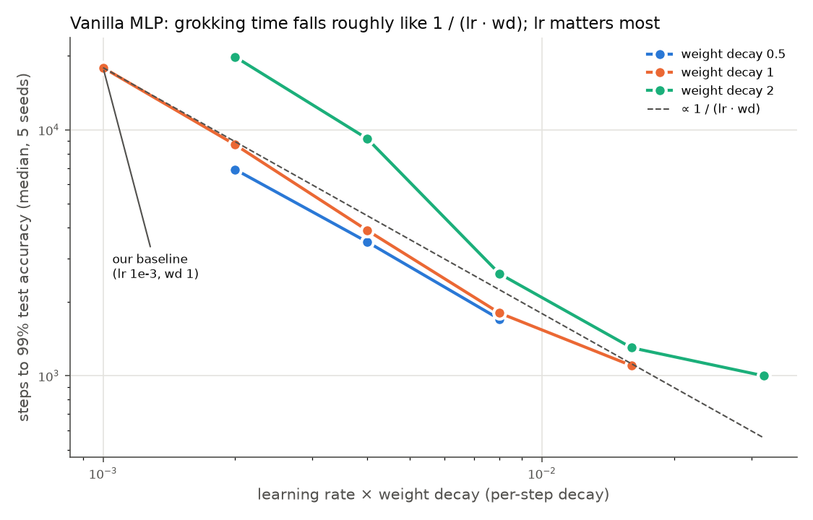

# Tuned baseline: how much of the delay is just the step size? (2026-11-07)

**Why.** Wave-module substitution (+41%, `reports/substitution.md`) and online nowcasting (+39%, `reports/nowcast.md`) were both measured against vanilla at lr 1e-3 and weight decay 1.0. Those settings were inherited from the pilot and never tuned for speed. Nowcasting extrapolates the weights, which resembles a larger step, and Omnigrok says the plateau is weight decay slowly shrinking the weights. So: what does plain training reach with better settings?

**Setup.** The vanilla `GrokMLP` on a + b mod 97 with 30% train and full-batch AdamW (betas 0.9/0.98), run on the tuning seeds 100–104. The grid is lr ∈ {1e-3, 2e-3, 4e-3, 8e-3, 1.6e-2} × wd ∈ {0.5, 1, 2, 4}, though not every pair was run; the table below lists the runs. Runs stop 3k steps after 99% test accuracy.

```bash
uv run python -m quickgrok.train --model mlp --steps 40000 --stop-after-grok 3000 \
    --lr $lr --weight-decay $wd --seed $s --out-dir runs/tuned_vanilla/lr${lr}_wd${wd}/seed$s
uv run python scripts/plot_tuned_baseline.py
```

## Result



| lr | wd | lr·wd | Steps to 99% test (median, 5 seeds) | Memorised by |
|---|---|---|---|---|
| 1e-3 | 1 | 0.001 | 17,900 | 200 |
| 1e-3 | 2 | 0.002 | 19,800 | 200 |
| 2e-3 | 0.5 | 0.001 | — (not run) | — |
| 2e-3 | 1 | 0.002 | 8,700 | 100 |
| 2e-3 | 2 | 0.004 | 9,200 | 100 |
| 4e-3 | 0.5 | 0.002 | 6,900 | 100 |
| 4e-3 | 1 | 0.004 | 3,900 | 100 |
| 4e-3 | 2 | 0.008 | 2,600 | 100 |
| 8e-3 | 0.5 | 0.004 | 3,500 | 100 |
| 8e-3 | 1 | 0.008 | 1,800 | 100 |
| 8e-3 | 2 | 0.016 | 1,300 | 100 |
| 1.6e-2 | 0.5 | 0.008 | 1,700 | 100 |
| 1.6e-2 | 1 | 0.016 | 1,100 | 100 |
| 1.6e-2 | 2 | 0.032 | 1,000 | 100 |
| any | 4 | — | most seeds never grok within 40k | — |

- **Grokking time falls roughly like 1 / (lr · wd)** (the per-step weight shrinkage of decoupled weight decay), from 17,900 to ~1,000 steps, where it saturates. This is consistent with Omnigrok's account and with published scaling laws: the plateau is roughly the time weight decay needs to shrink the weights into the generalising norm band.
- **But the product is only a rough guide here; the learning rate dominates.** At equal lr·wd the run with the larger lr is clearly faster (0.004: lr 8e-3/wd 0.5 → 3,500 vs lr 2e-3/wd 2 → 9,200; 0.002: lr 4e-3/wd 0.5 → 6,900 vs lr 1e-3/wd 2 → 19,800). At lr 1e-3 and 2e-3, raising wd from 1 to 2 makes grokking slightly *slower*. In the figure the curves for different weight decays don't collapse onto one line. (Correction 2026-11-07: an earlier version of this report said "almost exactly", which overstated it.)
- **It is still grokking.** Every tuned setting memorises by step ~100 and generalises 10–40× later. The delay shrinks but doesn't vanish within this grid.
- **Simply doubling the learning rate (8,700 steps) beats both of our methods** (10,800 and 11,150) at the old setting. The best tuned setting (1,000 steps) is ~18× faster than the old baseline.
- Too much decay (wd 4) prevents grokking at every lr tried.

## What this means for the project
- The +39–41% results are real against the old baseline, but small next to this knob. The honest question is whether either method adds anything **on top of a tuned baseline**, for example at lr 4e-3 and wd 2 (2,600 steps, still a 26× delay). The methods' intervals and horizons (probe and jump every 500–1,000 steps) would have to be rescaled for a run that is ~7× shorter.
- Nowcasting is consistent with this picture. Its jumps reach the same generalising norm sooner, which is what a larger effective decay does. Its gain may largely be a learned way of raising lr·wd.
- Settings where lr·wd can't simply be raised are where accelerators could still matter: larger models, transformers (attention is often unstable at high lr), and tasks where too much decay hurts.
