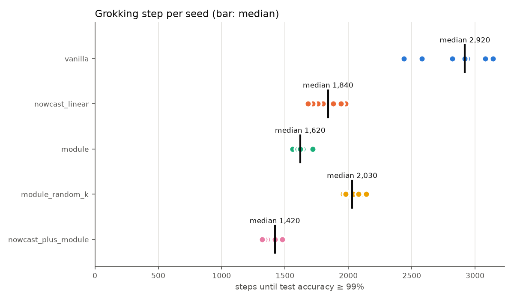
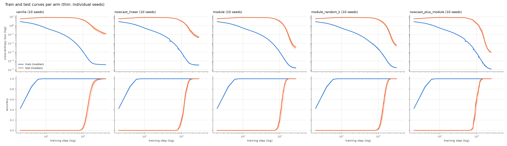
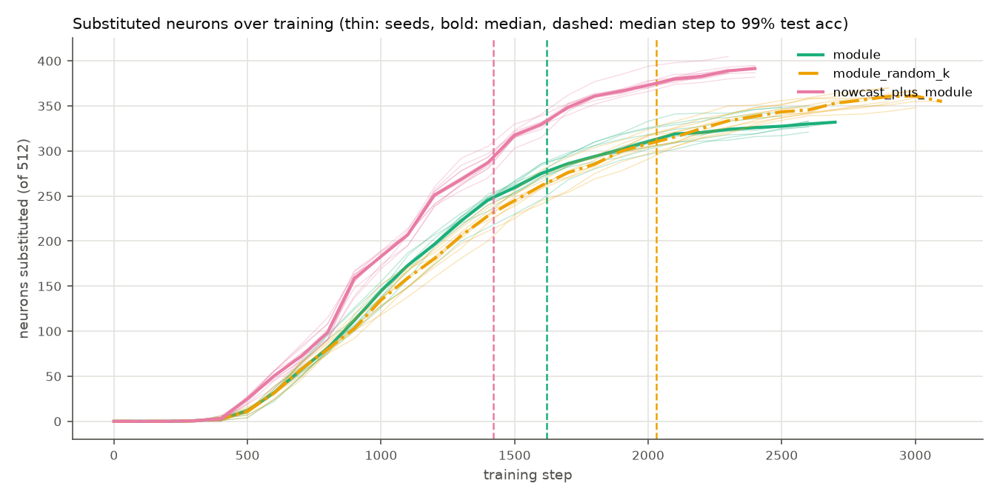
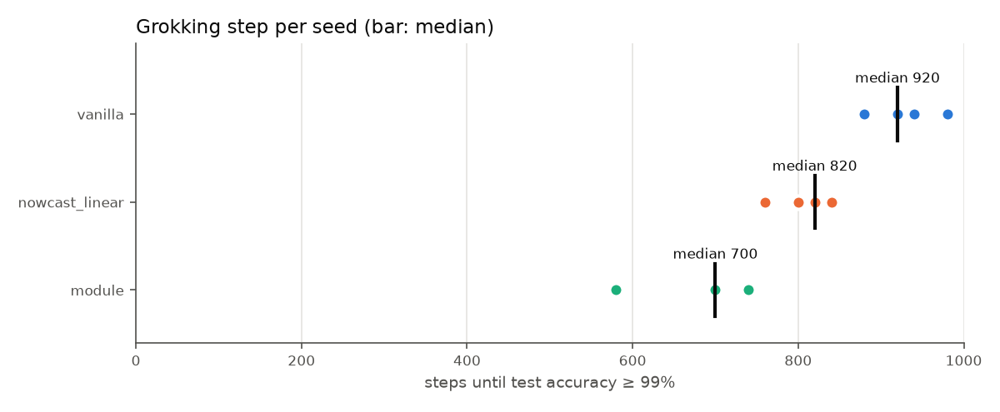
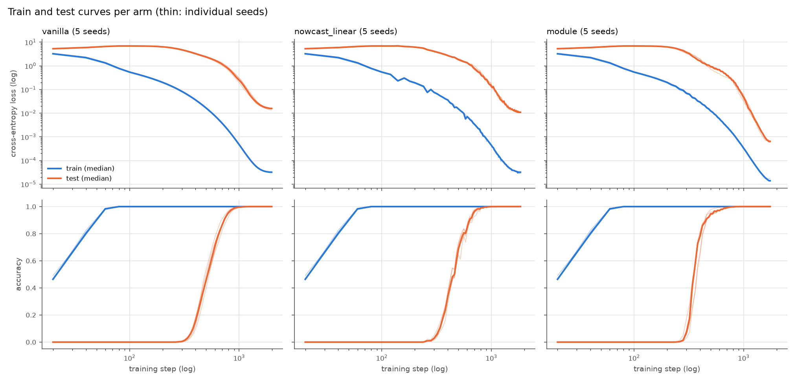

# Retest on a tuned baseline: do substitution and nowcasting still add speed? (2026-11-07)

**Question.** Wave-module substitution (+41%) and linear weight nowcasting (+39%) were measured against vanilla at lr 1e-3, wd 1 (18,400 steps to 99% test). `reports/tuned_baseline.md` showed that grokking time scales with 1 / (lr·wd), and at lr 4e-3, wd 2 vanilla groks at ~2,600 steps. Do the methods still help on top of that tuned baseline? And do they combine?

**Short answer.**
- **In steps: yes, both still help, by about as much as before.** Nowcast +37%, module +45%, and the fitted frequency still beats random-k (+20%, p = 2e-4).
- **They combine, but less than additively:** together +51%, which is 12% fewer steps than module alone (p = 2e-4).
- **In wall-clock: only nowcasting helps** (−20% at lr 4e-3, nothing at lr 1.6e-2). Module substitution is 1.5× slower than vanilla at lr 4e-3 and 3.5× slower at lr 1.6e-2. On this tiny model, a step costs 0.74 ms, so the hooks' fixed costs outweigh the steps they save.

## Setup
- Task and model as before: `GrokMLP` (512 ReLU), a + b mod 97, 30% train, full-batch AdamW (betas 0.9/0.98). Branch `exp/tuned-retest` from `main`.
- Base flags for every arm: `--model mlp --lr 4e-3 --weight-decay 2.0 --steps 20000 --stop-after-grok 1000 --eval-every 20 --save-every 500`. Accuracy is logged every 20 steps, so every step count below has a resolution of 20 steps.
- **Code changes** (commit `d282617`):
  - New flag `--nowcast-snapshot-every` (default 100, unchanged). It is 20 here.
  - `NowcastHook` now keys snapshots by parameter name and aligns them to the current parameters. This is what lets it compose with module substitution, which renames the weights it parametrizes (`embed_a.weight` → `embed_a.parametrizations.weight.original`) and grows its coefficient parameters at every event. Before this change, the first substitution inside a forecast window would have crashed `torch.stack` on snapshots of different lengths.
  - Rows and parameters with no history are filled with their current value, i.e. given a flat history (zero slope). Every parameter that existed through the whole window is forecast exactly as before. A new test checks this across a growth event.
- **Deviation from the brief:** J = 150 and H = 150 are not multiples of the 20-step snapshot interval, which the hook requires. I used 160 instead and kept the 20-step snapshots.
- `save_every` 500 is already a multiple of `eval_every` 20, so no change was needed there.
- Runs were launched 10 at a time on the RTX 5080. The launcher is a small thread pool that runs `python -m quickgrok.train <flags> --out-dir <dir>` and records each process's wall-clock (now `src/quickgrok/launch.py`).

```bash
uv run python experiments/tuned_retest.py run                   # tuning, final and secondary (lr 1.6e-2) arms
uv run python experiments/tuned_retest.py timing --parallel 1   # wall-clock runs, one at a time
uv run python experiments/tuned_retest.py figures
# arms and flags: top of experiments/tuned_retest.py
```

GPU time (wall-clock, RTX 5080):

| Batch | Runs | Wall-clock |
|---|---|---|
| Tuning (10 in parallel) | 35 | 69 s |
| Final + secondary (10 in parallel) | 65 | 154 s |
| Solo timing (sequential) | 30 | 157 s |
| Overhead micro-benchmark | — | ~10 s |
| **Total** | | **~6.5 min** |

## Tuning (seeds 100–104)
Pre-registered rule: lowest median steps to 99% test accuracy. Within each method two configs tied on the median (the 20-step grid makes ties likely). I broke the ties by mean steps. This tie-break was not pre-registered; in both cases the tied configs differ by less than one eval interval in mean.

| Arm | Steps to 99%, per seed | Median [IQR] | Mean | Jumps accepted / tried before grok | ‖Δ‖/‖w‖ of accepted jumps |
|---|---|---|---|---|---|
| vanilla | 2,520, 2,900, 2,600, 2,300, 2,560 | 2,560 [2,520–2,600] | 2,576 | — | — |
| **nowcast J 160, H 160** | 1,760, 1,920, 1,920, 1,680, 1,820 | **1,820** [1,760–1,920] | **1,820** | 27/56 | 0.29 |
| nowcast J 300, H 160 | 1,820, 1,900, 1,860, 1,820, 1,820 | 1,820 [1,820–1,860] | 1,844 | 25/30 | 0.28 |
| nowcast J 160, H 400 | 2,140, 2,260, 2,160, 1,900, 2,140 | 2,140 [2,140–2,160] | 2,120 | 9/64 | 0.36 |
| nowcast J 300, H 400 | 2,160, 2,260, 2,240, 1,940, 2,160 | 2,160 [2,160–2,240] | 2,152 | 8/34 | 0.34 |
| **module, probe every 100** | 1,620, 1,640, 1,640, 1,520, 1,620 | **1,620** [1,620–1,640] | **1,608** | — | — |
| module, probe every 200 | 1,620, 1,660, 1,660, 1,560, 1,620 | 1,620 [1,620–1,660] | 1,624 | — | — |

Module: about 270 neurons are substituted by the grok step, and the first swap is at step 400, for both probe intervals.

**Chosen:**
- Nowcast: J 160, H 160 (snapshots every 20, K 8, ratio 1.5).
- Module: probe every 100, τ (0.5, 0.8).

The jump interval barely matters, but the horizon does. At H 400 most jumps raise the train loss more than 1.5× and are rejected (8–9 of ~34–64 accepted), as at H 3000 in the long runs.

## Result (lr 4e-3, wd 2; seeds 0–9)

| Arm | Test acc ≥ 95% | Test acc ≥ 99% | Grokked | Speed-up vs vanilla (95% CI) | Mann–Whitney p | Wall-clock to 99%, alone (× vanilla) |
|---|---|---|---|---|---|---|
| vanilla | 2,110 [2,035–2,170] | 2,920 [2,640–2,940] | 10/10 | — | — | 2.10 s (×1.00) |
| **nowcast_linear** | 1,610 [1,570–1,635] | **1,840** [1,730–1,940] | 10/10 | **+37%** [+24%, +41%] | 1.7e-4 | **1.67 s (×0.80)** |
| **module** | 1,440 [1,420–1,495] | **1,620** [1,585–1,620] | 10/10 | **+45%** [+33%, +48%] | 1.7e-4 | 3.21 s (×1.53) |
| module_random_k | 1,840 [1,805–1,860] | 2,030 [1,985–2,075] | 10/10 | +30% [+18%, +33%] | 1.8e-4 | 4.00 s (×1.90) |
| **nowcast_plus_module** | 1,250 [1,225–1,300] | **1,420** [1,345–1,420] | 10/10 | **+51%** [+40%, +55%] | 1.6e-4 | 3.14 s (×1.50) |

How to read the table:
- Step cells are median [IQR] steps.
- Speed-up = (vanilla median − arm median) / vanilla median. The CI is a percentile bootstrap of the median difference; p is a two-sided Mann–Whitney U test, n = 10 vs 10. Every arm is completely separated from vanilla (p ≈ 2e-4 is the floor).
- Wall-clock is measured on seeds 0–2, each run alone, stopped at the 99% step: process time minus the 3.04 s start-up (import, data, model, first eval). See the wall-clock section.
- Vanilla on seeds 0–9 (2,920) is slower and more spread out than on the tuning seeds (2,560). Seeds 0–2 grok at the same step in the solo timing runs as in the main runs, for every arm, so the runs are deterministic.

**Direct contrasts** (same tests):

| Contrast | Medians | Difference (95% CI) | p |
|---|---|---|---|
| module vs module_random_k | 1,620 vs 2,030 | module 20% fewer steps [18%, 24%] | 1.7e-4 |
| module vs nowcast_linear | 1,620 vs 1,840 | 12% [5%, 18%] | 3e-4 |
| nowcast_plus_module vs module | 1,420 vs 1,620 | 12% [10%, 17%] | 1.5e-4 |
| nowcast_plus_module vs nowcast_linear | 1,420 vs 1,840 | 23% [16%, 32%] | 1.6e-4 |

**Hook activity before the grok step** (medians over seeds):

| Arm | Nowcast jumps accepted / tried | ‖Δ‖/‖w‖ of accepted jumps | Neurons substituted at grok | First swap |
|---|---|---|---|---|
| nowcast_linear | 54/111 (49%) | 0.29 | — | — |
| module | — | — | 270 | step 350 |
| module_random_k | — | — | 305 | step 350 |
| nowcast_plus_module | 31/81 (38%) | 0.37 | 282 | step 350 |

The nowcast jumps here are large: 29% of the weight norm, against 13–15% in the long runs.





In the curves, nowcast's jumps show as kinks in the train loss. In the combined arm, neurons are substituted faster, because the jumps also speed up the formation of Fourier features that the probe detects (`substitutions.png`; `trigger.png` and `lead_time.md` are in the same folder).

## Secondary check (lr 1.6e-2, wd 2; seeds 0–4; step constants ×0.4)

| Arm | Test acc ≥ 95% | Test acc ≥ 99% | Speed-up vs vanilla (95% CI) | Mann–Whitney p | Wall-clock to 99%, alone (× vanilla) |
|---|---|---|---|---|---|
| vanilla | 800 [780–820] | 920 [920–940] | — | — | 0.70 s (×1.00) |
| nowcast_linear (snapshots 8, J 64, H 64) | 700 [680–700] | 820 [800–820] | +11% [+7%, +20%] | 0.012 | 0.73 s (×1.04) |
| module (probe every 40) | 540 [500–540] | 700 [700–700] | +24% [+20%, +37%] | 0.011 | 2.46 s (×3.51) |

- With n = 5 vs 5, complete separation gives p ≈ 0.01, which is the case for both arms.
- module vs nowcast: 700 vs 820, p = 0.011.
- Nowcast accepted 35/60 jumps. Module substituted a median of 318 neurons by the grok step, with the first swap at step 120.
- Memorisation takes ~80 steps here, so the delay is only ~11×. Both methods still cut steps, nowcast by much less than at lr 4e-3.




## Wall-clock and hook overhead

Two measurements:
- **Solo** (the tables above): each run alone on the GPU, ending at the 99% step, minus start-up.
- **Under load** (the main runs, 10 processes sharing the GPU and CPU): median ms per step, including start-up. Vanilla 3.6, nowcast 4.2, module 11.0, module_random_k 10.3, nowcast_plus_module 12.4. At lr 1.6e-2: vanilla 4.4, nowcast 4.7, module 12.0.

Where the module overhead comes from (micro-benchmark, GPU, full batch):

| Operation | Cost |
|---|---|
| Plain training step | 0.74 ms |
| Training step with 270 neurons parametrized (`HarmonicColumns` forward + backward) | 1.16 ms (+57%) |
| One probe call (CPU least-squares fits of all neurons) | 28–49 ms |
| Nowcast: 8 snapshots + 1 linear jump attempt (two loss evaluations) | ~80 ms (first call, includes warm-up) |

- Module also rebuilds the AdamW optimizer at every substitution event (about 13 before the grok step, one per probe from step ~350).
- Probing every 200 instead of 100 steps (seeds 0–2, solo, exploratory) did **not** make module cheaper: 3.2, 5.6 and 3.6 s. The per-step parametrization cost and the events matter as much as the probes, and timings at this scale are noisy.
- Nowcasting is close to free. Its wall-clock gain at lr 4e-3 (−20%) is a bit smaller than its step gain (−37%) and vanishes at lr 1.6e-2 (+4%).
- Module substitution is a net wall-clock loss at both learning rates.
- These ratios are specific to a tiny, launch-bound model: 0.74 ms per step on an RTX 5080. For a model with more expensive steps, the fixed probe and event costs would shrink in relative terms, but the +57% per-step parametrization cost would not obviously shrink.

## Interpretation
- **Does either method add speed beyond lr·wd tuning? In steps, yes.**
  - At lr 4e-3, wd 2, both cut steps to 99% by about as much as they did at the untuned setting: nowcast +37% (was +39%), module +45% (was +41%).
  - The 1/(lr·wd) scaling and these methods therefore act on different parts of the plateau, at least at this point of the grid.
  - At the best tuned setting (lr 1.6e-2, ~900 steps) the gains shrink: nowcast +11%, module +24%. Both are still significant with 5 seeds, but they come closer to the 20-step eval resolution.
  - Nowcasting's gain fades faster. That fits the reading in `reports/tuned_baseline.md` that its jumps are partly a learned way of raising the effective decay: when lr·wd is already high, there is less slow drift left to extrapolate.
- **Does the fitted-frequency advantage over random-k survive? Yes, and it is larger.** module vs module_random_k: 1,620 vs 2,030, a 20% gap [18%, 24%], p = 2e-4 (was 14% in the long runs). Random-k still gives +30% over vanilla, so most of the module's gain is still the harmonic constraint itself. The fitted k* adds about a third more on top.
- **Do the gains combine? Partly.**
  - nowcast_plus_module (1,420) beats both components: 12% fewer steps than module, 23% fewer than nowcast, p ≈ 2e-4 each.
  - It is far from independent stacking. Multiplying the two speed-ups would give ~65%; observed is 51%.
  - In the combined arm fewer jumps are accepted (38% vs 49%), and the accepted ones are larger.
- **In wall-clock, the picture changes.**
  - Only nowcasting is a net win, and only at lr 4e-3 (−20%).
  - Module substitution, alone or combined, costs more time than the steps it saves: ×1.5 at lr 4e-3, ×3.5 at lr 1.6e-2.
  - On this model, a practitioner who only cares about time should tune lr·wd and, at most, add linear nowcasting. The module result remains interesting as a mechanism (the fitted frequencies help), not as an accelerator.

**Limits.**
- One task, one MLP width, one weight decay (2), two learning rates, 10 seeds (5 in the secondary check).
- The method hyperparameters were tuned on 5 seeds at lr 4e-3 only. At lr 1.6e-2 they were scaled ×0.4, not retuned.
- Vanilla had no further tuning beyond the lr × wd grid, and neither did the methods' optimizer settings.
- The tie-breaks in tuning were post hoc.
- Wall-clock rests on 3 seeds per arm on one GPU.
